# Varroa detector for the Discobox

A computer-vision application that measures the survival of varroa mites in treatment assays.
Mites are glued onto plates inside the Discobox, a box with a camera, LEDs and a fan that records
a short burst of frames at set intervals. For every mite in every recording, the app decides whether
it moved; followed over hours or days, those calls give each mite's time of death and the survival
of each treatment group.

Developed at [Agroscope](https://www.agroscope.admin.ch), the Swiss federal centre for agricultural
research, for screening treatments against *Varroa destructor*, the main parasite of honeybee colonies.


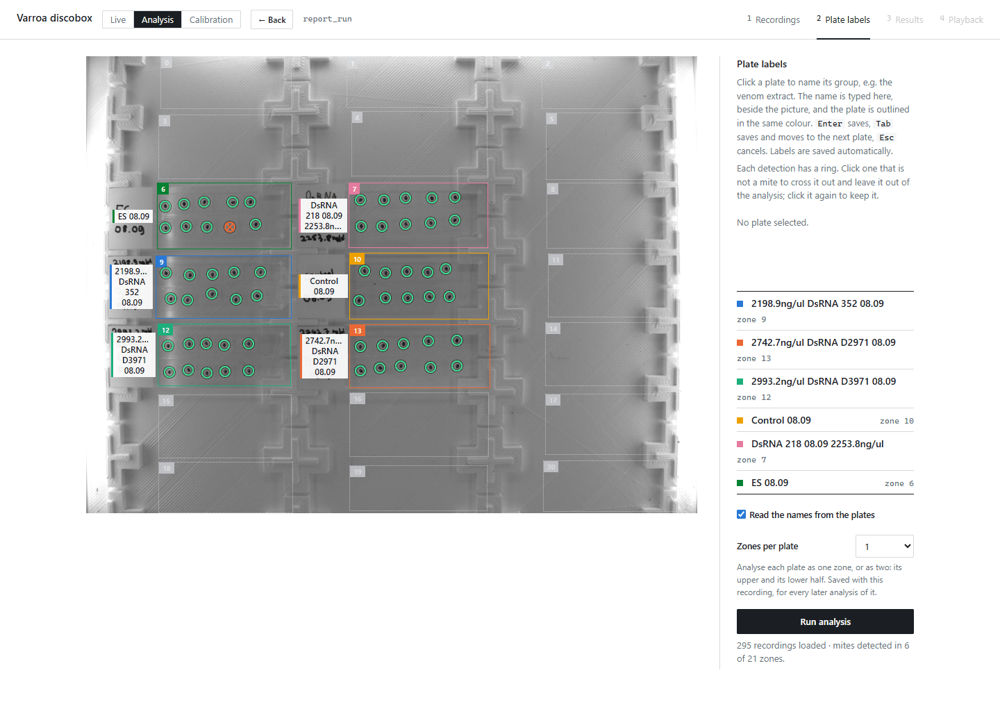

## Overview

The app runs a test on the Discobox from start to finish, or analyses recordings made earlier:

- **Live runs.** It controls the camera, fan and LEDs, analyses each recording as it arrives, follows
  each mite from one recording to the next, and stops once every mite is dead.
- **Motion score.** Each mite's movement is measured as the change on its outline across the frames
  of a recording, summed as vectors round the mite (so uniform noise and flicker cancel while a moving
  leg does not), in units of the recording's own noise floor.
- **Stabilization.** Each mite's patch is held still to a tenth of a pixel before scoring, so a
  shaking plate is not mistaken for a moving mite.
- **Calibration.** A labelling interface for ground truth by eye, a precision-recall report, the
  threshold with the best F0.5, and a poke test to check the calls against the mites' response.
- **Statistics.** Kaplan–Meier survival with 95 % confidence intervals, LT50 and log-rank tests
  against negative controls, shown in an interactive web interface and written to an Excel workbook.
- **Testing.** Regression tests compare results, every workbook sheet, figure contents and pixels
  against reference snapshots.

Compared with the Discobox's original analysis software
([Abilium varroa-discobox](https://github.com/Abilium-GmbH/varroa-discobox)), on recordings labelled
by eye that were not used to set the app's threshold:

| | This app | Original software |
|---|---|---|
| Unit of analysis | Each mite, tracked by id through the run | Changed spots per recording |
| Wrong calls, 18,480 labelled mite-recordings | 89 | 974 |
| Time-of-death error, long run (59 mites, 49 h) | 3.4 recordings | 199.6 recordings |
| Analysis time per 90-frame recording | 0.53 s | 69.8 s |
| Storage of a run | 19–95× smaller (lossless per-mite video) | every frame as a 3 MB BMP |
| Still recordings called moving at 0.2–0.25 px of plate shake | 0 % | 35 % |

<sub>Benchmark of 26 October 2026; details in [How well it works](#how-well-it-works) and the
[performance report](report/3_performance.md).</sub>

## Contents

- [How it works](#how-it-works): the pipeline, step by step, on real mites
- [How well it works](#how-well-it-works): the benchmark against the original software
- [Reports](#reports): the user manual, how it works, the performance report
- [Quick start](#quick-start)
- [User manual](#user-manual): [Live](#live-from-the-discobox) · [Analysis](#analysing-recordings) · [Calibration](#calibration)
- [Architecture](#architecture) · [Command line](#command-line) · [Files](#where-files-go) · [Tests](#tests) · [References](#references)

---

## How it works

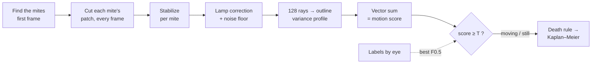

Below, the steps run on real data, a live run of 14 mites with 95 recordings of 90 frames over 15.7 h.
Every figure comes from the app's own functions
([`scripts/visual_walkthrough.py`](scripts/visual_walkthrough.py)). The two examples are
mite 7.1 in recording 8 (labelled moving by eye) and mite 7.3 in recording 19 (labelled still).

### 1. Find the mites

Only the plates are kept and the hand-written labels are blanked out. Then OpenCV's blob detector finds the dark,
mite-shaped regions. Each mite gets an id from its plate and its reading order: `7.3` is the third mite on plate 7.

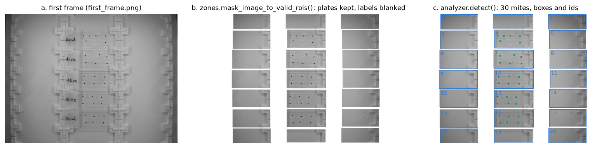

### 2. Cut each mite's patch from every frame

Each patch is the mite's box plus 16 px, in all 90 frames. By eye the frames look identical. The variance
over the frames (right) shows what changed: a few bright spots where the legs moved.

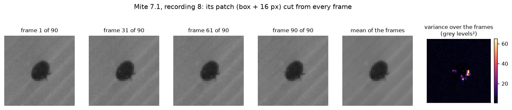

### 3. Hold the patch still

Plate shake is the main source of false movement. A shift of a fifth of a pixel, too small to see, slides the dark edge of every
mite across its pixels and lights up the whole outline (top left). The stabilizer follows the centre
of each mite's darkness, frame by frame, and cuts the patch shifted back by it (bilinear). The ring
largely disappears, but a moving mite's legs stay (bottom), because only a shift of the whole mite is removed.

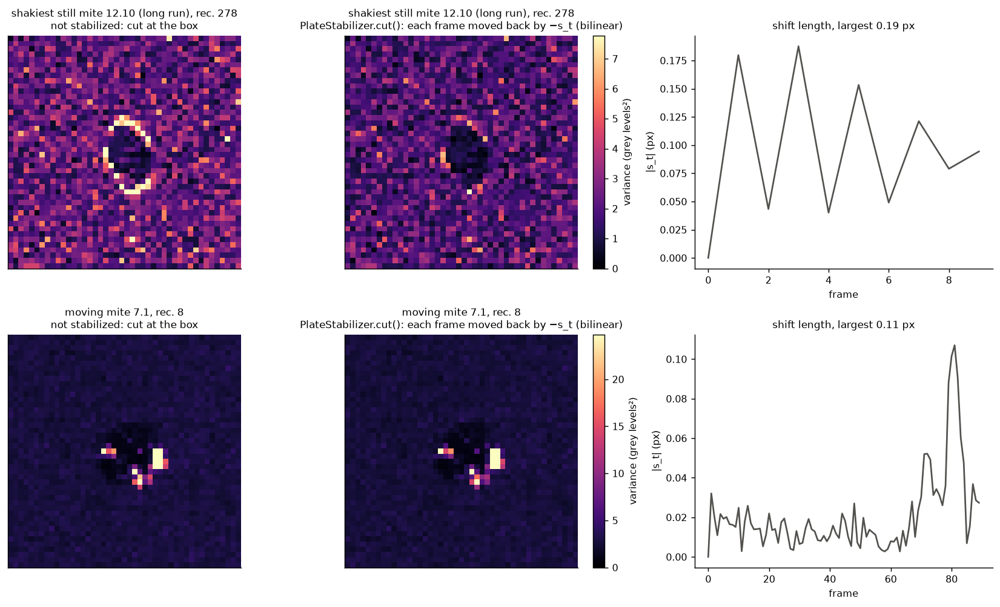

### 4. Read the outline along 128 rays

Every frame is scaled so that the plate has the same light, which cancels lamp flicker. From the mite's centre, 128 rays
are sampled every 0.5 px. Along each ray the app finds where the body ends (orange) and measures
the variance over the frames in a ±1.04 px band round that edge. The legs show up as bright blobs on
the band.

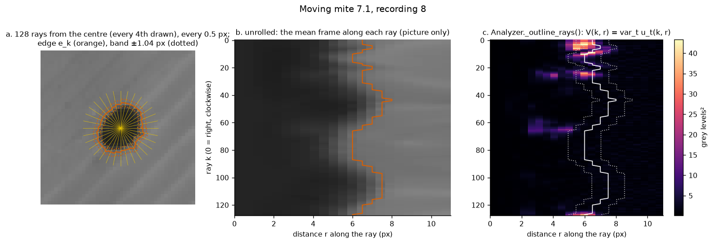

### 5. One number per direction, in units of noise

Each direction gets one value: the variance on its stretch of the outline, divided by the noise floor,
which is the variance of the bare plate at the patch's rim in the same recording. A still mite is flat at about 0.4. The
moving mite has peaks of up to 9× the noise, all on one side.

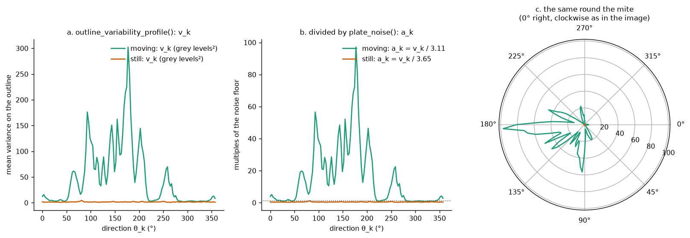

### 6. Add them up as vectors: the motion score

Each value becomes an arrow pointing in its direction, and the arrows are laid tip to tail. The score is the
length of the sum. Change that is the same all round (noise, flicker, a uniform blur) walks in a
circle and cancels. A leg moving on one side does not. In Fourier terms the score is the first
harmonic of the profile.

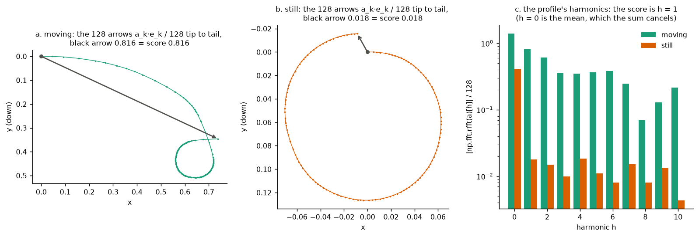

In the app, every mite's page draws this over its picture, the outline coloured by change and the arrow
from its centre:

<p align="center">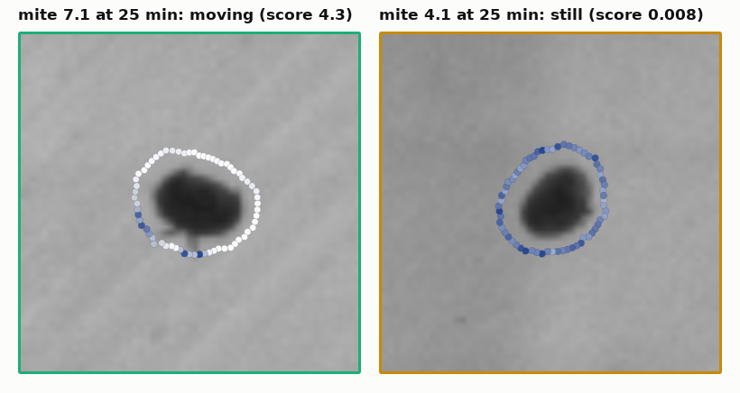</p>

### 7. One threshold: moving or still

One score per mite per recording, one call each. Mite 7.1 moves on and off for 5.5 h, then its
score drops tenfold and stays there.

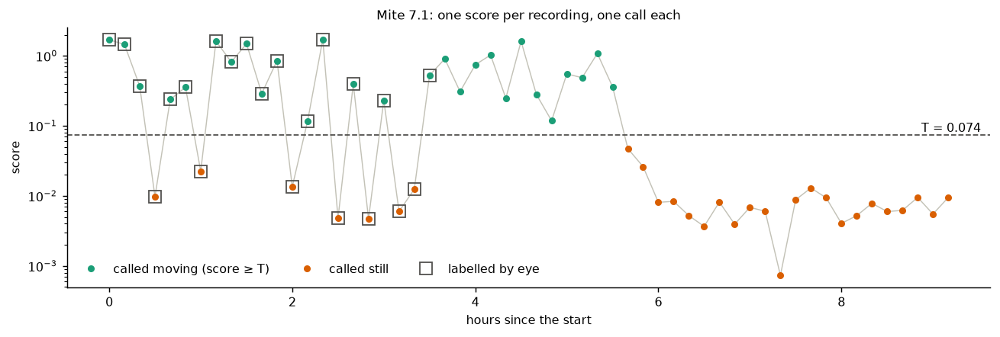

### 8. Where the threshold comes from

The threshold is calibrated against labels made by eye. The labelled scores barely overlap (average
precision 0.999). The app picks the threshold with the best F0.5, which counts a still recording called
*moving* four times as heavily as the opposite error, because one false "moving" can bring a dead mite back to life
hours after it died.

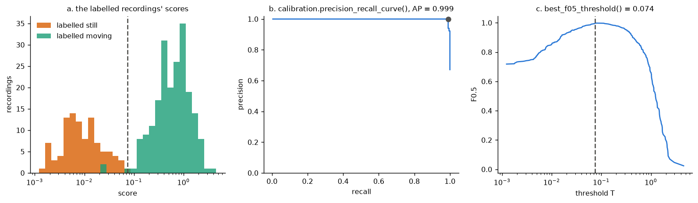

### 9. From calls to deaths and survival

A mite dies at the recording after its last movement, once it has stayed still for the chosen
death time. Pooled per treatment, that gives Kaplan–Meier survival curves with 95 % confidence intervals
(Greenwood, log-log), LT50s and log-rank tests against the negative controls.

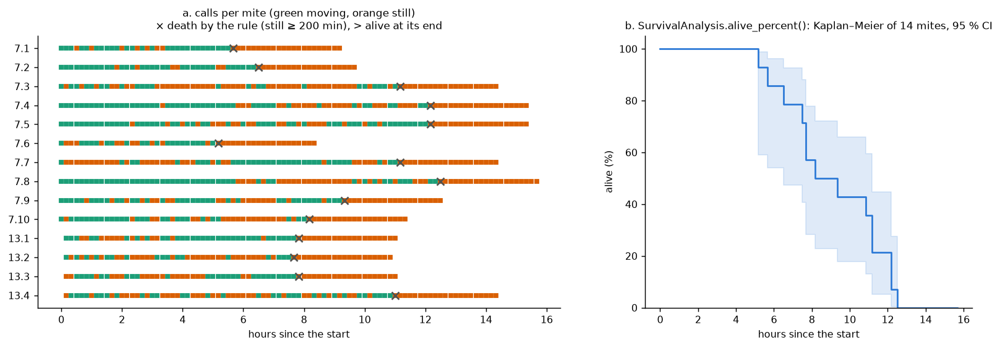

> The constants of the stabilizer and the score (rays, band width, body edge,
> interpolation, …) were chosen by a 600-trial Optuna search on four labelled datasets, with the mites
> split into tune and test halves ([`scripts/pipeline_optuna.py`](scripts/pipeline_optuna.py)).
>
> Every figure in this section is drawn by [`scripts/visual_walkthrough.py`](scripts/visual_walkthrough.py) with the
> app's own functions; the full walk-through, with the code of each step, is
> [How it works, step by step on one mite](report/visual_how_it_works.md).

---

## How well it works

The app was compared with the Discobox's original analysis software
([Abilium varroa-discobox](https://github.com/Abilium-GmbH/varroa-discobox), reimplemented in
[`classes/scoring/benchmark.py`](classes/scoring/benchmark.py)). For each recording, the original denoises
every frame, takes the difference to the first frame, thresholds it at 25 grey levels and counts the spots;
a mite counts as moving when a spot touches its box. Both ran on the same
18,480 mite-recordings labelled by eye, from three datasets that were not used to set the app's threshold.

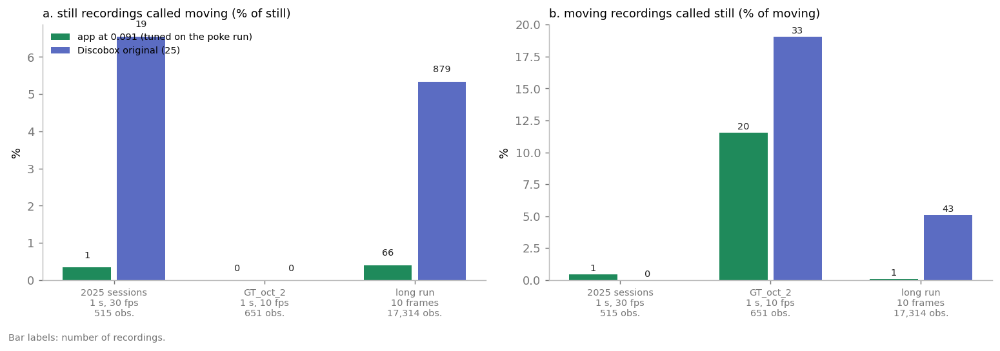

| Dataset | Method | Accuracy | Still called moving | Moving called still | F0.5 |
|---|---|---:|---:|---:|---:|
| 2025 sessions (515 obs.) | app | 0.996 | 1 | 1 | 0.996 |
| | original | 0.963 | 19 | 0 | 0.937 |
| GT_oct_2 (651 obs.) | app | 0.969 | 0 | 20 | 0.975 |
| | original | 0.949 | 0 | 33 | 0.955 |
| Long run (17,314 obs.) | app | 0.996 | 66 | 1 | 0.941 |
| | original | 0.947 | 879 | 43 | 0.529 |

A bootstrap over mites (2,000 resamples) puts the app's F0.5 gain above zero on every dataset
(+0.058, +0.019 and +0.412). The largest difference is in recordings where the plate shakes:

<p align="center">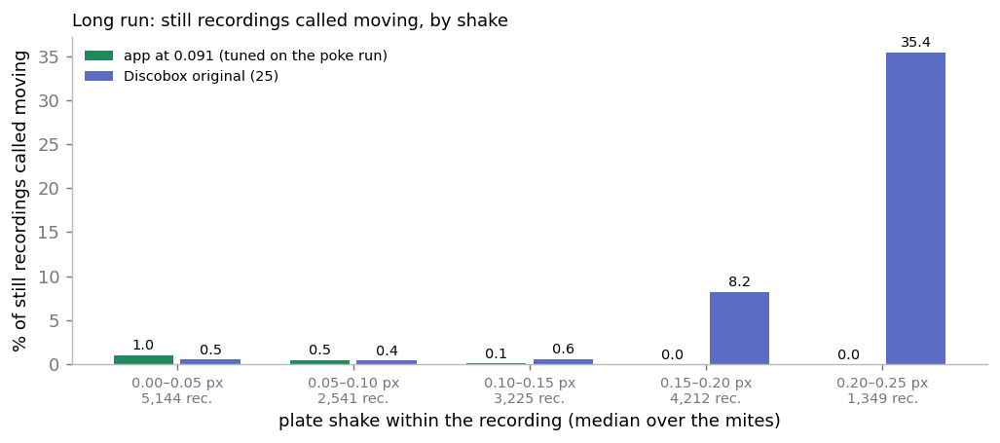</p>

The app is also much cheaper to run, since it works only on the mites' patches rather than on whole
denoised frames, and it saves each mite as a lossless FFV1 video instead of every frame as a BMP:

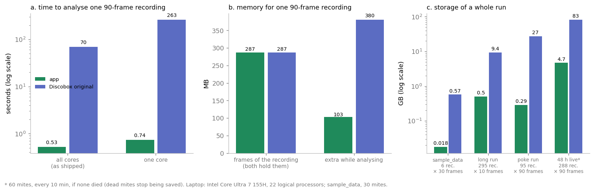

For a 48 h run with a 3 s recording every 10 minutes, the app spends about 2.5 minutes analysing in total;
the original needs about 5.6 hours on 22 cores.

---

## Reports

Longer write-ups, in [`report/`](report/):

| Report | What it covers |
|---|---|
| [User manual](report/1_user_manual.md) | Using the app: a live test on the Discobox, analysing recordings, calibrating the threshold, the files it writes |
| [How it works](report/2_how_it_works.md) | What the app computes, with the reasoning: detection, the stabilizer, the motion score, the threshold, survival statistics, calibration |
| [How it works, step by step on one mite](report/visual_how_it_works.md) | The same pipeline run on real data, with the code of each step and a figure of what it did |
| [Performance](report/3_performance.md) | The app against the Discobox's original software: calls, time of death, speed, memory, storage (26 October 2026) |

The code behind every figure is in the repository: [`report/scripts/`](report/scripts/) lists which
script draws which figure.

---

## Quick start

```bash
conda env create -f discobox_env.yaml && conda activate discobox_env

python -m uvicorn web.server:app --port 8000   # the web app → http://127.0.0.1:8000
python main.py                                 # or: analyse sample_data from the command line
```

On Windows, double-click `start.bat`. On Linux, run `bash install_linux.sh` once: it installs Miniforge if conda
is missing, creates `discobox_env` and adds a *Varroa discobox* icon to the desktop and app menu.

<details>
<summary><b>Starting, stopping and updating, in detail</b></summary>

The Linux icon runs `start.sh`, the Linux version of `start.bat`: the server runs in the background (output
in `server.log`) and only the browser opens. Right-click the icon and pick *Stop the app* to stop it, or run
`./start.sh stop`.

In a git clone, `start.sh` first pulls the newest version from GitHub, and it updates `discobox_env` if
`discobox_env.yaml` changed. `start.sh` and `start.bat` also update it when it lacks a package the app needs.
If it is offline or the pull fails, it starts the current version and says why in `update.log`. So that the
new version is always the one loaded, it stops a server already running (unless a live test run is going on
it) and starts it again, on port 8010: http://127.0.0.1:8010.

Started from `start.bat` or `start.sh`, the server stops by itself about 10 seconds after the last browser tab
is closed, so the next start always runs the current code (e.g. after a `git pull`). A tab left in the
background keeps it running. Started by hand with the command above, it keeps running.

Everything runs on `127.0.0.1` and no asset is fetched from the internet, so the app works with no network
connection.

</details>

---

## User manual

The page opens on **Live**, the Discobox camera. The tabs *Live*, *Analysis* and *Calibration* in the header
switch between the three modes. Each keeps its place while you look at another, and a test run goes on
meanwhile; a red dot on *Live* says one is being recorded.

The first page of each mode lists the **previous recordings**: every test run recorded here and every folder
dropped into the page. For each it shows when it was recorded, how many recordings it holds and the Discobox
settings it was recorded with. Those are the frames and frame rate of a recording, the time between
recordings, and the fan and LED durations and intensities, from its `.settings.txt`. For a live run it also
shows the camera, dropped frames and whether the run was stopped early (from its `run.json`). It shows the
plate labels, *not a mite* marks and ground truth kept with it, and its last results. *Analyse* and
*Calibrate* open it in that mode.

**What the app reports.** The camera only sees movement, so that is all the app measures. A mite is *moving*
in a recording when its motion score in that recording reaches the threshold of the metric in use,
`mite.metric_thresholds[mite.metric]` in `config.yaml`, and *still* otherwise. Each recording is judged on its
own; *alive* and *dead* follow from one rule (a mite is alive up to the last recording in which it moved, and
dead once still for the *death time*).

### Live from the Discobox

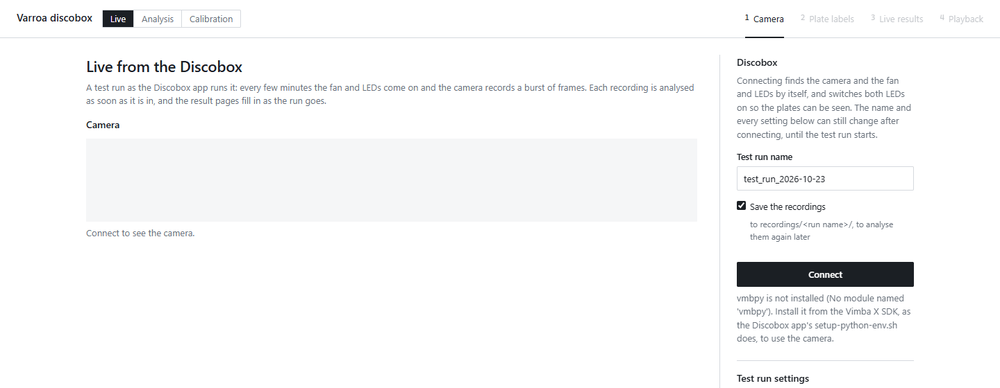

*Live*, the page the app opens on, runs a Discobox test run from this app, as the Discobox app
(github.com/Abilium-GmbH/varroa-discobox) does: every *time between recordings* the fan and LEDs come on and
the camera records a burst of frames. Each recording is analysed as soon as it is in, and the usual result
pages fill in as the run goes.

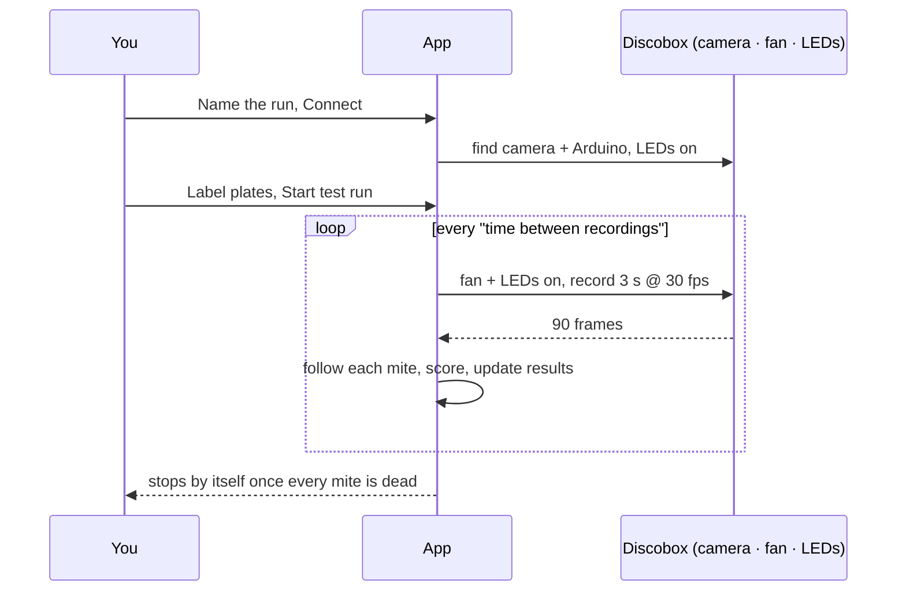

1. **Camera**: name the run and *Connect*: the camera and the Discobox's Arduino are found by themselves, and
   both LEDs come on so the plates can be seen; they stay on until the run starts. The Arduino restarts when
   its port opens, so the first command waits 2 s for it; until the run starts, both LEDs are told again
   every 5 s, and once more before the mites are detected for labelling, so a command it missed leaves them
   dark a few seconds at most. A start that fails leaves them on. The camera's image shows at once. The run's
   name, whether its recordings are saved and every setting can still be changed after connecting, until the
   test run starts. The test run's settings are the Discobox app's (time between recordings, fan and LED
   durations and intensities), but the length of the run is set as the *experiment duration, at most*, rather
   than a number of recordings. Every recording is 3 s at 30 fps (90 frames), fixed rather than a setting: a
   threshold only fits recordings as long and as fast as those it was calibrated on, and a longer recording
   tells a moving mite from a still one far better than a faster one (`notebooks/poke_run_followed.ipynb`,
   section 9). A `settings.txt` with other values is read as these. *Dead when still for* is how long a mite
   must go without moving to count as dead; a run cannot start without it. It is added to the end of the run,
   so a mite still at the end of the experiment can be told from a dead one, and the *Mites alive* charts use
   it. The run ends sooner, by itself, once every mite of every zone is dead (see *Live results*). *Most a
   mite moves between recordings* (50 px by default, 0 for not at all) is how far a mite is followed from one
   recording to the next (see *Following the mites* below). The settings are saved to `settings.txt` as you
   change them (an older file with a number of recordings is read as the duration they span; one with *Go on
   until every mite is dead*, which this replaced, is read without it). *On/Off* switches the fan to check
   it; the sliders set the intensity of the fan and of the LEDs.
2. **Plate labels**: the same page as for a folder, on the camera's newest frame, with the LEDs on. *Zones per
   plate* (1 or 2) is chosen here. *Start test run* switches the LEDs off and starts recording; from then on
   the run switches them.
3. **Live results**: the result pages of a folder, with a panel above them: a circle per zone with mites,
   filled as its mites die (dead of those seen moving, under it), the frame rate, dropped frames, the fan and
   LEDs, the countdown to the next recording, and *Pause* / *Stop* / *Add mites*. A zone none of whose mites
   has been seen moving yet is drawn hollow and does not count; a zone is done once each of its mites seen
   moving is dead (or marked gone). Once every zone that counts is done, the run stops by itself and the panel
   says why. The charts' time axis covers the whole run from the start, and each recording fills in its part;
   once the run is over, the axis is what was recorded. *Follow the latest recording* shows each new recording
   as it comes; choose an older one and the page stays on it. Labels and *not a mite* marks can still change;
   the results follow them.

*Stop* ends the recording being captured with the frames already in, analyses it and writes the results; so
does Ctrl+C on the server. Closing the page does not stop a run: open the page again to get back to it.
Started from `start.bat` or `start.sh`, the server waits for a run to end before stopping by itself.

<details>
<summary><b>Following the mites, adding mites mid-run, and mites counted dead</b></summary>

**Following the mites.** At the start of each recording the detector looks at its first frame, and every mite
moves to the blob nearest it in its own zone, at most *Most a mite moves between recordings* away (nearest
pairs first); a mite with no such blob stays where it was, and one off by less than 2 px stays put (the
detector's jitter). Within a recording its box stays put, as the score needs. A mite is still known (labels,
ground truth, corrections, its place on the plate map) by where it was found, but what is shown of it in a
recording follows it: its clip, the picture of where its pixels change, its outline on the mite page and its
square in the playback are cut round where it was in that recording, with its ring there.

**Adding mites.** *Add mites* on the panel lights the plates between two recordings (it is refused while one
is being captured or is about to start; the run waits meanwhile; the camera is given 10 s to follow the
LEDs), detects the mites and shows those not followed yet on the label page, over that frame, as before the
run: a ring each, all kept; click one to leave it out, and name a plate a new mite is on. Then *Add N mites*
(or *Cancel*). They are followed from the next recording on, numbered after the mites of their zone, those
added together in reading order (left to right, line by line, as the first frame's) (mite `13.7` after
`13.6`). Before then they count as not there (censored, as a mite marked gone), and their survival is counted
from the recording they were added in, as if it were their first: the survival curves, the mites alive
beside them, the LT50s and the log-rank tests (and the calibration's survival) are in time since each mite
was first followed: every mite runs on its own timer. Its lifeline starts at 0, its page shows only its own
recordings, timed from when it was added (its score chart, its table, its last movement), and says "died 20
min after it was added (at 80 min of the run)". A zone whose mites were all added during the run does the
same: it is not on the plate map (nor in the playback) before its first mites were added, its page shows
nothing for those recordings, and its charts, its survival rate (with its group's beside it, read on the
same clock) and its card under *Movement per zone* start at 0 when they were added. Before it was added, and
once it counts as dead, its recordings say *not added yet* / *dead, not followed* (in the playback too, where
its square is black: nothing was saved) and cannot be set by hand. The same holds on the calibration pages:
on the ground-truth page those recordings show a placeholder and cannot be labelled (nor count among the
mite-recordings to do), the poke test does not let a mite be poked in a round before it was added, and the
reports leave those recordings out and count an added mite's survival from its start. A ground truth opened
during a run takes the mites added since, and those counted dead, as each recording comes in.

**Mites counted dead.** After each recording, every mite that counts as dead by the *Dead when still for*
rule (a mite never seen moving too, once still that long from its start) is no longer followed: from the
next recording on it is neither scored nor saved, and it shows as *dead, not followed*, still. A call
corrected by hand later cannot bring back what was not saved.

**Ground truth and poke test during a run.** *Ground truth* and *Poke test* on the live panel open the
calibration's pages on the run's recordings so far, once the first is analysed: label the mites as the
recordings come in, and enter each round of pokes right after you poke, between two recordings. Each
recording is added, unlabelled, once the run has analysed it; the one being captured is not there yet. They
are kept next to the recordings, as for any folder (`ground_truth.json`, `poke_test.json`), so opening the
run's folder in *Calibration* later finds them. The *Live* tab goes back to the run; the buttons go back to
the same labels. They need the recordings saved: without them there is no clip to judge.

</details>

<details>
<summary><b>What a live run saves (only the mites' surroundings)</b></summary>

Only what the analysis reads of the recordings is saved, to `recordings/<run name>/`
(classes/storage/roi_recordings.py):

| File | What |
|---|---|
| `first_frame.png` | The first frame of the first recording, whole: the mites are found and the zones labelled on it |
| `rois/mite_000.mkv` ... | Per mite, its surroundings (its box and 32 px round it, at least 40 px round its centre) in every frame of every recording it was followed in, one recording after the other: one lossless (FFV1) grey video, its region moving with the mite |
| `added_frames/from_<n>.jpg` | The lit frame mites were added on, `n` the recording they were added in: the result pages (plate map, zone and mite crops), the ground-truth and the poke-test pages draw the plate from that recording on with it, so the mites added are seen where they are drawn, and a mite has no ring before it is there |
| `rois/index.json` | Where each mite was found (and from which recording, for one added), and per recording its name, frame rate, number of frames, where each mite was in it (none once it counted as dead) and the blobs found on its whole first and last frame (fly-offs, see below) |

While the run goes on, each recording is saved as its own short videos in `rois/parts/`; once it is over,
they are stitched onto the end of each mite's video. A run of `sample_data`'s 6 recordings takes 17.5 MB this
way, against 574 MB of BMPs. The settings, labels and marks are next to them, and `run.json`: how the run was
made (the camera, frames dropped) and how far it got, brought up to date after every recording. Only the
bursts are saved, never the camera image in between. That folder is a session like any other: it is listed
with the previous recordings, and analysed there it gives exactly the results the live run gave, the scores
to the last digit. The live results go to `results/<run name>/`.

Since only the mites' surroundings are saved, the pages of such a session play only a mite's own clip (its
page, the ground truth, the playback): the plate map and the zones show the first frame, and a fly-off is
seen leaving its place, not its walk across the plate. The mites are those found when the run started and
added during it; the detector's settings changed later find no others there. Untick *Save the recordings*
for long runs; the results are the same, but there is then no clip to play and nothing to open again.
Folders of BMPs opened by path, from the Discobox app or from runs before this, are read as before; folders
dropped onto the page are shrunk (classes/storage/roi_conversion.py).

</details>

<details>
<summary><b>Setting up the camera, and one difference from the Discobox app</b></summary>

**Setting up the camera.** Install Vimba X as the Discobox readme describes, then
`bash install_linux.sh <VimbaX SDK path>` (the path given to the app's `setup-python-env.sh`), and add
yourself to the `dialout` group for the fan and LEDs (`sudo adduser $USER dialout`, then log in again).
Folder mode needs none of this.

**One difference from the Discobox app.** The app switches on only one of the devices due at the same
moment: with equal fan and LED durations (20 s each for `sample_data`) only LED 2 ever came on, never the fan
or LED 1. Here every device comes on as set. Mites stirred by the fan may move more than in recordings made
with the app, so check the movement threshold on a live recording (Calibration) before comparing the two.

</details>

### Analysing recordings

**1. Recordings.** Pick one of the previous recordings, or drag the session folder (the one holding the
`..._fps-30` folders) onto the page, or click *Choose folder*. The images are copied to
`recordings/<folder name>/`, then shrunk to what a live run saves, the mites' surroundings (about a thirtieth
of the space, the same results; your own folder is left as it is). Its labels, ground truth and poke test
come along. Dropping the same folder again only sends files that changed (no frames already shrunk; new
recordings join the others), and keeps the labels you already typed. You can also type a path instead, and
then labels are saved next to the recordings.

**2. Plate labels.** Click a plate and type its group (e.g. the venom extract). <kbd>Tab</kbd> saves and moves
to the next plate. Labels are saved to `labels.json` automatically. Tick *negative control* under the name of
the control plates; they are saved to `controls.json`. Each detection has a ring: click one that is not a
mite to cross it out (*not a mite*).

<details>
<summary>Reading the hand-written names with Google Gemini (optional)</summary>

With *Read the names from the plates* ticked (a setting, off until you tick it and saved as
`label_reader.enabled` in `config.yaml`), the names written by hand beside the plates with no name yet are
read by Google Gemini and filled in, to be checked (`classes/plate/label_reader.py`). It sends a picture of
each label area to Google, so it takes the internet and a free API key from aistudio.google.com/apikey: put
it in a file `.env` in the app's folder as `GEMINI_API_KEY=...` (the file is this machine's own, not in git)
and start the app again. Without one the box is greyed out and names are typed as before.

</details>

**3. Results.** An overview with the fraction of mites moving per group, the fraction alive per group with
its 95% confidence interval (Kaplan-Meier, Greenwood's formula on the log-log scale; a mite counts as alive
up to the last recording in which it moved; with a death time in the run's settings, only once it has been
still that long does it count as dead from then on; for a folder it can be changed above the chart, and is
saved to the folder's `.settings.txt`), a table with the log-rank test of each group's survival (every zone
with that label pooled) against the negative controls, pooled, by the same alive rule, with its p value and
each group's LT50 (the time by which half its mites are dead) with its 95% confidence interval, a plate map,
one card per zone, every motion score by group, the scores of the moving mites alone by group (a box plot
the many still recordings do not pull down), and per zone a ridgeline of the rests of a mite: the time
between two movements with at least one still recording in between.

<p align="center">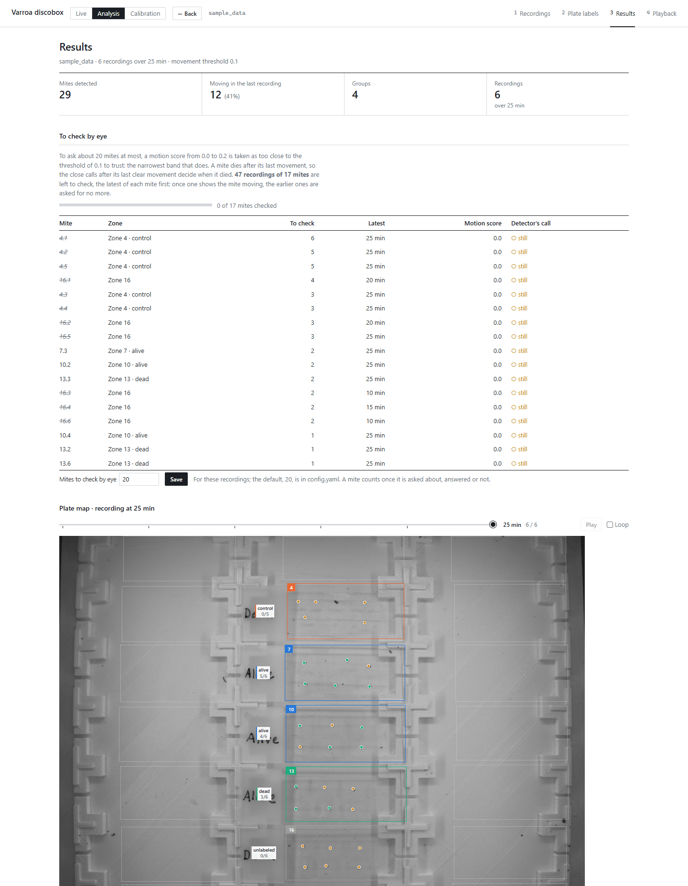</p>

Click a zone to see its mites, how many moved, how many are alive and their motion scores. Click a mite to
see its close-up and score in each recording. Every chart has a tooltip, opens what it shows when clicked,
and downloads as SVG or PNG. The browser's back button works throughout. When config.yaml says so (see
*Scores on one scale per mite* below), the scores of a folder are normalised over the run, and the pages'
headings say by what.

<p align="center"></p>

A mite's page plays its close-up with the outline coloured by change and the arrow of its score, and charts
its score in every recording:

<p align="center">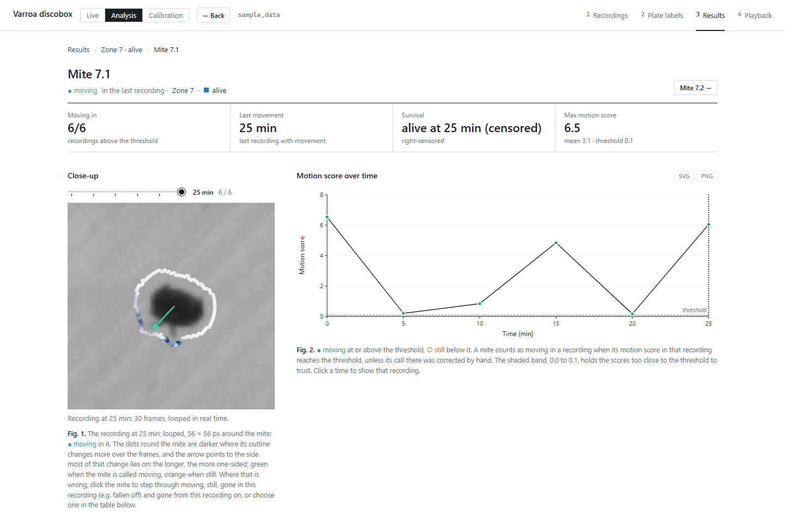</p>

**4. Playback.** Every mite's whole video, its recordings one after the other, laid out by zone (a box per
zone, a square per mite in it, the fly-offs at the end of theirs), all on one timer at the top of the page:
play or pause, a slider over every frame of the run, a speed of 1× (real time) to 16×, and the time,
recording and frame shown. Each square is the mite's box (the detector's `mite.radius` round its centre) and
4 pixels more, as recorded, so the mite fills it, its edge the mite's call in the recording playing (green
moving, orange still, grey gone or set aside); click it to open the mite. The server cuts, per recording and
zone, one picture with a row per mite and a column per frame (`pipeline.playback_sheet`, kept in
`results/<name>/clips/`; a recording of more than 100 frames is thinned to 100), and the page fetches the
recording playing and the two after it. Of a run saved as the mites' ROIs, a square is the mite's own ROI. A
live run has it too when it saves its recordings.

<p align="center">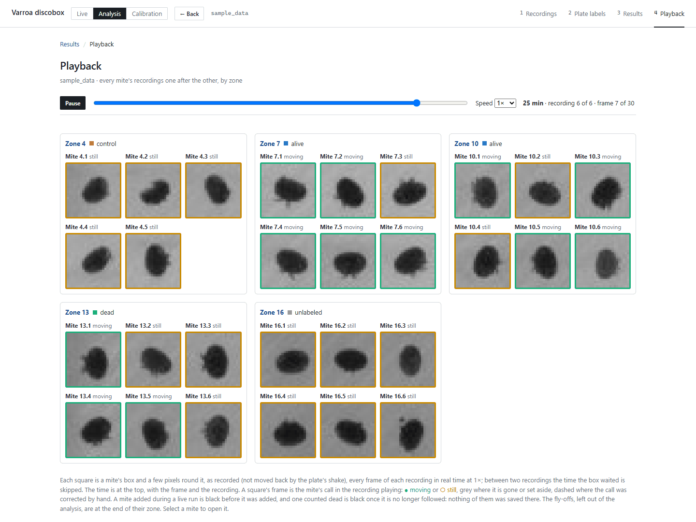</p>

**Correcting a call.** A call the detector got wrong can be corrected by hand on the result pages, of a
folder and of a live run alike: on the mite's page, click the mite in the recording shown, or the button of
a recording in the table, and its call changes from *moving* to *still* or back. Every number and chart
follows at once, and the mite's ring is dashed; the workbook (its `corrected` column) and the figures are
written again once the corrections pause for half a minute, and at once when the workbook is downloaded or
the app is closed. Clicking again brings back the detector's call. A mite that is not there any more, e.g.
one that fell off the plate, can be marked *gone* the same way, in one recording or from a recording on: it
is censored there, counting neither as moving nor as still, and a mite gone from a recording on leaves the
survival numbers at the recording before, alive as far as is known (right-censored). The corrections are
saved by mite position to `corrections.json` next to the recordings, so later runs keep them; they are apart
from the calibration's ground truth, which they do not change.

A detection marked *not a mite* is removed from every later analysis of that folder: `run_analysis` drops it
before scoring, so it appears in no count, curve or figure.

<details>
<summary><b>Close calls to check by eye</b></summary>

A mite dies at the recording after its last movement, so one wrong call can move its death by hours: a still
recording called moving long after it, or a weak last movement called still. The scores close to the
threshold are the ones the detector gets wrong. Under *To check by eye* on the results page you say how many
mites to check (`mite.review_mites` in `config.yaml`, 20 unless changed, or the run's own number set there
and kept as `review_mites` in its `.settings.txt`; 0 for none). The app then fits the narrowest band around
the threshold that asks about that many mites: a score in the band is a close call, and the results page
lists, mite by mite, the ones its time of death depends on: those after its last clear movement, the latest
first. The band keeps the shape of `mite.metric_review_bands` in `config.yaml` (how far it reaches below the
threshold against above it), when one is set there; without one it reaches as far either way. The
calibration report no longer suggests one, but saving a threshold saves its band too: the band in use moves
with the threshold, scaled by the new threshold over the old, so it keeps how far it reaches below against
above. A mite counts against the number once it is asked about, answered or not, so answering does not
bring in other mites. Opening a mite shows the recording and asks *Moving* or *Still*; the answer is kept in
`corrections.json`, also when it is the detector's own call, and the next one comes up. Once a close call
shows the mite moving, the earlier ones no longer matter and are asked for no more. The band changes no
number by itself: a call stays what the threshold makes it until it is answered. A saved shape the threshold
is no longer in, as after a threshold was set in `config.yaml` by hand, is not used.
`scripts/optuna_death_time.py` chooses the threshold and the band by where they put each mite's death, on
the saved ground truth split into train and test mites, and `notebooks/death_time_calibration.ipynb` shows
what it found.

</details>

<details>
<summary><b>Unusual activity: fly-offs, set-aside recordings, rotators</b></summary>

A mite can come unglued (`classes/scoring/unusual_activity.py`). One that walks off, a *fly-off*, is found
when its place is empty in 3 recordings in a row: no blob there on the first or last frame, and its image
faded to less than half its first contrast. It is left out of the analysis, as a detection marked *not a
mite* is, and followed from blob to blob as it walks. Wherever a mite that is not in its place, and was
elsewhere the recording before, comes within reach of another mite's scored patch (or a fly-off's track
passes there while it lies against that mite, one blob with it), that recording of that mite is set aside:
censored, it counts neither as moving nor as still; setting the call by hand counts it again. A mite whose
body turns by more than 30° where it is, a *rotator*, stays in the analysis. The results overview lists them
under *Unusual activity*: the tracks of the fly-offs on the plate, the mites they disturbed, the recordings
set aside, and each rotator as a chart of how far the long axis of its body has turned from its first 3
recordings, in each recording (the median of the 5 round it), clockwise up and anticlockwise down, with the
band within 30° shaded. The *Playback* page plays every mite, the fly-offs too. What is measured for this is
kept with the scores, so a run read back from them has it too.

</details>

<details>
<summary><b>A shaking plate, and how it is shown</b></summary>

A shake of half a pixel, too small to see, makes every still mite look like it moves, with any metric. With
`stabilize_plate: true` (the default) each mite's shift in each frame is measured, how far the centre of the
darkness of its body moved from the first frame, and its patch is cut shifted back by it before it is scored
(`classes/scoring/plate_stabilizer.py`). A glued mite moves with what it is glued to, so this also follows
plates that shake apart. A moving mite's legs pull its centre by about a tenth of a pixel, which changes 8 of
the 17 829 calls of the ground truth (all near the threshold); `notebooks/centre_stabilization.ipynb`
compares it with the median of the mites' shifts (by registration) used before: the same calls on a plate
that shakes as one piece, far fewer still mites called moving when the plates shake apart, and twenty times
cheaper to measure. A shift of more than 15 px along an axis is not followed further (`STABILIZE_MARGIN`
beyond the scored patch is all a saved live run keeps). On a still plate it changes nothing, so a threshold
calibrated on still ground truth holds on a shaking plate. The results overview shows the shake: the median
over the mites of how far each one's own patch moved within each recording, recording by recording, to spot
a recording or a stretch of time in which the plate shook, and the 10 mites that drifted furthest from their
zone across the recordings, each as its path over its outline in the first recording (both at the mite's
scale, with a bar for it, to read how far and which way it drifted against its body; *Scale: Path* zooms in
until the path fills its square), then every fly-off: its path until it flew off, and a dashed line out of
its square the way it walked off (the first point of its track out of its place). The *Stabilize plate*
checkbox next to the metric on the calibration report tries it on or off with *Score again*; saving a
threshold saves it with the metric. `python scripts/shake_robustness.py` shakes the saved ground truth by 0.5
to 2 px and reports each metric's accuracy at its unshaken threshold, with and without stabilization;
`python scripts/centre_stabilization.py` compares ways of stabilizing (the table
`notebooks/centre_stabilization.ipynb` reads).

</details>

<details>
<summary><b>Scores on one scale per mite (noise floor and normalisation)</b></summary>

A still mite does not score 0: camera noise gives it a floor, which differs from mite to mite, so one
threshold sits inside the noise of some. The score in use, `outline_variability`, is therefore given in
multiples of each recording's own noise floor: the variance on the mite's outline is divided by the variance
over the frames of the bare plate at the patch's edge in the same recording (`Analyzer.plate_noise()`; where
that is 0, which only frames without noise or a black plate give, the score is left undivided and a
`NoNoiseWarning` flags it: it is then off the threshold's scale). That needs no other recording, so it holds
in a live run too. On sample_data the floor is 3.1 to 3.8 grey levels squared. The constants of the score
and the stabilizer (128 rays of 11.4 px, the body's edge at 0.226 of its darkest, a ±1.04 px outline band, a
bilinear stabilizer, …) were chosen by an Optuna search on the labelled recordings on 2026-10-27
(`scripts/pipeline_optuna.py`, `notebooks/pipeline_optuna.ipynb`); they are read from `config.default.yaml`
and the code, never from a machine's `config.yaml`. The search also divided the score by its outline's mean
variance to the power 0.491 (`relative`); that was taken out the same day, as it changed no call on the
labelled recordings. The default threshold (0.074) is the best F0.5 threshold of the poke run (3 s at 30 fps)
on that scale. A threshold saved before then is on another scale: save one again from a calibration report.

Two further normalisations put the scores of a finished run on one scale
(`classes/scoring/score_normalizer.py`); both keep the scores on about the scale they had.
`normalize_brightness: true` scales each score to the run's typical brightness, as camera noise grows with
the light on the mite's patch. `normalize_floor: true` moves each mite's own floor, the median of its scores
over the run, to the median floor of all mites; the median is the floor only of a mite still in most
recordings, so one moving in more than half of them gets too high a floor and its weaker movements are lost.
The *Normalise brightness* and *Per-mite floor* checkboxes next to the metric on the calibration report try
them with *Score again*, on each dataset as on a run, and saving a threshold saves them with the metric. The
analysis of a folder then uses them; a live run does not, as both need the whole run: open its folder in the
Analysis window when it is over. With a ground truth of a few recordings in which most mites move, the
per-mite floor cannot be told from movement, and the report shows it.

</details>

### Calibration

In *Calibration* you mark by eye which mites move in each recording and compare that with the detector.


1. **Calibration data**: pick *Calibrate the threshold* or *Test the threshold*, then drop the folder, or
   *Calibrate* one of the previous recordings. The mites are found on its first frame; nothing is scored
   until a report is made.
2. **Ground truth**: zone by zone and recording by recording, the zone's frames of that recording play in a
   loop; click each mite to cycle it through *moving*, *still*, *not a mite* (a false detection) and back to
   unlabelled; clicking on past a *not a mite* you just set brings back the mite's labels. <kbd>↑</kbd>
   <kbd>↓</kbd> change recording, <kbd>←</kbd> <kbd>→</kbd> change zone. The detector's own call is hidden so
   it cannot bias you. Every label is saved as it is set, by position in `ground_truth.json` next to the
   recordings, so they survive a change in detector settings.
3. **Report**: every labelled (mite, recording) is compared with the detector's call there, moving when that
   recording's score reaches the threshold. *Calibration* suggests the threshold with the largest F0.5 of the
   calls moving, mite-recording by mite-recording (1.25 × moving called moving over 1.25 × moving called
   moving + 0.25 × moving called still + still called moving): a still recording called moving costs four
   times a moving one called still, because one such call can bring a dead mite back to life hours after its
   death, while a live mite called still moves again later. It can save the threshold to `config.yaml`. The
   close calls it gets wrong are the ones the results page asks to check by eye (see *Close calls to check by
   eye* above). For the suggested threshold and the one in use it reports the share called right, the moving
   recordings called still, the still ones called moving, F0.5 and the death-time error: the mean distance,
   in recordings, between each mite's death by the detector and by the labels (a mite dies at the recording
   after its last movement), which is reported but not chosen on. Its precision-recall curve marks both
   thresholds, with the curve of the points as good by F0.5 as the better of them. Its confusion matrix
   switches between the suggested threshold and the one in use. *Test* shows the confusion matrix at the
   threshold in use, the precision-recall curve with its average precision, and where on the plate the
   errors are. Both show the fraction of mites moving per recording by the ground truth against the
   detector's; *Test* also shows it per group, a poke test where one was entered (see *Poke test* below), and
   the outline change between recordings (see *Outline change between recordings* below). The report is the
   one picked on the first page; to see the other, go back and pick it there.

Test a threshold on a different recording from the one it was calibrated on.

<details>
<summary><b>The report in detail: wrong calls, pooling, metric choice, calibration.xlsx</b></summary>

In *Calibration*, *Show the wrong calls* under *Wrong calls* lists every labelled mite-recording the detector
called the other way (all, or only moving called still or still called moving), at the threshold the
confusion matrix shows, to check by eye that the ground truth is right, as the close calls are on the results
page: clicking one, or *Check them one by one*, opens that mite in its recording on the ground-truth page,
which says what it is labelled and what the detector called it and asks *Moving* or *Still* (or <kbd>M</kbd>,
<kbd>S</kbd>). The answer is its label, and the next wrong call not checked yet comes up, in whichever
dataset it is; a bar says how many are checked, and after the last one the report comes back, to update with
the labels changed. Everything is also written to `calibration.xlsx`, in `results/<recording>/calibration/`
(a report pooled over saved ground truth alone in `results/pooled/<date time>/`). Under *Data used*, switch
on *Pool with saved ground truth* to add other labelled recordings, and untick any you want left out. Every
point, map dot and zone row names the folder and recording it comes from, and clicking it opens that mite in
its own recording, whichever dataset it belongs to. Under *Movement score*, choose a metric and its
parameters (e.g. `n` for `topN_variability`) and *Score again*: nothing in `config.yaml` changes until you
save a threshold, which saves the metric and parameters with it.

`config.yaml` holds the metric in use and, under `metric_params`, the parameters of each metric
(`{topN_variability: {n: 10}}`); one left out uses the default in `classes/scoring/analyzer.py`. It belongs to
the machine and is not in git, so updating never changes the metric saved there. A new copy of the app makes
it from `config.default.yaml`; change the defaults for everyone there.

</details>

<details>
<summary><b>Poke test</b></summary>

Poking the mites by hand says which are alive: one that moves when poked was alive up to then, one that does
not is dead from then on. *Enter a poke test* on the ground-truth page shows the whole plate; add a round for
each time you poked (after which recording), choose *moved*, *did not move* or *not poked*, and click each
mite, or a zone's number for the zone's mites not poked yet. Poke between two recordings, not during one: a
poked mite moves, and the detector would count it. During a live test run, enter it from the live panel as
you go (see *Live from the Discobox*). Every click is saved by mite position to `poke_test.json` next to the
recordings (`classes/ground_truth/poke_test.py`). The *Test* report then draws the Kaplan-Meier survival of
the poked mites by the pokes, a mite dying at the first poke it did not answer and one that answered every
poke being right-censored at its last, with the detector's laid over it on the same mites at the threshold in
use, a mite dying at the recording after its last movement; `calibration.xlsx` has both as the sheet
`poke_survival`. Only the mites poked are in it. A poke only says dead by then, not when the mite died, so
the detector's curve may fall earlier and still agree; it should not be above the pokes' at a poke. The
recording needs at least one mite labelled moving or still, as every report does.

</details>

<details>
<summary><b>Outline change between recordings</b></summary>

The *Test* report also compares each mite's outline from one recording to the next
(`classes/scoring/outline_change.py`), a change that opening the box to poke the mites does not fake: the
outline is read from the mean of a recording's frames as rays from the mite's centre, without its size or a
shift of the whole mite, and two recordings are compared at the turn that fits best, so a mite pushed a few
pixels or turned does not change, and one that moved a leg does. Its darkness is read against the plate in a
ring around it, and only what lies near its body counts, so a neighbour at the edge of its patch is not part
of it. A change above 0.064 px counts (what 99% of the long run's long-dead mites stay under), and a mite
moved in a recording when the change into it and into the one before both count. Its calls join the others:
a survival curve in Fig. 2 and in the groups', a row of the death-time table and a curve in the poke test's
figure. A figure of its own shows every mite seen moving by the ground truth, in the order it has them die,
coloured by the change from each recording to the next, with the survival by the ground truth, by the outline
change and by the pokes over it; a cell opens that mite in that recording. It sees the mites go on changing
between recordings after their last movement within one, for hours, so it puts the deaths later than the
labels do. `notebooks/moved_mite_change.ipynb` shows how it was chosen. The changes are cached in the
recording's `scores/` (`outline-*.json`); the first report decodes every frame.

</details>

<details>
<summary><b>Saved ground truth</b></summary>

A recording's ground truth and poke test are kept with it, in `recordings/<name>/`, never its scores: there
is no second copy. The *Saved ground truth* list on the first calibration page shows every recording in
`recordings/` with ground truth, and lets you reopen one to go on labelling it, delete its ground truth (its
recordings stay), or tick several and report on them pooled. Every report scores the pooled recordings again
with the movement score chosen, so old ground truth can judge a new metric. `scores/` in a recording's folder
only caches the scores of one exact metric, parameters and scoring code, to skip decoding again; it can be
deleted at any time. A folder opened by typing its path is copied into `recordings/` first, its frames shrunk
to the mites' surroundings, and calibrated there; opening it again opens that copy.

</details>

---

## Architecture

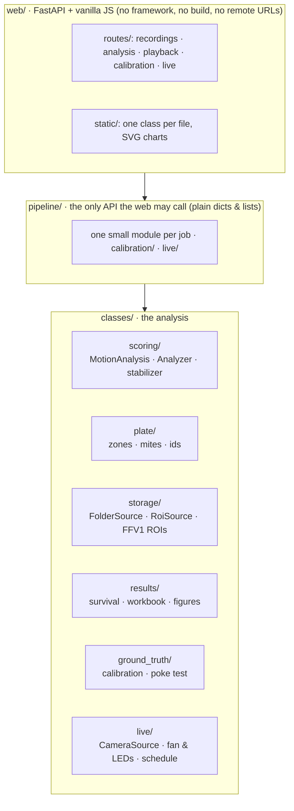

Dependencies point one way, `web/` → `pipeline/` → `classes/`, and `unit_tests/test_layering.py` enforces it.
The test fails if the web layer imports cv2/pandas/matplotlib/numpy/classes, if the analysis imports anything
web-related, if the modules of `pipeline/` import each other in a circle, or if the page references a remote
URL. `pipeline.open_session()` and `pipeline.run_analysis()` exchange only plain dicts, lists, strings and
numbers with the web layer, never a `Zone`, `Mite`, `DataFrame` or image array.

**One analysis core for folder and live runs.** `MotionAnalysis` finds the mites on the first frame, then
scores each recording, from all of its frames, as it comes. Its frames come from a folder (`FolderSource`),
a live run's saved ROIs (`RoiSource`) or the camera (`CameraSource`), and it doesn't know which. Analysing a
saved live run gives exactly the scores the live run gave. vmbpy and pyserial are only imported for a live run.

```
web/static/            the page: one class per file in js/<area>/, one stylesheet per part in css/
web/                   FastAPI server: server.py puts it together, one router per part of the page in routes/
pipeline/              the only package the interface may call: one small module per job (its
                       __init__.py lists them), calibration/ and live/ for those pages
classes/               the analysis, by what it works on (classes/__init__.py lists the packages):
  scoring/             finding the mites and scoring them; motion_analysis.py is the core
  plate/               zones, mites and their ids, the names beside the plates
  storage/             recordings (whole frames or ROIs: frame_source.py) and the app's files
  results/             the workbook and figures (reporting.py), survival, corrections
  ground_truth/        calibration against the user's labels, the poke test
  live/                the camera, fan and LEDs, test run and live session
  discobox/            camera_utils.py from the Discobox app, unchanged
scripts/, notebooks/   benchmarks, Optuna searches and the notebooks that read them
main.py                command-line entry point
unit_tests/            includes test_layering.py, which enforces the boundary above
```

Built with Python · OpenCV · NumPy · pandas · SciPy · matplotlib · FastAPI/uvicorn · vanilla JS + SVG ·
FFV1 lossless video · Optuna · pytest · Vimba X (vmbpy) camera · Arduino over pyserial · optional Google Gemini.

---

## Command line

```
python main.py                       # sample_data, labels from its labels.json -> results/sample_data/
python main.py my_recordings out/run1
```

A live test run, with the settings in `settings.txt`; Ctrl+C stops it cleanly:

```
python main.py --list-cameras
python main.py --live                       # the only camera connected
python main.py --live --camera-id DEV_000F31 --run-name hive3 --labels labels.json
python main.py --live --no-save-frames      # long runs: analyse, save nothing
python main.py --live --dead-after 240      # dead when still for 240 min, over settings.txt
```

It prints a line per recording analysed; the recordings go to `recordings/<run name>/` and the results to
`results/<run name>/` (`--out-dir` to change that).

---

## Where files go

| Folder | Contents |
| --- | --- |
| `recordings/<name>/` | Every recording session: each live test run, and each folder dropped into the page or calibrated. Its frames (the mites' surroundings), labels, *not a mite* marks, ground truth, poke test, `.settings.txt` and, for a live run, `run.json`; `scores/` caches the scores (and outline changes) calibration reports computed. |
| `results/<name>/` | The last analysis of that recording, replaced when it is analysed again (files below). `clips/` holds the frames the result pages play, and `kept/` the scores, so that analysing the same recordings again, with the same metric and the same scoring code, takes a moment instead of scoring every frame again; both can be deleted at any time. `calibration/` holds its calibration session and report, `calibration.xlsx`. |
| `results/pooled/<date time>/` | A calibration report pooled over saved ground truth alone: its `calibration.xlsx`. Those that made no report are removed at the next start. |
| `results/scripts/` | What the scripts in `scripts/` write: tables, optuna studies. |

Each analysis writes to `results/<recording>/`:

| File | Contents |
| --- | --- |
| `results.xlsx` | `mites` (one row per mite: when it last moved, in minutes from the start of the first recording), `scores` (every score: one row per mite, one column per recording), `mite_map` (the plate with each mite's ID drawn on it, to find a mite of the sheets in the video), `measurements` (one row per mite per recording, with `moving`, position and the `brightness` of the mite's patch; with normalised scores, `raw_score` holds them as scored), `group_summary`, `moving` (fraction of mites moving per group and per zone at each recording), one sheet per group, `group <name>` (its mites only: zone, when each last moved and its score in every recording), and `settings` (the settings of `run_settings.json`, one row each: section, parameter, value) |
| `moving_by_group.png` | Fraction of each group's mites moving in each recording |
| `distribution_by_group.png` | Score distribution per group, box plot with raw points |
| `score_over_time.png` | Each mite's score across the session |
| `score_distribution.png` | Overall histogram |
| `detections.jpg` | First frame with zones, labels and detected mites drawn on |
| `run_settings.json` | The settings the recordings were made and analysed with, to publish with the results and make them again (the same as the workbook's `settings` sheet). `code`: git commit, any files changed but not committed, Python, OpenCV. `recording`: number of recordings and how they were made (interval, frames, frame rate, fan and LEDs, following). `detector`: how the mites were found. `analysis`: metric and its parameters, threshold, mite radius, the score's and the stabilizer's constants, normalisations, death rule, zones per plate, mites corrected by hand. A number in the code not listed here is fixed by the commit. Written again with the workbook, e.g. after a correction. |

### Zone coordinates

`coords_pixel.txt` holds one line per zone: `type x1 y1 x2 y2`, where type `1` is a plate and type `0` is a
printed-label area that is masked out before detection. Plates are numbered 0-14 in reading order (left to
right, top to bottom), and that id is what a typed label attaches to. A mite's id is its plate's number, a
dot, and its own number on that plate, counted from 1 in the same reading order: `13.4` is the fourth mite of
plate 13.

`coords_pixel_2.txt` cuts each plate, and its label area, into an upper and a lower half: two zones per plate.
*Zones per plate* (1 or 2) chooses between the two files: on the label page, for a folder and for a live run
until it starts. The choice is saved with the recordings, as the `zones_per_plate` line of their
`.settings.txt`, so every later analysis and calibration of them uses the same zones
(`classes/plate/zone_layout.py`). A zone id is another plate in the other layout, so the labels and negative
controls of two zones per plate are kept apart, in `labels_2.json` and `controls_2.json`.

---

## Tests

```
python -m pytest
python -m pytest -m "not slow"     # without the runs on the whole of sample_data
```

`folder_regression_test.py` compares folder mode with a reference made before live input was added
(`unit_tests/reference/`): the results, every sheet of the workbook, what each figure draws, the images'
pixels and what the command line prints. `live_acceptance_test.py` feeds folders through the live pipeline,
with a stand-in for the camera, and checks that folder mode on the frames it saved gives exactly the same.
Rewrite the reference (`python unit_tests/make_reference.py`) only for a deliberate change to what folder mode
produces. The camera and the fan and LEDs are tested with stand-ins; the first run on the real Discobox is the
test of the hardware itself.

---

## References

1. **Abilium GmbH, *varroa-discobox*: the Discobox's control and analysis software.**
   GitHub, <https://github.com/Abilium-GmbH/varroa-discobox> (analysis as of commit `cbf8c47`).
   This app builds on it in two ways:
   - **Camera and hardware.** Much of the code that connects to the Discobox comes from it.
     [`classes/discobox/camera_utils.py`](classes/discobox/camera_utils.py) is its camera module, copied
     unchanged; [`classes/live/camera.py`](classes/live/camera.py) finds, opens and sets up the camera
     (Vimba X, vmbpy) with those functions, as its app does; and [`classes/live/lights.py`](classes/live/lights.py)
     speaks its Arduino protocol for the fan and LEDs (`src/controller.py`). A test run follows its schedule
     and settings.
   - **The benchmark.** Its analysis (`src/processing.py`: denoise, difference to the first frame, threshold
     25, grow, count the spots) is reimplemented step for step in
     [`classes/scoring/benchmark.py`](classes/scoring/benchmark.py) and compared with this app in
     [How well it works](#how-well-it-works) and the [performance report](report/3_performance.md).
2. **Allied Vision, *Vimba X SDK* and *vmbpy*,** the camera's driver and Python API, installed as the
   Discobox's own instructions describe.
3. Statistics: Kaplan–Meier survival with Greenwood's confidence intervals on the log-log scale, and the
   log-rank test (`scipy.stats.logrank`); motion-score constants tuned with **Optuna** (Akiba et al.,
   *Optuna: A Next-generation Hyperparameter Optimization Framework*, KDD 2019).
