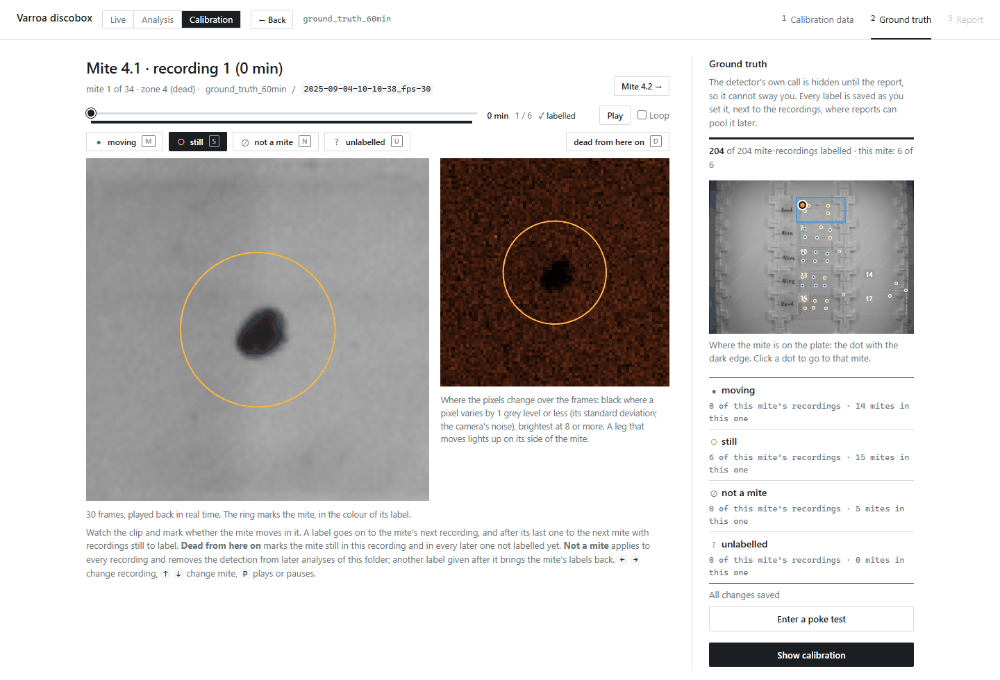
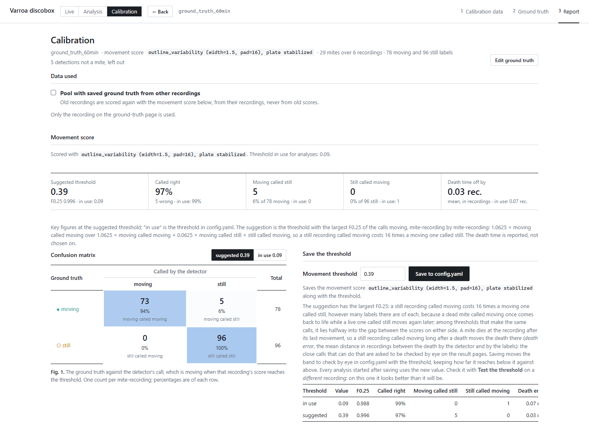
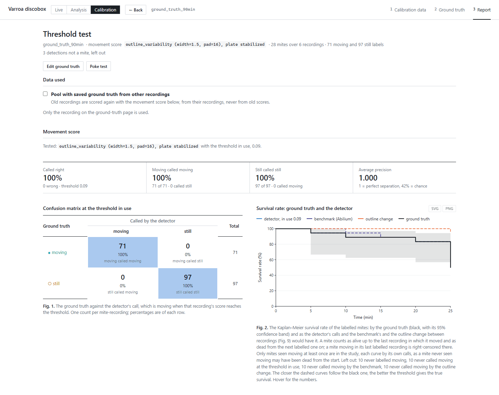
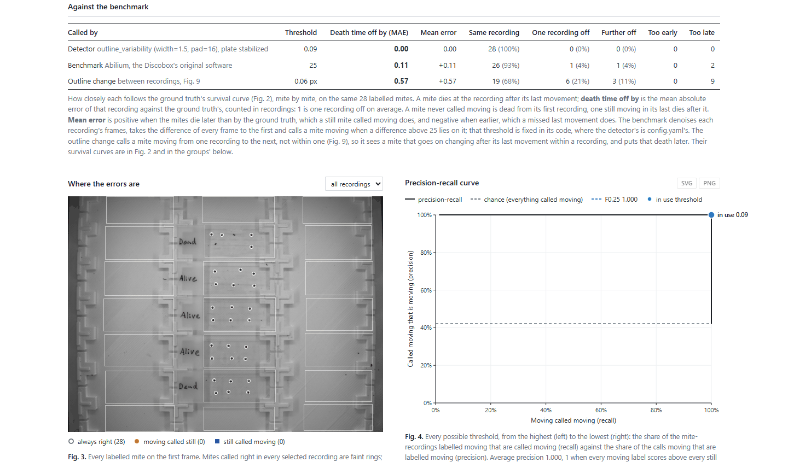

# Varroa detector for the Discobox: user manual

*Agroscope · status of 30 October 2026 · part 1 of 4*

*This part explains how to use the app. Part 2 (`2_how_it_works.md`) explains what it
computes, part 3 (`visual_how_it_works.md`) runs the same steps on one real mite, with the
code of each, and part 4 (`3_performance.md`) shows how well it works.*

The app watches varroa mites glued on plates inside the Discobox. It finds every mite on
the first frame, decides in every short recording whether each mite moved, and turns those
calls into survival curves per treatment group. It can run a test from start to finish on
the Discobox camera (**Live**), analyse recordings made earlier (**Analysis**), and check
its own calls against what you see by eye (**Calibration**).

**What the app reports.** The camera only sees movement. A mite is *moving* in a recording
when its motion score reaches the threshold, and *still* otherwise. *Alive* and *dead*
follow from one rule: a mite is alive up to the last recording in which it moved, and dead
once it has stayed still for the *death time* you set (for example 300 min). A mite never
seen moving is left out of the survival numbers.

**The threshold matters most.** Every call depends on it. Section 4 explains when and how
to set it, and how to check it.

---

## 1. Starting and stopping

| Where | How to start | Address |
|---|---|---|
| Discobox PC (Linux) | Desktop icon *Varroa discobox* | http://127.0.0.1:8010 |
| Windows | Double-click `start.bat` | http://127.0.0.1:8000 |

The browser opens by itself. On the Discobox, the icon first fetches the newest version
of the app (if the PC is online) and restarts the server, except while a live test is
running.

- **Stop**: close every tab of the app. The server stops about 10 s later. A running live
  test keeps it going until the test ends. On Linux you can also right-click the icon and
  choose *Stop the app*.
- **No internet needed.** Everything runs on the PC itself. The only exception is the
  optional reading of plate names by Google Gemini (§3.3).
- **First installation on Linux**: `bash install_linux.sh` once (it installs the Python
  environment and the desktop icon). For the camera, Vimba X must be installed as the
  Discobox readme describes, and your user must be in the `dialout` group for the fan and
  LEDs (`sudo adduser $USER dialout`, then log in again).

The header has three tabs: **Live**, **Analysis**, **Calibration**. Each keeps its place
while you look at another, and a live test goes on in the background. A red dot on *Live*
means a test is being recorded.

The first page of each tab lists the **previous recordings**: every test run and every
folder dropped into the app, with its date, number of recordings, Discobox settings,
labels, ground truth and last results. *Analyse* and *Calibrate* open one.

---

## 2. Running a test on the Discobox (Live)

*Taken on the development laptop, which has no camera, hence the "vmbpy is not installed"
note.*

### 2.1 Connect

1. Type a **name** for the run and click **Connect**. The camera and the Discobox's Arduino
   (fan and LEDs) are found by themselves, both LEDs come on, and the camera image appears.
2. Check the **settings**. They can be changed until the test starts:

   | Setting | Meaning |
   |---|---|
   | Time between recordings | How often a recording is made |
   | Fan / LED durations and intensities | As in the Discobox app. *On/Off* tests the fan; the sliders set intensities |
   | Experiment duration, at most | The longest the test runs. It stops earlier once every mite is dead (§2.3) |
   | Dead when still for | The death time. Required. It is added to the end of the run so a mite still at the end can be told from a dead one |
   | Most a mite moves between recordings | How far a mite is followed from one recording to the next (50 px by default, 0 = not at all) |
   | Save the recordings | Keep each mite's video. Needed to replay, label ground truth or re-analyse. Untick only for very long runs where you don't need them |

   Every recording is **3 s at 30 fps** (90 frames). This is fixed on purpose: a threshold
   only fits recordings of the length it was calibrated on (§4.1).

3. If the status text under *Connect* turns red or grey, read it: it says what failed
   (camera not found, serial port refused, …).

### 2.2 Label the plates and start

1. Choose **Zones per plate** (1, or 2 to split each plate into an upper and lower half).
2. Click a plate and type its **group** (e.g. the treatment). <kbd>Tab</kbd> saves and goes
   to the next plate. Tick **negative control** under the control plates: the survival of
   every group is tested against them.
3. Each detected mite has a ring. Click a ring that is not a mite (dust, a shadow) to cross
   it out; it is left out of everything.
4. If the detector **missed a mite**, place it by hand (§3.3). The run then follows it like
   the others.
5. Click **Start test run**. The LEDs go off, and from then on the app switches the fan and
   LEDs before each recording.

### 2.3 During the run

The results pages fill in after every recording. A panel above them shows:

- **A circle per zone**, filling as its mites die. A zone with no mite seen moving yet is
  hollow and doesn't count. When every counting zone is done, the run **stops by itself**
  and the panel says why.
- Frame rate, dropped frames, fan and LEDs, and the countdown to the next recording.
- **Pause**, **Stop**, **Add mites**, **Ground truth**, **Poke test**.

What happens to the mites:

- **Following.** Before each recording, each mite moves to the nearest blob in its zone (at
  most the distance set). Its clip follows it; its id and label stay.
- **Dead mites** (still for the death time) are no longer scored or saved. Correcting a
  call later can't bring back what wasn't saved.
- **Add mites**: lights the plates between two recordings, detects the mites not followed
  yet and shows them on the label page. Untick any that aren't mites, place any it missed
  by hand, name new plates, then *Add N mites*. They are followed from the next recording,
  numbered after the zone's other mites, and each runs on **its own clock** from when it
  was added.
- **Stop** ends the current recording with the frames already in, analyses it and writes
  the results. Closing the browser does **not** stop a run: open the page again to get back
  to it.

### 2.4 After the run

The run is saved in `recordings/<run name>/` and listed with the previous recordings. Open
it in *Analysis* to see the results again, or in *Calibration* to label it. Re-analysing it
gives exactly the same scores as the live run.

---

## 3. Analysing recordings made earlier (Analysis)

### 3.1 Open the recordings

In *Analysis*, either pick one of the previous recordings, or **drag the session folder**
(the one that holds the `..._fps-30` recording folders) onto the page, or click *Choose
folder*. The images are copied into the app. Your own folder is not changed, and dropping
the same folder again only sends what changed.

The first time the folder is analysed or calibrated, the copy is **shrunk to the mites'
surroundings** (about 1/30 of the space, same results). Until then it keeps its whole
frames, so this is the moment to place any mite the detector missed (§3.3): afterwards
there is nothing left to place it on.

> Don't open a folder by typing its path if you want to keep it untouched: labels and
> corrections are then saved next to its recordings.

### 3.2 Label the plates

As in 2.2: click a plate, type its group, <kbd>Tab</kbd> to the next, tick the negative
controls. Labels are saved by themselves.

*Read the names from the plates* (off by default) sends a picture of each hand-written
label to Google Gemini and fills in the names for you to check. It needs the internet and a
free API key (aistudio.google.com/apikey) saved as `GEMINI_API_KEY=...` in a file `.env` in
the app's folder. This is preset with the developer's key and works out of the box; to use
your own, paste your key there instead.

### 3.3 Place a mite the detector missed

Click **Place a mite by hand**, then click on the mite. The ring goes on the dark spot
nearest the click (within 8 px), so the click need not be exact. A click off the plates, on
a plate's label, or within 10 px of another mite is refused. <kbd>Esc</kbd> or *Done
placing mites* ends it.

A mite placed by hand has a **dashed ring**; click it to take it away. It is saved with the
recordings (`mites_by_hand.json`) and found with the detector's mites everywhere: in the
analysis, in calibration and in a live run. The button is not shown for a session already
shrunk to the mites' surroundings (a saved live run, or a dropped folder after its first
analysis).

### 3.4 Read the results

The overview shows, per group:

- the share of mites **moving** in each recording;
- the share **alive** over time (Kaplan–Meier) with its 95 % confidence interval. The
  death time can be changed above the chart for a folder;
- a table with each group's **LT50** (time by which half the mites are dead, with its 95 %
  interval) and a **log-rank test** against the negative controls (p value). Without a
  negative control the table is empty;
- the **plate shake** per recording, and the mites that drifted furthest;
- **unusual activity**: mites that came unglued and walked off (*fly-offs*, left out),
  recordings another mite walked through (*set aside*, counted neither moving nor still),
  and mites that turned on the spot (*rotators*, kept).

*The shake chart of `sample_data`, a calm session: under a tenth of a pixel throughout. A
recording or stretch that shakes much more than the rest is worth checking in the
playback.*

*The screenshots in this manual show the 2025 test sessions (`sample_data`,
`ground_truth_60min`, `ground_truth_90min`, 4 September 2025).*

Below that: a **plate map**, one card per zone, all motion scores by group, and the scores
of the moving mites alone.

**Click** a zone to see its mites, a mite to see its close-up and score in every recording.
Every chart has a tooltip, opens what it shows when clicked, and downloads as SVG or PNG.
The browser's back button works throughout.

Every recording shown (plate, zone, mite, ground truth) **plays once** and stops on its
last frame; **Play** plays it again. Tick **Loop** to play it over and over (the browser
remembers the choice). Loop is off by default because the jump from the last frame back to
the first can look like movement.

A mite's close-up is **framed in the colour of its call**: green moving, orange still, grey
gone. The dots round the mite are darker where its outline changes more over the frames.

### 3.5 Correct a call

On a mite's page, click the mite in the recording shown (or the recording's button in the
table) to switch its call between *moving* and *still*. Every number follows at once and
the frame round the close-up turns **dashed**. Clicking again restores the detector's call.
A mite that is no longer there (fell off the plate) can be marked **gone** the same way, in
one recording or from a recording on: it then counts as alive up to its last recording, and
nothing is assumed after.

Corrections are saved by mite position in `corrections.json` next to the recordings, so a
later analysis keeps them. They don't change the calibration's ground truth.

### 3.6 Check the close calls by eye

A mite dies at the recording after its last movement, so a single wrong call can move its
death by hours. Under **To check by eye** you choose how many mites to check (20 by
default, 0 for none). The app picks the scores closest to the threshold that a mite's time
of death depends on and asks about them one by one, latest first: *Moving* or *Still*
(keys <kbd>M</kbd>, <kbd>S</kbd>). Once one shows the mite moving, the earlier ones no
longer matter and aren't asked.

### 3.7 Playback

Every mite's video side by side, laid out by zone, on one timer: play/pause, a slider over
the whole run, 1× to 16× speed. Each square is framed green while the mite is called
moving, orange while still, grey when gone or set aside, dashed when corrected by hand.
Click a square to open the mite.

### 3.8 Files written

| File in `results/<name>/` | Contents |
|---|---|
| `results.xlsx` | `mites` (one row per mite, when it last moved), `scores` (mite × recording), `mite_map` (the plate with every id), `measurements` (one row per mite and recording: moving, position, brightness, corrected), `group_summary` (with the percent of each group alive in every recording below it), `moving` (share moving per group and zone), one `group <name>` sheet per group, and `settings` |
| `run_settings.json` | The settings the recordings were made and analysed with (code version, recording, detector, analysis, threshold), the same as the workbook's `settings` sheet. Keep it with results you pass on |
| `moving_by_group.png`, `distribution_by_group.png`, `score_over_time.png`, `score_distribution.png` | Figures |
| `detections.jpg` | The first frame with zones, labels and mites |

The workbook and figures are rewritten half a minute after the last correction, and at
once when you download the workbook or close the app.

---

## 4. Calibration: setting and checking the threshold

The threshold decides *moving* or *still* for every mite in every recording, so it decides
every death time and every survival curve. It is saved per machine in `config.yaml`. The
*Calibration* tab sets it from recordings you labelled by eye (**Calibrate the
threshold**) and checks it on others (**Test the threshold**).

### 4.1 When to calibrate

Calibrate, then test, whenever the scores may have moved relative to the threshold:

- **On a new machine**, or a new installation of the app. It starts with the default
  threshold (0.091), set on one 3 s / 30 fps run at Agroscope.
- **When the recordings are made differently**: another recording length or frame rate
  (older 1 s or 10-frame recordings need their own threshold; live runs are fixed at
  3 s / 30 fps), camera, lens or focus, LED intensity, fan settings (a fan that stirs the
  mites more makes them move more), or another kind of plate.
- **When an update changes the score.** The report then says *"The threshold in use … was
  set for … on another scale"*. A threshold saved between 27 and 29 October 2026 was saved
  on such a scale: save one again from a calibration report.
- **When results look wrong**: dead mites coming back to life, deaths much later than you
  see, or many still mites called moving (§6).

Otherwise there is no need to recalibrate for every experiment. A **test** on a new run
now and then (§4.6) shows whether the threshold still holds.

### 4.2 What makes good calibration data

- **Recorded the way you run tests**: same Discobox, same settings, 3 s / 30 fps.
- **A whole run, including dead mites.** The hard part is not the lively first hours but
  keeping a dead mite still for hours: one still recording called moving brings it back to
  life. Labels without long stretches of dead mites can't show whether the threshold does
  that.
- **Both moving and still labels.** With only one kind there is no threshold to suggest.
- **Every mite in every recording you choose**, not only the obvious ones. The close calls
  are the ones that matter.
- **A poke test if you can** (§4.4): it says which mites were really alive.
- **Two runs**: one to calibrate on, a different one to test on. On the run it was set on,
  a threshold always looks better than it will be.

### 4.3 Step 1: label the ground truth

1. On the *Calibration* tab choose **Calibrate the threshold**, then drop the folder (the
   one holding the `..._fps-30` folders), pick it under the previous recordings, or reopen
   it under *Saved ground truth*.
2. The ground-truth page shows **one mite in one recording** at a time: its clip on the
   left, and on the right where its pixels change over the frames (bright where a leg
   moved). The detector's call is hidden so it can't sway you.

   

3. Watch the clip and label it: **moving** <kbd>M</kbd>, **still** <kbd>S</kbd>, **not a
   mite** <kbd>N</kbd>, **unlabelled** <kbd>U</kbd>. A label moves on to the mite's next
   recording, and after its last one to the next mite still to label.
4. **Dead from here on** <kbd>D</kbd> labels the mite still in this recording and in every
   later one not labelled yet. Use it once a mite has clearly died, then check a few of
   its later recordings by eye.
5. <kbd>←</kbd> <kbd>→</kbd> change recording, <kbd>↑</kbd> <kbd>↓</kbd> change mite,
   <kbd>P</kbd> plays or pauses. The plate map on the right shows where the mite is; click
   a dot to go to that mite.
6. *Not a mite* applies to every recording and removes the detection from later analyses
   of that folder.

Labels are saved as you set them (`ground_truth.json`, by mite position, so they survive a
change of detector settings). The bar on the right counts the mite-recordings labelled.

During a live run, **Ground truth** on the live panel opens the same page on the
recordings so far, so you can label as the run goes.

### 4.4 Step 2 (optional): enter a poke test

Poking a mite says whether it is alive: one that moves when poked was alive up to then, one
that doesn't is dead from then on. On the ground-truth page click **Enter a poke test**:

1. **Add round** for each time you poked, saying after which recording.
2. Choose what a click marks (*moved*, *did not move*, *not poked*) and click each mite you
   poked, or a zone's number for all its mites not marked yet.

**Poke between two recordings, never during one**: a poked mite moves, and the detector
would count it. During a live run, enter each round from the live panel right after you
poke. The poke test shows in the *Test* report (§4.6).

### 4.5 Step 3: read the calibration report and decide

Click **Show calibration**. The report compares every labelled mite-recording with the
detector's call there.

Read it top to bottom:

1. **The header** says what went in: the recordings, how many mites, how many moving and
   still labels, and how many were left out (unlabelled, not a mite).
2. **Key figures at the suggested threshold**, each with the value at the threshold in use
   beside it: share called right, moving called still, still called moving, and how many
   recordings each mite's death is off on average.
3. **The suggested threshold** has the best *F0.25*: a still recording called moving costs
   **16 times** as much as a moving one called still, because a false *moving* brings a
   dead mite back to life, while a missed movement is usually caught by the mite's next
   one. Among thresholds that make the same calls, it sits halfway between the scores on
   either side.
4. **The table under *Save the threshold*** puts the two thresholds side by side. This is
   where you decide.
5. **Wrong calls**: *Show the wrong calls* lists every labelled mite-recording the
   detector called the other way. Check them (§4.7) before you save anything: a wrong
   call is often a wrong label.
6. **Fig. 2** (survival by your labels and by the detector), **Fig. 3** (every labelled
   score; everything right of a line is called moving at that threshold) and **Fig. 4**
   (precision-recall curve, average precision 1 = perfect separation).

**Should you save the suggestion?** Save it when:

- the data meets §4.2 (above all: the dead mites' still recordings are labelled), and
- the table shows a real gain at the suggested threshold, chiefly fewer *still called
  moving* and a smaller death error, and
- the wrong calls have been checked.

Don't save it when the labels are few or come only from the first hours. With few labels
the moving and still scores leave a wide gap, and the suggestion lands halfway into it,
which can be far from where a whole run would put it.

*Example.* The screenshot is `ground_truth_60min`, a 2025 test session of 6 recordings of
1 s. It suggests 0.39 against 0.09 in use: at 0.39 no still recording is called moving
but 5 moving ones are called still; at 0.09 it is 1 and 0. Both separate this session
almost perfectly (average precision 0.999). The data is too small, and the recordings
1 s long instead of 3 s, so this suggestion should **not** be saved for live runs.

To save: type the threshold (the suggestion is filled in) and click **Save to
config.yaml**. It is saved with the movement score, and the band of close calls to check
by eye moves with it. Every analysis started afterwards uses it.

Everything is also written to `results/<recording>/calibration/calibration.xlsx`.

### 4.6 Step 4: test the threshold on another run

Go **Back**, choose **Test the threshold**, and open a **different** labelled run, then
click **Show test report**. The test report judges the threshold in use; it doesn't
suggest one.

Read it in this order:

1. **Called right, moving called moving, still called still, average precision.** On a
   good threshold *still called still* stays very close to 100 %.
2. **Fig. 1, the confusion matrix**, at the threshold in use. The bottom-left cell, *still
   called moving*, is the one to keep at or near zero.
3. **Fig. 2, survival**: the black curve is your labels, the dashed ones the detector, the
   original Discobox software (*benchmark*) and the outline change between recordings.
   The closer the detector's curve follows the black one, the better.
4. **Against the benchmark**: how many recordings each method puts the deaths off. *Mean
   error* is positive when the deaths come too late, which is what still mites called
   moving do, and negative when too early, which a missed last movement does.

   

5. **Fig. 3, where the errors are**: every labelled mite on the plate, coloured by its more
   frequent error. Errors that gather on one plate or at the edge point to that plate
   (shake, light, focus) rather than to the threshold.
6. **The last recording** as the detector and the benchmark call it, **per zone** counts,
   the **poke test** (the detector's survival should not lie above the pokes' at a poke),
   the **outline change between recordings**, and **survival per group**.

*Example.* The screenshots test 0.09 on `ground_truth_90min`: all 168 labelled
mite-recordings called right, every death in the right recording (the benchmark puts
two late).

**What to do with the result**

| The test shows | Then |
|---|---|
| Still called moving near 0, deaths within a recording or so | Keep the threshold |
| Many still called moving, deaths too late (positive mean error) | The threshold is too low for these recordings. Check the wrong calls, then calibrate on more data with dead mites, pooled (§4.8) |
| Many moving called still, deaths too early (negative mean error) | The threshold may be too high. Check the wrong calls; if they are real, calibrate again |
| Errors on one plate or in one stretch of time | Look at the shake chart and the playback first; it may be the recording, not the threshold |

### 4.7 Check the wrong calls

In either report, **Show the wrong calls**, then **Check them one by one**. Each opens the
mite in its recording on the ground-truth page, says how you labelled it and how the
detector called it, and asks *Moving* or *Still* (<kbd>M</kbd>, <kbd>S</kbd>). Your answer
becomes its label, and the next wrong call comes up, across all pooled datasets. After the
last, the report comes back: click **Update** to see it with the corrected labels.

### 4.8 Pool several runs

Under **Data used**, tick **Pool with saved ground truth from other recordings**, then
untick any you want left out. Pooling gives more labels, and more varied ones, for a
steadier threshold. Pool only recordings made the same way (same length and frame rate).
The *Saved ground truth* list on the first page can also report on ticked datasets alone,
and reopen or delete a dataset's ground truth (its recordings stay).

### 4.9 Checklist

1. Record a whole run the way you run tests, with mites that die.
2. Label it (§4.3), including hours of dead mites; add a poke test if you have one.
3. *Calibrate*, check the wrong calls, read the table, save if §4.5 says so.
4. *Test* on a different labelled run. Keep the threshold if *still called moving* stays
   near zero and the deaths land within a recording or so.
5. Repeat after any change in §4.1.

---

## 5. Where things are kept

| Folder | Contents |
|---|---|
| `recordings/<name>/` | Each session: `first_frame.png`, one video per mite in `rois/`, labels, *not a mite* marks, mites placed by hand, ground truth, poke test, corrections, settings, `run.json` (live runs) |
| `results/<name>/` | The latest analysis: workbook, figures, `run_settings.json`, clips for the pages, `calibration/` |
| `results/pooled/<date time>/` | Calibration reports pooled over several recordings |
| `config.yaml` | This machine's threshold and settings (created from `config.default.yaml`) |

`scores/` in a recording and `kept/` and `clips/` in a result are caches: they can be
deleted at any time and are rebuilt.

---

## 6. When something goes wrong

| Problem | What to do |
|---|---|
| Live: camera or fan/LEDs not found | Read the red/grey status text under *Connect*. Check that the original Discobox app is closed (only one program can use the camera) and that you are in the `dialout` group |
| The page looks like an old version | Open http://127.0.0.1:8010/api/version: it shows the folder, the commit and any live run. The update log is `update.log` in the app's folder |
| Dead mites keep coming back to life | The threshold is probably too low for your recordings, or still recordings of dead mites were never labelled. Recalibrate (§4) with labels including dead mites, and check the close calls (§3.6) |
| The calibration report says the threshold in use is on another scale | The score changed with an update. Calibrate and save a threshold again (§4.5) |
| Many still mites called moving on some plates from one moment on | A plate may have moved by many pixels. In a live run the mites are followed; in a folder analysis the boxes stay where they were found. Check the playback and the shake chart, and correct or mark the affected recordings |
| A mite was not detected | Place it by hand before the first analysis (§3.3), or during a live run with *Add mites* |
| A mite fell off | Mark it *gone* from that recording on (§3.5) |

## 7. Contact

For any problem or request, open an issue on the GitHub repository:

https://github.com/Mateo-Schaerer-Gonzalez/Varroa_detector_discobox
