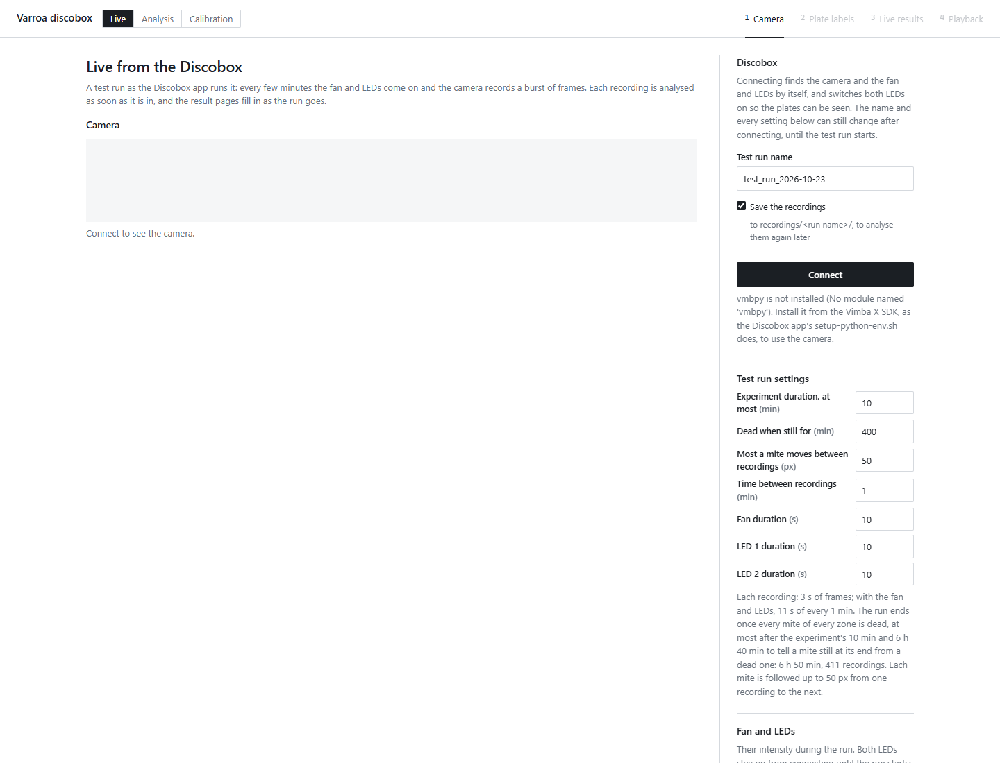
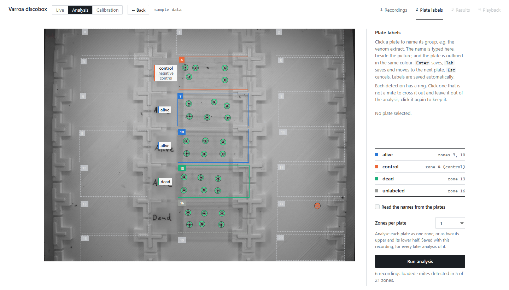
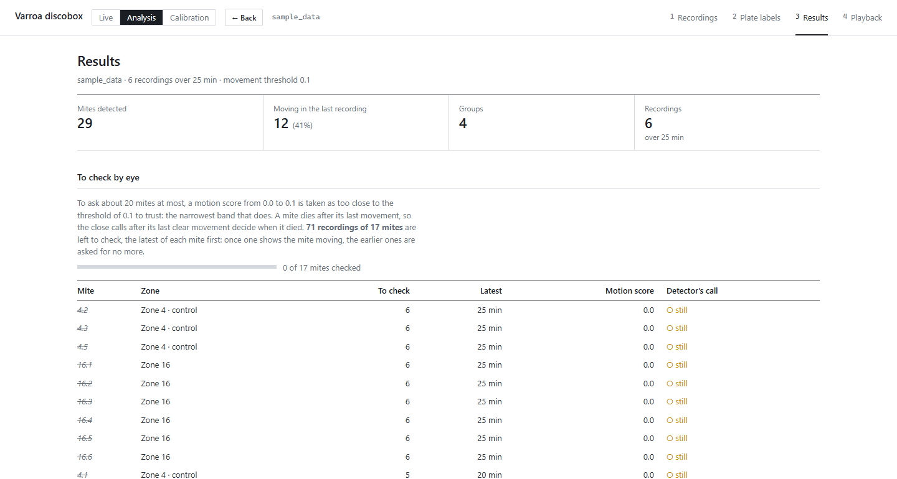
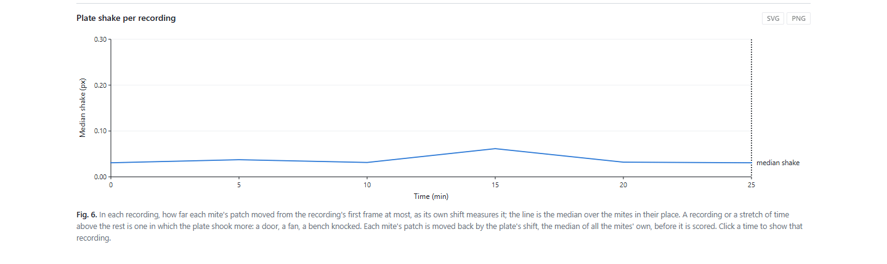
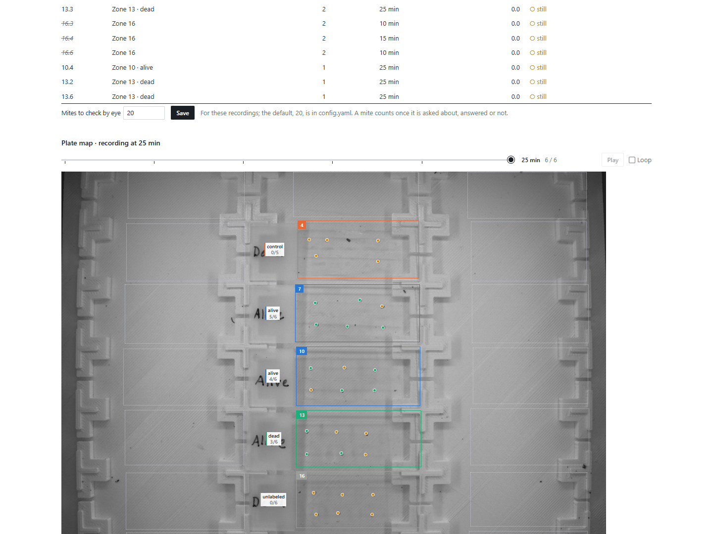
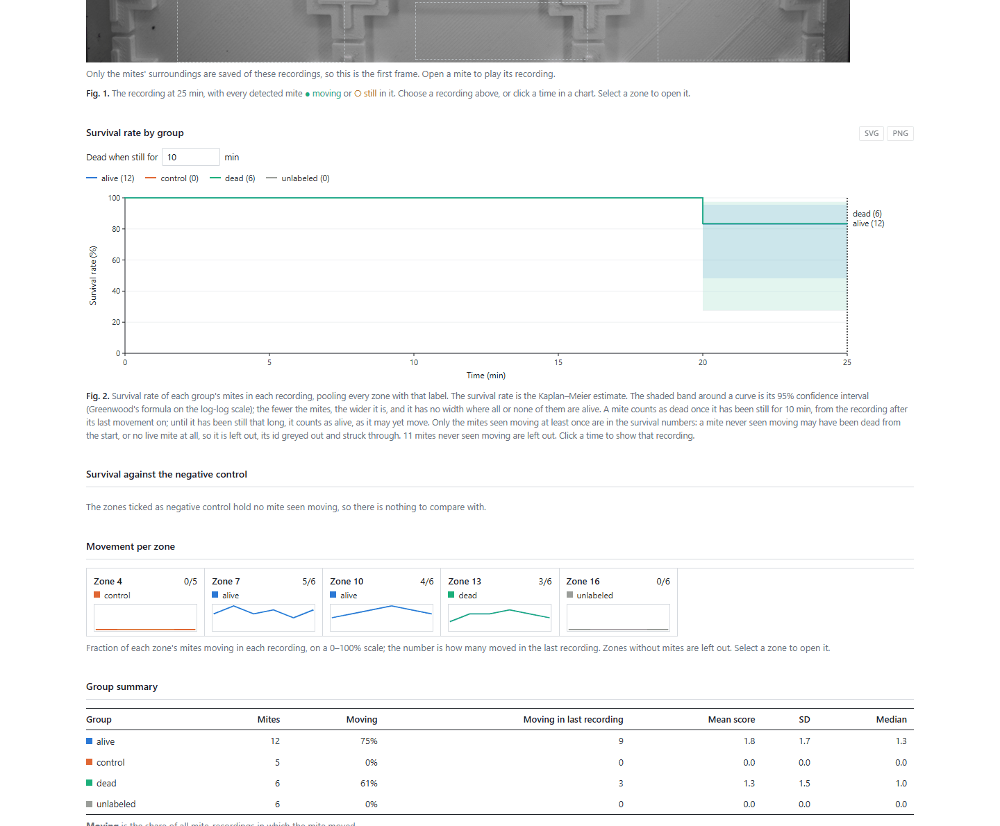
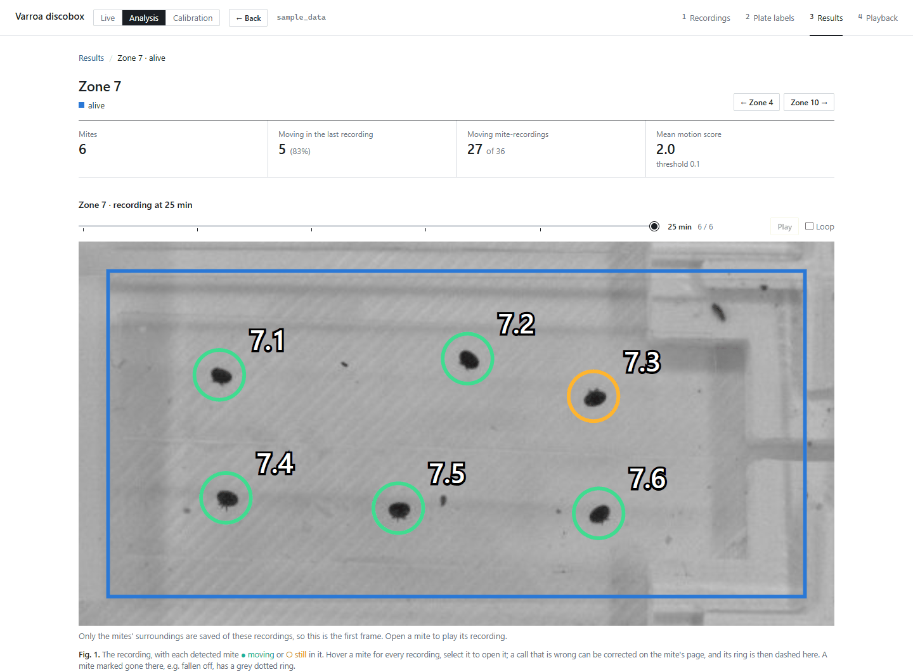
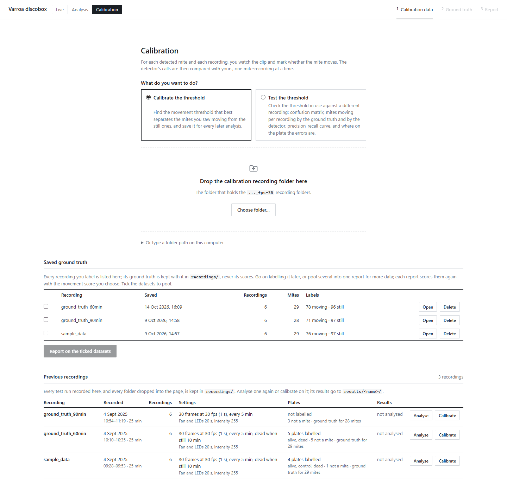

# Varroa detector for the Discobox: user manual

*Agroscope · status of 26 October 2026 · part 1 of 3*

*This part explains how to use the app. Part 2 (`2_how_it_works.md`) explains what it
computes, and part 3 (`3_performance.md`) how well it works.*

The app watches varroa mites glued on plates inside the Discobox. It finds every mite on
the first frame, decides in every short recording whether each mite moved, and turns those
calls into survival curves per treatment group. It can run a test from start to finish on
the Discobox camera (**Live**), analyse recordings made earlier (**Analysis**), and check
its own calls against what you see by eye (**Calibration**).

**What the app reports.** The camera only sees movement. A mite is *moving* in a recording
when its motion score reaches the threshold, and *still* otherwise. *Alive* and *dead*
follow from one rule: a mite is alive up to the last recording in which it moved, and dead
once it has stayed still for the *death time* you set (for example 300 min). A mite never
seen moving is left out of the survival numbers.

---

## 1. Starting and stopping

| Where | How to start | Address |
|---|---|---|
| Discobox PC (Linux) | Desktop icon *Varroa discobox* | http://127.0.0.1:8010 |
| Windows | Double-click `start.bat` | http://127.0.0.1:8000 |

The browser opens by itself. On the Discobox, the icon first fetches the newest version
of the app (if the PC is online) and restarts the server, except while a live test is
running.

- **Stop**: close every tab of the app. The server stops about 10 s later. A running live
  test keeps it going until the test ends. On Linux you can also right-click the icon and
  choose *Stop the app*.
- **No internet needed.** Everything runs on the PC itself. The only exception is the
  optional reading of plate names by Google Gemini (§3.2).
- **First installation on Linux**: `bash install_linux.sh` once (it installs the Python
  environment and the desktop icon). For the camera, Vimba X must be installed as the
  Discobox readme describes, and your user must be in the `dialout` group for the fan and
  LEDs (`sudo adduser $USER dialout`, then log in again).

The header has three tabs: **Live**, **Analysis**, **Calibration**. Each keeps its place
while you look at another, and a live test goes on in the background. A red dot on *Live*
means a test is being recorded.

The first page of each tab lists the **previous recordings**: every test run and every
folder dropped into the app, with its date, number of recordings, Discobox settings,
labels, ground truth and last results. *Analyse* and *Calibrate* open one.

---

## 2. Running a test on the Discobox (Live)

*Taken on the development laptop, which has no camera, hence the "vmbpy is not installed"
note.*

### 2.1 Connect

1. Type a **name** for the run and click **Connect**. The camera and the Discobox's Arduino
   (fan and LEDs) are found by themselves, both LEDs come on, and the camera image appears.
2. Check the **settings**. They can be changed until the test starts:

   | Setting | Meaning |
   |---|---|
   | Time between recordings | How often a recording is made |
   | Fan / LED durations and intensities | As in the Discobox app. *On/Off* tests the fan; the sliders set intensities |
   | Experiment duration, at most | The longest the test runs. It stops earlier once every mite is dead (§2.3) |
   | Dead when still for | The death time. Required. It is added to the end of the run so a mite still at the end can be told from a dead one |
   | Most a mite moves between recordings | How far a mite is followed from one recording to the next (50 px by default, 0 = not at all) |
   | Save the recordings | Keep each mite's video. Needed to replay, label ground truth or re-analyse. Untick only for very long runs where you don't need them |

   Every recording is **3 s at 30 fps** (90 frames). This is fixed on purpose: a threshold
   only fits recordings of the length it was calibrated on.

3. If the status text under *Connect* turns red or grey, read it: it says what failed
   (camera not found, serial port refused, …).

### 2.2 Label the plates and start

1. Choose **Zones per plate** (1, or 2 to split each plate into an upper and lower half).
2. Click a plate and type its **group** (e.g. the treatment). <kbd>Tab</kbd> saves and goes
   to the next plate. Tick **negative control** under the control plates: the survival of
   every group is tested against them.
3. Each detected mite has a ring. Click a ring that is not a mite (dust, a shadow) to cross
   it out; it is left out of everything.
4. Click **Start test run**. The LEDs go off, and from then on the app switches the fan and
   LEDs before each recording.

### 2.3 During the run

The results pages fill in after every recording. A panel above them shows:

- **A circle per zone**, filling as its mites die. A zone with no mite seen moving yet is
  hollow and doesn't count. When every counting zone is done, the run **stops by itself**
  and the panel says why.
- Frame rate, dropped frames, fan and LEDs, and the countdown to the next recording.
- **Pause**, **Stop**, **Add mites**, **Ground truth**, **Poke test**.

What happens to the mites:

- **Following.** Before each recording, each mite moves to the nearest blob in its zone (at
  most the distance set). Its clip follows it; its id and label stay.
- **Dead mites** (still for the death time) are no longer scored or saved. Correcting a
  call later can't bring back what wasn't saved.
- **Add mites**: lights the plates between two recordings, detects the mites not followed
  yet and shows them on the label page. Untick any that aren't mites, name new plates,
  then *Add N mites*. They are followed from the next recording, numbered after the zone's
  other mites, and each runs on **its own clock** from when it was added.
- **Stop** ends the current recording with the frames already in, analyses it and writes
  the results. Closing the browser does **not** stop a run: open the page again to get back
  to it.

### 2.4 After the run

The run is saved in `recordings/<run name>/` and listed with the previous recordings. Open
it in *Analysis* to see the results again, or in *Calibration* to label it. Re-analysing it
gives exactly the same scores as the live run.

---

## 3. Analysing recordings made earlier (Analysis)

### 3.1 Open the recordings

In *Analysis*, either pick one of the previous recordings, or **drag the session folder**
(the one that holds the old discobox recordings folders) onto the page, or click *Choose folder*. The
images are copied into the app and shrunk to the mites' surroundings (about 1/30 of the
space, same results). Your own folder is not changed. Dropping the same folder again only
sends what changed.

> Don't open a folder by typing its path if you want to keep it untouched

### 3.2 Label the plates

As in 2.2: click a plate, type its group, <kbd>Tab</kbd> to the next, tick the negative
controls. Labels are saved by themselves.

*Read the names from the plates* (off by default) sends a picture of each hand-written
label to Google Gemini and fills in the names for you to check. It needs the internet and a
free API key (aistudio.google.com/apikey) saved as `GEMINI_API_KEY=...` in a file `.env` in
the app's folder. This is preset with the developers key and works out of the box, but if you need to change it just paste your own API key.

### 3.3 Read the results

The overview shows, per group:

- the share of mites **moving** in each recording;
- the share **alive** over time (Kaplan–Meier) with its 95 % confidence interval. The
  death time can be changed above the chart for a folder;
- a table with each group's **LT50** (time by which half the mites are dead, with its 95 %
  interval) and a **log-rank test** against the negative controls (p value). Without a
  negative control the table is empty;
- the **plate shake** per recording, and the mites that drifted furthest;
- **unusual activity**: mites that came unglued and walked off (*fly-offs*, left out),
  recordings another mite walked through (*set aside*, counted neither moving nor still),
  and mites that turned on the spot (*rotators*, kept).

*The shake chart of `sample_data`, a calm session: under a tenth of a pixel throughout. A
recording or stretch that shakes much more than the rest is worth checking in the
playback.*

*The screenshots in this manual show `sample_data`, a test session of 4 September 2025.*

Below that: a **plate map**, one card per zone, all motion scores by group, and the scores
of the moving mites alone.

**Click** a zone to see its mites, a mite to see its close-up and score in every recording.
Every chart has a tooltip, opens what it shows when clicked, and downloads as SVG or PNG.
The browser's back button works throughout.

### 3.4 Correct a call

On a mite's page, click the mite in the recording shown (or the recording's button in the
table) to switch its call between *moving* and *still*. Every number follows at once and
the mite's ring is dashed. Clicking again restores the detector's call. A mite that is no
longer there (fell off the plate) can be marked **gone**, in one recording or from a
recording on: it then counts as alive up to its last recording, and nothing is assumed
after.

Corrections are saved by mite position in `corrections.json` next to the recordings, so a
later analysis keeps them.

### 3.5 Check the close calls by eye

A mite dies at the recording after its last movement, so a single wrong call can move its
death by hours. Under **To check by eye** you choose how many mites to check (20 by
default, 0 for none). The app picks the scores closest to the threshold that a mite's time
of death depends on and asks about them one by one, latest first: *Moving* or *Still*
(keys <kbd>M</kbd>, <kbd>S</kbd>). Once one shows the mite moving, the earlier ones no
longer matter and aren't asked.

### 3.6 Playback

Every mite's video side by side, laid out by zone, on one timer: play/pause, a slider over
the whole run, 1× to 16× speed. Each square is framed green while the mite is called
moving, orange while still, grey when gone or set aside. Click a square to open the mite.

### 3.7 Files written

| File in `results/<name>/` | Contents |
|---|---|
| `results.xlsx` | `mites` (one row per mite, when it last moved), `scores` (mite × recording), `mite_map` (the plate with every id), `measurements` (one row per mite and recording: moving, position, brightness, corrected), `group_summary`, `moving` (share moving per group and zone) |
| `moving_by_group.png`, `distribution_by_group.png`, `score_over_time.png`, `score_distribution.png` | Figures |
| `detections.jpg` | The first frame with zones, labels and mites |

The workbook and figures are rewritten half a minute after the last correction, and at
once when you download the workbook or close the app.

---

## 4. Checking and setting the threshold (Calibration)

The threshold decides *moving* or *still*. It is saved per machine in `config.yaml`. Set it
from recordings you labelled by eye, ideally a full run including dead mites, recorded the
way you will run tests (3 s / 30 fps).

### 4.1 Label the ground truth

1. Choose *Calibrate the threshold* (or *Test the threshold*), then drop a folder or pick a
   previous recording.
2. Zone by zone and recording by recording, the zone's clip plays in a loop. **Click each
   mite** to cycle it through *moving* → *still* → *not a mite* → unlabelled.
   <kbd>↑</kbd> <kbd>↓</kbd> change recording, <kbd>←</kbd> <kbd>→</kbd> change zone.
3. The detector's call is hidden so it can't bias you. Labels save as you click
   (`ground_truth.json`, by position).

During a live run, **Ground truth** on the panel opens the same page on the recordings so
far, so you can label as the run goes.

**Label the still recordings of dead mites too**, not only the lively first hours. The
threshold has to keep dead mites still for hours; labels without dead mites can't show
whether it does.

### 4.2 Read the report

- The **suggested threshold** is the one with the best *F0.5*: it counts a still recording
  called moving four times as much as a moving one called still, because one false
  *moving* can bring a dead mite back to life hours after its death.
- For the suggested threshold and the one in use it shows: share of calls right, moving
  called still, still called moving, F0.5, and the **death-time error** (how many
  recordings off each mite's death is).
- A **precision-recall curve** with both thresholds marked, and its average precision
  (1 = perfect).
- The **confusion matrix**, switchable between the two thresholds.
- *Test* also shows where on the plate the errors are, the share moving per recording by
  your labels and by the detector, and the poke test (below).
- **Show the wrong calls** lists every labelled mite-recording the detector called the
  other way. *Check them one by one* opens each so you can confirm or change your label.
- **Pool with saved ground truth** adds other labelled recordings to the report.
- **Save** writes the threshold to `config.yaml`. Test a threshold on a different
  recording from the one it was calibrated on.

Everything is also written to `results/<recording>/calibration/calibration.xlsx`.

### 4.3 Poke test

Poking a mite says whether it is alive: one that moves when poked was alive up to then.
On the ground-truth page, *Enter a poke test*, add a round each time you poke (after which
recording), and click each mite: *moved*, *did not move* or *not poked*. **Poke between two
recordings, never during one**: a poked mite moves, and the detector would count it. The
*Test* report then draws survival by the pokes with the detector's survival over it.

---

## 6. Where things are kept

| Folder | Contents |
|---|---|
| `recordings/<name>/` | Each session: `first_frame.png`, one video per mite in `rois/`, labels, *not a mite* marks, ground truth, poke test, corrections, settings, `run.json` (live runs) |
| `results/<name>/` | The latest analysis: workbook, figures, clips for the pages, `calibration/` |
| `results/pooled/<date time>/` | Calibration reports pooled over several recordings |
| `config.yaml` | This machine's threshold and settings (created from `config.default.yaml`) |

`scores/` in a recording and `kept/` and `clips/` in a result are caches: they can be
deleted at any time and are rebuilt.

---

## 7. When something goes wrong

| Problem | What to do |
|---|---|
| Live: camera or fan/LEDs not found | Read the red/grey status text under *Connect*. Check that the original Discobox app is closed (only one program can use the camera) and that you are in the `dialout` group |
| The page looks like an old version | Open http://127.0.0.1:8010/api/version: it shows the folder, the commit and any live run. The update log is `update.log` in the app's folder |
| Dead mites keep coming back to life | The threshold is probably too low for your recordings, or still recordings of dead mites were never labelled. Recalibrate (§4) with labels including dead mites, and check the close calls (§3.5) |
| Many still mites called moving on some plates from one moment on | A plate may have moved by many pixels. In a live run the mites are followed; in a folder analysis the boxes stay where they were found. Check the playback and the shake chart, and correct or mark the affected recordings |
| A mite fell off | Mark it *gone* from that recording on (§3.4) |

## 8. Contact

In case of any issue or request feel free to leave an issue on the git repo:

https://github.com/Mateo-Schaerer-Gonzalez/Varroa_detector_discobox

