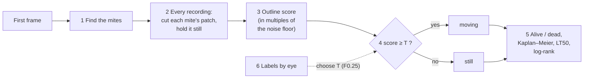

# Varroa detector for the Discobox: how it works

*Agroscope · status of 30 October 2026 · part 2 of 3*

*Part 1 (`1_user_manual.md`) explains how to use the app. Part 3 (`3_performance.md`) compares the app with the Discobox's original software in accuracy, speed, storage and memory use. This part guides the reader through the algorithm's steps, so that its results are easier to interpret. Every step names where in the code it is implemented, for readers who want to look at it, and ends with the same step run on one real mite.*


*Flowchart of the analysis pipeline.*

**Notation.** A *recording* is a short burst of $N$ grey frames $I_1,\dots,I_N$ ($N$ = `frame_count`, taken at `fps`; live runs
are fixed at 3 s × 30 fps, so 90 frames; older recordings have other numbers of frames). Grey levels
run from 0 (black) to 255. $\operatorname{var}_t$ is the variance over the frames of a recording (of one pixel's value across the $N$ frames), $\operatorname{med}$ a median. All pixel distances are in
pixels (px) of the 2064 × 1544 camera image.

**Parameters.** The text refers to each setting by its name in the results workbook's
`settings` sheet (and `run_settings.json`), such as `stabilizer_rim_px`, rather than by its
value: the sheet of a run gives the values that run used. The sheet's `section` column says
where each one is: `recording`, `detector` or `analysis`. For orientation, the values at the
time of writing (30 October 2026) are:

| Section | Parameter | Value |
|---|---|---|
| recording | `fps`, `frame_count` | 30, 90 (fixed for live runs) |
| recording | `follow_px` | 50 |
| detector | `min_threshold`, `threshold_step`, `max_threshold` | 30, 10, 200 |
| detector | `blob_color` | 0 (dark) |
| detector | `min_area`, `max_area` | 40, 1,200 px² |
| detector | `min_circularity`, `min_convexity`, `min_inertia_ratio` | 0.55, 0.80, 0.45 |
| analysis | `metric` | `outline_variability` |
| analysis | `metric_pad`, `metric_width` | 16 px, 1.5 px |
| analysis | `threshold` | 0.091 (new machine) |
| analysis | `outline_rim_px`, `body_share`, `body_grow_px` | 6 px, 0.3, 2 px |
| analysis | `edge_share`, `edge_darkest_n` | 0.5, 30 |
| analysis | `rays`, `ray_step_px`, `ray_reach_px` | 64, 0.5 px, 13 px |
| analysis | `stabilize_plate` | true |
| analysis | `stabilizer_pad_px`, `stabilizer_rim_px` | 8 px, 6 px |
| analysis | `stabilizer_darkest_n`, `stabilizer_body_share`, `stabilizer_body_grow_px` | 1, 0.3, 2 px |
| analysis | `stabilizer_margin_px`, `stabilizer_interpolation` | 16 px, Lanczos |
| analysis | `death_minutes` | set per run |

**Positions are vectors.** Bold letters are positions or displacements in the image, with two
components: $\mathbf x = (x, y)$, where $x$ is the column and $y$ the row, in pixels. The
origin is the top-left pixel of whatever is being worked on (the crop in 2, the patch in
3), $x$ grows to the right and $y$ **downwards**, as in any image. A pixel's whole-number
coordinates are its centre, so the top-left pixel is $(0, 0)$ and its neighbour to the right
$(1, 0)$. A position worked out from pixels (a centre $\mathbf c_t$, a shift $\mathbf s_t$)
has real-valued components and can fall between pixel centres; the image's value there,
$I_t(\mathbf x)$, is interpolated.

**The worked example.** Each section ends with the same steps run on real data, with the
command the app runs and a figure of what it did. The data is the poke run `poke_test_oct`
(a live run of 22–23 October 2026, 3 s at 30 fps = 90 frames per recording, 14 mites, 95
recordings over 15.7 h), and the two example mites are:

- **moving:** mite **7.1** in recording **8** (labelled moving by eye),
- **still:** mite **7.3** in recording **19** (labelled still).

These figures and numbers come from one script, which calls the app's own functions and
re-implements nothing but two pictures (marked *picture only*):

```bash
python scripts/visual_walkthrough.py --long-run %TEMP%/zzrc/perf/long_run   # reads the poke run in %TEMP%/zzrc/gt; writes report/images/walk_*.png
```

The score built up step by step there is identical to the one the app's own analysis of the
run gives (`scoring.detect_and_score()`): 0.617032 for the moving example and 0.010960 for
the still one, difference 0.0 for both.

---

## 1. Finding the mites

*Code: `classes/scoring/analyzer.py` (`detect`), `classes/plate/zones.py`.*

The mites are found once, on the first frame of the first recording.

1. **Mask.** `coords_pixel.txt` divides the image into mite zones (the plates) and label zones (the hand-written names). The detector runs only on the mite zones, so the writing is never taken for a mite.
2. **Blob detection.** OpenCV's `SimpleBlobDetector` thresholds the masked image at every
   grey level from `min_threshold` to `max_threshold` in steps of `threshold_step`, finds the connected dark regions at each level,
   and keeps the regions whose centres agree across several levels. A region then has to
   pass every filter (from `config.yaml`, section `detector`; the settings sheet's section `detector`):

   | Filter | Definition | Kept when |
   |---|---|---|
   | colour | grey level at the blob's centre | = `blob_color` (0: dark) |
   | area | pixels in the region | `min_area` ≤ A ≤ `max_area` |
   | circularity | $4\pi A / P^2$ (P = perimeter) | ≥ `min_circularity` |
   | convexity | $A / A_\text{convex hull}$ | ≥ `min_convexity` |
   | inertia ratio | minor / major axis of the second moments | ≥ `min_inertia_ratio` |

3. **Mite ROI.** The blob detector gives a centre $(x, y)$ and a diameter $s$. The mite's **ROI** is the
   square $[x - s/2,\, x + s/2] \times [y - s/2,\, y + s/2]$.
4. **Zone and id.** A mite belongs to the zone (plate, or half-plate with two zones per
   plate, `zones_per_plate`) that holds its whole box. Inside a zone the mites are sorted in reading order: mite `13.4` is the fourth mite of zone 13.


Labels, ground truth and corrections are saved **by position** (matched to a mite within
10 px, `classes/plate/positions.py`), not by id, so they survive a change to the detector.

In a live run each mite is also *followed* (`classes/live/`, `motion_analysis.py`):
before each recording the detector runs on its first frame, and each mite moves to the
nearest blob of its own zone at most `follow_px` away. A mite
with no blob in reach, or one less than 2 px away, stays where it is.

### 1.1 On the example run

```python
zones  = plate_zones.zones_of(data_dir)                 # the plates from coords_pixel.txt
masked = zones.mask_image_to_valid_rois(first_frame)    # keep the plates, blank the rest
mites  = Analyzer().detect(masked)                      # cv2.SimpleBlobDetector -> one Mite per blob
zones.assign_mites(mites)                               # each mite to its zone; ids "zone.n" in reading order
# all four: motion_analysis.detect_mites(zones, first_frame, Analyzer())
```


**a.** The first frame. **b.** Only the plates are kept; the rest (the box, the hand-written
labels) is painted white, so it can't be taken for a mite. **c.** The blob detector finds
10 mites, all on plate 7. (Plate 13's four mites were added during the run with the *Add
mites* button: they are followed from recording 1 on.)


`SimpleBlobDetector` thresholds the image at 18 grey levels (30, 40, …, 200) and keeps
the dark regions whose centre stays put across several levels and that pass the area,
circularity, convexity and inertia filters of `config.yaml`. Three of the levels are shown:
at 40 only the mites' darkest cores; at 80 the whole mites; at 110 the plate's texture
starts to come through too, but those regions fail the filters. Right: the 10 mites kept,
numbered in reading order (two mite heights per line, then left to right).

---

## 2. Cutting each mite's patch, and holding it still

*Code: `classes/scoring/plate_stabilizer.py`.*

For each recording, each mite gets a **patch**: its ROI plus $p$ = `metric_pad` px on every side,
cut from every frame, giving a stack of $N$ small images. Everything after this point
looks only at the patch. Before the patch is cut, the **stabiliser** (switched on by `stabilize_plate`) measures how far the
mite moved as a whole in each frame and cuts each patch shifted back by that amount.

### 2.1 Why stabilisation is crucial

The score looks for changes on the mite's outline. A shaking plate moves the mite, often by less than a pixel. Small as they are, such sub-pixel shifts change the pixels all along the outline, and left uncorrected they degrade the calls considerably.


The long run's plates shake by up to 0.24 px within a recording. Without stabilisation,
the shaky recordings are where most still mites get called moving. If that happens late in a run, it pushes death times back by hours, which makes the calls useless.

### 2.2 Overview and rationale of the stabiliser's design

Since the mites are glued onto the plates, the plate's shake is passed directly to the mite. Thus the shake can be measured directly on the mites: find where the mite is in each frame, and move each frame back so that the mite sits
where it was in the first.

To find the mite's position we use its "centre of darkness": the average position of its pixels weighted by their darkness, which is its centre of mass if darkness were density. This gives sub-pixel accuracy for two reasons: a shift of less than a pixel already shows in the changing intensities of the edge pixels (some get slightly lighter, others darker), and averaging over the whole body makes random pixel noise largely cancel out.

Moving legs could in principle pull the centre away from the plate's shake, but the effect is small: the body has far more dark pixels than the legs, so it dominates the centre of darkness.

The main reason to stabilise each mite on its own, rather than with one shift per zone, is lens distortion: the magnification varies across the field of view, so the same physical shake of the plate moves a mite by more pixels near the edges than in the centre. One shift per zone would apply the wrong correction depending on where a mite sits. And if a plate rotates, mites far from the centre of rotation move more than those near it.

### 2.3 Step by step

**Step 1: light of the plate.** Take a slightly larger crop, the box plus `stabilizer_pad_px` pixels. Its outer
ring of `stabilizer_rim_px` pixels (the *rim*) is bare plate. In each frame $t$ the plate's light is

$$P_t = \operatorname{med}_{\mathbf x \in \text{rim}} I_t(\mathbf x).$$

**Step 2: darkness.** Each pixel's darkness is the share of the plate's median light it takes
away:

$$D_t(\mathbf x) = \max\!\left(0,\; 1 - \frac{I_t(\mathbf x)}{P_t}\right).$$


**Step 3: the body.** On the mean darkness $\bar D = \frac{1}{N}\sum_t D_t$, let $\delta$
be the mean of its `stabilizer_darkest_n` largest values inside the rim (the mite's darkest part). The pixels
inside the rim with $\bar D(\mathbf x) >$ `stabilizer_body_share` $\cdot\,\delta$ form connected pieces; the piece nearest the middle of the crop is the mite (another is a neighbour). It is expanded by `stabilizer_body_grow_px` 3 × 3 dilations (one px each), to make the body mask $B$: $B(\mathbf x) = 1$ for a pixel
in the mask, 0 elsewhere.


**Where the constants come from.** The crop (`stabilizer_pad_px`), the rim
(`stabilizer_rim_px`), the share (`stabilizer_body_share`), the number of darkest pixels
(`stabilizer_darkest_n`) and the growth (`stabilizer_body_grow_px`), like the score's constants in section 3, are
those the app had before an Optuna search of 27 October 2026 (`scripts/pipeline_optuna.py`). The
search's constants separated moving from still better on the mites it was tuned on, but not on the
mites held back to test it, and the earlier ones were restored on 29 October 2026.

**Step 4: centre per frame.** The mite's centre in frame $t$ is the centre of its
darkness inside the body. The weights $w_t(\mathbf x) = D_t(\mathbf x)\,B(\mathbf x)$ count only the pixels inside the body mask.

$$\mathbf c_t = \frac{\sum_{\mathbf x} w_t(\mathbf x)\,\mathbf x}{\sum_{\mathbf x} w_t(\mathbf x)},
\qquad\text{that is}\qquad
c_{t,x} = \frac{\sum_{\mathbf x} w_t(\mathbf x)\,x}{\sum_{\mathbf x} w_t(\mathbf x)},\quad
c_{t,y} = \frac{\sum_{\mathbf x} w_t(\mathbf x)\,y}{\sum_{\mathbf x} w_t(\mathbf x)}.$$


If some frame's centre is a whole pixel or more from the mean centre, the mask $B$ is moved
by those whole pixels for that frame and the centre is computed again, so no part of the
mite falls outside its mask.

**Step 5: shift.** The mite's shift in frame $t$ is the vector

$$\mathbf s_t = \mathbf c_t - \mathbf c_1 $$

Each component is clipped to ±(`stabilizer_margin_px` − 4) px, 12 px: the Lanczos cut reads 4 px
beyond the point it interpolates, and a saved run keeps only `stabilizer_margin_px` round the patch.
Shifts that large usually belong to a mite that came unglued and walks, not to a shaking plate. A mite whose centre can't be found in some frame takes the
plate's shift: the median of the other mites' shifts.

**Step 6: cut.** Each frame's patch is cut shifted back by $-\mathbf s_t$: the value the
stabilised frame has at position $\mathbf x$ is the one the original frame has where the mite
had moved to. Thus:

$$I^{\text{stab}}_t(\mathbf x) = I_t(\mathbf x + \mathbf s_t),$$

A shift of a fraction of a pixel
puts $\mathbf x + \mathbf s_t$ between pixel centres, so it needs interpolation: each new
pixel is computed from the pixels around the point it comes from. The stabiliser uses
the interpolation `stabilizer_interpolation`. Where the cut
reaches past the image's edge, the image is mirrored in.


### 2.4 What it records, and what it doesn't handle

The app records, per mite and recording, the largest shift (`shake`) and how far the
mite's shift strayed from the plate's median (`stray`). The results page plots the median
shake per recording, to spot a recording or a stretch of time in which the plate shook.

A mite that walks more than `stabilizer_margin_px` px within a recording, or a plate displaced by many pixels
*between* recordings, is beyond what the stabiliser follows. The second is handled in live
runs by moving each mite's box to the mite before every recording.

### 2.5 On the example mites

**The patch.**

```python
loader = score_cache.open_recordings(data_dir)            # a live run: one FFV1 video per mite (rois/)
box    = loader.placements(name)[number]                  # where the live run followed the mite to
frames = loader.load_recording_region(name, x0, y0, x1, y1)   # (90, H, W) grey frames round it
patch  = PlateStabilizer.cut(frames, box, pad=16, shifts=0)   # box + 16 px, every frame
```


The patch is the mite's box plus 16 px on every side, in all 90 frames. By eye the frames
look the same; the **variance over the frames** (right) shows where pixels changed: a few
bright spots on the mite's edge, where its legs moved. Everything after this point is
computed from this stack of 90 small images.

**Holding it still.**

```python
shifts = PlateStabilizer().shifts(frames, [box])[0]     # (90, 2): how far the mite moved since frame 1
roi    = PlateStabilizer.cut(frames, box, 16, shifts)   # every frame moved back by -s_t (Lanczos)
```


**a.** A crop of the box + 8 px; its outer 6 px (blue) are bare plate and give the
plate's light in each frame. **b.** Each pixel's *darkness*, the share of the plate's
light it takes away. **c.** The body mask: at least 0.3 as dark as the darkest pixel,
grown by 2 px (orange); the green dots are the centre of darkness in each of the 90
frames, all on top of each other. **d.** The shift $\mathbf s_t = \mathbf c_t - \mathbf c_1$
per frame: for this still mite at most 0.03 px, only noise.


**Top:** the poke run hardly shakes, so this row uses the **long run's** shakiest
still-labelled recording (mite 12.10, recording 278, 10 frames), whose plate moved by up to
**0.29 px** (as the stabiliser measures it). Cut at the box (left), the whole outline lights
up: a shift far too small to see moves the dark edge across its pixels. Moved back by its
shift (middle), most of the ring is gone (the 99th percentile of the variance drops from 7.6
to 5.6 grey levels²), and **the score drops sevenfold: 0.0144 → 0.0020**, far below the
threshold.
**Bottom:** the moving mite. Its centre moves by up to 0.14 px (its legs pull it), and the
legs' changes stay: stabilising removes a shift of the whole mite, not a leg moving.

---

## 3. The motion score: outline variability

*Code: `classes/scoring/analyzer.py`, `_outline_variability`, `outline_variability_profile`,
`plate_noise`, `_lit`, `_outline_rays`.*


`metric` is the score in use. It is fixed to `outline_variability`; the other metrics in the code remain only for the scripts that compare them.


The score measures how much the outline changes over the recording on one
side more than the others, in units of the camera's noise in that recording.

The score works on the stabilised patch: the ROI plus `metric_pad` px on every side.

The score uses three regions of the patch:


*The same mite as in section 2, stabilised. a. Blue: the rim, the outermost 6 px, always bare plate.
It gives the lamp's light in each frame (section 3.1) and the noise floor (section 3.6). Grey and blue: the
outer 8 px, where the body isn't looked for, so a neighbour at the patch's edge isn't taken
for the mite. Orange: the body mask (section 3.2). b. The 64 rays from the centre (section 3.3), the body's
edge on each (solid, section 3.4) and the outline band ±1.5 px round it (dotted, section 3.5). c. The noise
floor: the variance over the frames of each of the rim's 936 pixels; their median is
$\sigma^2$ (section 3.6). The median ignores the long right tail, where a neighbour or a speck
changes a few rim pixels.*

The example below is mite 7.1 in recording 8 of the poke run of 22 October 2026 (3 s,
30 fps, 90 frames), labelled moving by eye.


### 3.1 Even out the lamp

The patch's outermost `outline_rim_px` are bare plate (the rim, $R$). Per frame, the plate's light is
$P_t = \operatorname{med}_{\mathbf x\in R} I_t(\mathbf x)$, and its mean over the recording is
$L = \frac{1}{N}\sum_t P_t$. Every frame is scaled to the same plate light:

$$\tilde I_t(\mathbf x) = I_t(\mathbf x)\,\frac{L}{P_t}.$$

A flickering lamp then changes nothing. (If the plate is black, $P_t \le 0$, the patch
gets no score.)

### 3.2 Find the body once, its centre in every frame

Darkness $D_t$, the body mask $B$ and the centre $\mathbf c_t$ are found as in the
stabiliser, with these differences: the body is the piece darker than `body_share` $\cdot\,\delta$,
with $\delta$ the single darkest value of $\bar D$ away from the patch's edge, grown by `body_grow_px`; the outer 8 px of
the patch are left out of the mask, so a neighbour at the edge isn't taken for the mite; and the mask is not moved along for frames where
the centre strays a pixel or more. The mask is found once, on $\bar D$, and is the same in
every frame; the centre is found in every frame.

If the mite or the plate moved a little within the recording, $\mathbf c_t$ moves with
it, and the rays below start from where the mite is **in that frame**. Shake the stabiliser
left over then does not count as a change of outline.

Why not simply threshold the darkness in each frame and take the centre of what is left?
Because the cut-off would then pick slightly different pixels in every frame: camera noise and a
moving leg push the edge pixels, which are only partly dark, in and out of the mask. Every pixel
that enters or leaves moves the centre by a fraction of a pixel, and that jitter would start the
rays from a slightly different place in each frame, which shows up as change on the outline. With
one mask found on the mean frame, the same pixels are weighed in every frame, and the centre
moves only when the darkness itself moves.


### 3.3 Cast $K$ rays

From $\mathbf c_t$, $K$ = `rays` rays go out at angles $\theta_k = 2\pi k/K$
($k = 0,\dots,K-1$, one every $360°/K$). Ray $k$ points along the unit vector $\mathbf e_k = (\cos\theta_k, \sin\theta_k)$:
$\theta = 0$ points right, $\theta = 90°$ down (since $y$ grows downwards), so the angles go
round clockwise in the image. Each ray is sampled every `ray_step_px` from $r = 0$ out to the reach
$\rho$, the smaller of `ray_reach_px` and the distance from the centre to the patch's edge, with
bilinear interpolation; the point at distance $r$ along ray $k$ is $\mathbf c_t + r\,\mathbf e_k$:

$$u_t(k, r) = \tilde I_t\big(\mathbf c_t + r\,\mathbf e_k\big).$$

`ray_reach_px` is chosen to reach past a mite's legs (the yellow lines in panel **a**, drawn
13 px long). Unrolled, the patch becomes a grid of $K$ directions ×
$\lceil\rho/$`ray_step_px`$\rceil$ distances (panel **c**: 64 × 26). If $\rho < 2$ px, the patch
gets no score.

### 3.4 Find the body's edge on each ray

Let $\delta_e$ be the mean of the `edge_darkest_n` largest values of $\bar D$ in the whole patch (the mite's darkest part). On
ray $k$, with $\bar u(k, r) = \frac{1}{N}\sum_t u_t(k, r)$ the mean frame along it and
$d(u) = 1 - u/L$ the darkness of a grey level $u$, the edge
$b_k$ is the first distance at which the darkness drops below $\varepsilon\,\delta_e$, with
$\varepsilon$ = `edge_share`:

$$b_k = \min\big\{ r : d\big(\bar u(k, r)\big) < \varepsilon\,\delta_e \big\}$$

(the outermost point if it never does). This is the solid orange line in panels **a**–**c**.

### 3.5 Measure the change along the outline

The variance over the frames at every point of every ray is
$V(k, r) = \operatorname{var}_t\, u_t(k, r)$ (blue in panels **b** and **c**). The
**outline** is the band within $w$ = `metric_width` px of the edge (shaded in **c**). Each direction's
value is the mean variance in that band:

$$v_k = \operatorname{mean}\{\,V(k, r) : |r - b_k| \le w\,\}, \qquad k = 0,\dots,K-1.$$

These $K$ numbers, in grey levels², are the mite's **outline profile**. If their mean is
below $10^{-6}$ (frames identical), the score is 0.

### 3.6 Divide by the recording's noise floor

The camera's noise in this recording, at this mite, is the median over the rim's pixels of
their variance over the frames (lamp-corrected as in 3.1):

$$\sigma^2 = \operatorname{med}_{\mathbf x\in R}\; \operatorname{var}_t\,\tilde I_t(\mathbf x).$$

The profile is then
expressed in multiples of this noise floor:

$$a_k = v_k / \sigma^2.$$

This also makes the score robust to changes in plate colour and lighting, as camera noise grows with brightness.

If $\sigma^2 = 0$ (frames with no noise at all, or a black plate), the profile is left
undivided and the app raises a `NoNoiseWarning`: that score isn't on the threshold's scale.

### 3.7 Add the $K$ values up as vectors

Each direction's value becomes an arrow pointing in that direction, as long as the value:
the vector $a_k\,\mathbf e_k$, with $\mathbf e_k$ the unit
vector of ray $k$ (section 3.3). The score is the length $\lVert\cdot\rVert$ of their sum, divided
by $K$:

$$\boxed{\;\text{score} = \left\lVert\frac{1}{K}\sum_{k=0}^{K-1} a_k\,\mathbf e_k\right\rVert\;}$$

Reading each position $(x, y)$ of the image as the complex number $x + jy$, the unit vector
$\mathbf e_k$ becomes $e^{j\theta_k} = e^{j2\pi k/K}$, and the score can be written as

$$\boxed{\;\text{score} = \left|\frac{1}{K}\sum_{k=0}^{K-1} a_k\, e^{j2\pi k/K}\right|\;}$$

This is closely linked to the discrete Fourier transform (DFT) of the outline profile. The DFT of the $K$
values $a_0, \dots, a_{K-1}$ (here normalised by $1/K$) is

$$X[h] = \frac{1}{K}\sum_{k=0}^{K-1} a_k\, e^{-j2\pi hk/K}, \qquad h = 0, \dots, K-1.$$

The score is equal to the DFT coefficient $X[-1] = X[K-1]$. Since the $a_k$ are real, $X[-1]$ is the complex
conjugate of $X[1]$ and has the same magnitude, so the score is the magnitude of the first
Fourier coefficient:

$$\text{score} = \big|X[1]\big|.$$


**Do still mites land on the same level?** 


*a. The noise floor at each mite. b. The still scores, in grey
levels². c. The same score divided by the floor, as the app computes it now (log scales in
b and c). Each dot is one mite's median over its still recordings; the black bar is the
median of the dataset's still recordings. Data: `results/scripts/noise_floor.csv.gz`
(`scripts/noise_floor.py`).*

### 3.8 How the app displays the score

The mite page draws the profile over the mite's clip: a dot per direction, darker where the
outline varies more, and frames the clip green when the mite is called moving and orange
when still.


*The dots are shaded relative to the mite's own largest value, so a still mite's noise
looks dark all round: what tells it from a moving mite is that the dark dots are not on one side.*

### 3.9 On the example mites, in code

**Lamp and noise floor** (sections 3.1 and 3.6):

```python
lit, L, rim = Analyzer._lit(roi)        # every frame scaled so the plate has the same light L
sigma2      = Analyzer.plate_noise(roi) # median over the rim of each pixel's variance over the frames
```


**a.** The rim $R$: the outer 6 px of the patch (936 pixels), bare plate. **b.** The plate's
light per frame $P_t$ (the median of the rim). Here the lamp is steady to a quarter of a
grey level; each frame is scaled by $L/P_t$ anyway, so a flickering lamp would change
nothing. **c.** The variance over the frames of each rim pixel; their median is the
**noise floor** $\sigma^2 = 2.82$ grey levels²: how much a pixel changes from noise alone in
this recording, at this mite.

**Rays, edge and variance** (sections 3.2 to 3.5; the figure *The outline unrolled* above
shows them for the moving mite):

```python
variance, edge, step, centre = Analyzer._outline_rays(roi)
# variance: (64, 26) = V(k, r), the variance over the frames at each point of each ray
# edge:     (64,)    = b_k, where each ray leaves the body (darkness < 0.5 × the darkest, the mean of the 30 darkest)
```

**The profile** (sections 3.5 and 3.6):

```python
v = Analyzer.outline_variability_profile(roi)   # (64,): mean of V(k, r) within 1.5 px of b_k
a = v / Analyzer.plate_noise(roi)               # in multiples of the noise floor
```


**a.** $v_k$, the mean variance in each ray's outline band, in grey levels². **b.** Divided
by the noise floor (2.82 for both): $a_k$. The still mite is flat at about 0.33 (a dark body
is less noisy than the bright plate, so it sits below 1). The moving mite has peaks at about
5°, 30°, 65° and 355°, up to 7 times the noise, and a small one at 185°. **c.** The same
values drawn round the mite: the moving mite's change is all on one side, to the right and
below.

**The score** (section 3.7; the figure *The 64 values and their vector sum* above shows the
walk):

```python
score = Analyzer._motion_score(roi, "outline_variability")
# inside: direction = exp(2j·π·k/64);  score = |mean(a · direction)|
```

The moving mite's arrows walk away from the start, to a score of **0.617**. The still
mite's arrows are all about equally long and go round a circle back to almost where they
started: although the mean value (0.33) is far from 0, its score is **0.011**. As a check,
`np.fft.rfft(a)[1] / 64` gives the same two numbers: the score is harmonic 1 of the profile.

---

## 4. One threshold: moving or still

*Code: `classes/plate/mite.py`, `classes/app_config.py`.*

$T$ (`threshold`) is `mite.metric_thresholds.outline_variability` in the machine's `config.yaml`
(a new machine starts with the one in `config.default.yaml`, 0.091, the poke run's best
threshold by F0.5 and F0.25 alike; a threshold saved between 27 and 29 October 2026, while
the Optuna constants were in use, is on another scale and has to be saved again). It is chosen on the Calibration
page. **A threshold fits only recordings as long as the ones it was calibrated on, which
is why live recordings are fixed at 3 s / 30 fps.**

**Close calls.** On the results page the app also draws a band $[T - \beta_-, T + \beta_+]$
around $T$ (`classes/results/review_band.py`). A score inside it is a close call. The user
says how many mites to check by eye ($n$, 20 by default). The app takes the narrowest band
of the configured shape (how far below $T$ against above, or symmetric) that contains close
calls of $n$ mites whose time of death depends on them. Neither edge goes further than $T$
from $T$ (so the band stays within $[0, 2T]$). Only close calls after the mite's last
*settled* movement count: a score at or above the band, or a call set by hand. They are
asked latest first. The band changes no call by itself.

**Set aside.** A recording in which another mite walked into this mite's patch
(`classes/scoring/unusual_activity.py`) is censored: it counts neither as moving nor as
still. A mite whose place stays empty for 3 recordings in a row (no blob within 6 px and its
contrast below half its first) is a *fly-off* and is left out of the analysis.

**On the example run.**

```python
run    = scoring.detect_and_score(data_dir, None)   # sections 1 to 3 for every mite in every recording
moving = score >= T                                  # Mite.moving: one call per recording
```


Mite 7.1's score in each recording it was followed in, on a log scale. Green: at or above
the threshold $T = 0.087$ (the run's own best, section 6), called moving; orange: below,
called still. Squares: recordings labelled by eye. It moves on and off for 5.5 h, then its
scores drop more than tenfold, to 0.01 and below, and stay there: still for good. The live
run stopped saving it once it counted as dead (section 5.4), which is why its line ends at
9.2 h.

---

## 5. From moving and still to alive and dead

*Code: `classes/results/survival.py`.*

### 5.1 The death rule

For one mite, let its calls be $m_0, m_1, \dots$ (moving, still, or none where it wasn't
followed), with recording times $t_0, t_1, \dots$ in minutes, and let $D$ be the death time
(*dead when still for*, `death_minutes`).

- **In the study** only if it moved at least once. A mite never seen moving may have been
  dead from the start.
- $\ell$ = its last recording called moving; $E$ = its last recording with a call (the end
  of its follow-up); $s$ = the recording it was first followed in (0 unless added mid-run).
- If $E > \ell$ and $t_E - t_{\max(\ell, s)} < D$, it hasn't been still long enough: it is
  **alive and censored** at $t_E - t_s$ (all that is known is that it lived that long).
- Otherwise it **died** at recording $\ell + 1$, at time $t_{\ell+1} - t_s$.

Every mite runs on its own clock from $t_s$. A mite marked *gone* (e.g. fell off) has no
call from then on and is censored at its last recording.

### 5.2 Kaplan–Meier survival

The 95 % confidence interval uses Greenwood's variance on the log-log scale, which keeps it
inside 0–100 % (`scipy.stats.ecdf(...).sf.confidence_interval(method="log-log")`).

Where it is undefined (everyone alive or everyone dead) the interval is the estimate itself.

The comparison to the negative control is performed using a log-rank test.

### 5.3 LT50

LT50 is the first recording time at which $\hat S \le 50\,\%$. Its 95 % interval runs from
the first time the lower bound reaches 50 % to the first time the upper bound does. Each is
"not reached" if it doesn't happen by the end of the run.

### 5.4 A live run stops itself

After each recording, a mite that counts as dead by section 5.1 (a never-moved one too, once
still for $D$ from its start) is no longer followed, scored or saved. A zone is done when
every mite in it that was seen moving is dead or gone. Zones with no mite seen moving
don't count. The run stops when every counting zone is done.

### 5.5 On the example run

```python
analysis = SurvivalAnalysis(times, death_minutes=200)
time, dead = analysis.survival(Calls(calls, start=mite.start))   # dead after 200 min still
alive = analysis.alive_percent(movings)                           # Kaplan–Meier, in %
```


**a.** Every mite's call in every recording it was followed in (green moving, orange
still). A mite **dies** at the recording after its last movement, once it has been still
for 200 min (this run's *dead when still for*); × marks that. All 14 moved at least once,
so all are in the study, and all 14 died. After death the live run stopped following them.
**b.** The Kaplan–Meier curve of the 14 with its 95 % interval: the first mite died after
5.2 h, half were dead by about 8 h, the last at 12.5 h.

---

## 6. Calibration: choosing $T$

*Code: `classes/ground_truth/calibration.py`, `pipeline/calibration/calibration_report.py`.*

**Labels.** On the ground-truth page the user marks each mite in each recording as
*moving*, *still* or *not a mite*, watching the clip without seeing the detector's call.
Each labelled (mite, recording) is one observation; *moving* is the positive class.

**Counts at a threshold $T$.** TP = moving called moving, FN = moving called still,
FP = still called moving, TN = still called still.

$$\text{precision} = \frac{TP}{TP + FP},\qquad \text{recall} = \frac{TP}{TP + FN}.$$

**Suggested threshold: the best F0.25.**

$$F_\beta = \frac{(1+\beta^2)\,TP}{(1+\beta^2)\,TP + \beta^2\,FN + FP}, \qquad \beta = 0.25.$$

With $\beta = 0.25$ one still recording called moving (FP) costs as much as sixteen moving
recordings called still (FN, weight $\beta^2 = 0.0625$). Until 29 October 2026 the app used
$\beta = 0.5$ (four times); on the poke run both give the same threshold. The reason is asymmetric: in a long
run a dead mite is scored hundreds of times, and a single FP after its death brings it back
to life and moves its death by hours. A live mite called still once moves again in a later
recording and loses nothing. TN counts for nothing, so the number of still labels doesn't
dilute the result.

$F_{0.25}$ is evaluated at every distinct score, from the highest down. Of the thresholds
with the largest $F_{0.25}$, the highest is taken, and it is placed halfway into the gap
down to the next lower score, as far as possible from the scores on either side.

**Precision-recall curve and average precision.** The report draws precision against
recall over all thresholds and gives the average precision.

**Death-time error** (reported, not chosen on). For each mite seen moving, its death by the detector (the recording after its last call of moving) is compared with its death by the labels. The report gives the mean absolute difference in recordings and how many mites are
exact.

**Poke test.** A poked mite that moves was alive; one that doesn't is dead from that poke.
The report draws the Kaplan–Meier curve of the poked mites by the pokes (dead at the first
poke not answered; censored at the last poke for one that answered every poke) with the
detector's curve over it.

**On the example run.**

```python
T  = calibration.best_f05_threshold(scores, labels)      # the threshold with the best F0.25
AP = calibration.average_precision(scores, labels)
```


**a.** The scores of the 304 labelled (mite, recording)s of this run: 204 moving (green),
100 still (orange). They barely overlap. **b.** Precision against recall over every
threshold: average precision 0.9995. **c.** F0.25 at every threshold; its maximum is at
**0.087**, which calls 0 still recordings moving and 4 moving ones still. Any threshold
between the highest still score below it (0.082) and the lowest moving score above it
(0.092) makes the same calls; the app's default threshold, 0.091, lies in that gap too.

---

## 7. What is saved

*Code: `classes/storage/roi_recordings.py`, `classes/storage/kept_scores.py`.*

A live run saves only each mite's surroundings: its box plus 32 px (room for the score's `metric_pad`
plus the stabiliser's `stabilizer_margin_px`), at least 40 px round its centre, as one lossless FFV1
video per mite (`rois/mite_NNN.mkv`). Lossless compression and the 32-px margin mean that
analysing the saved run reads exactly the pixels the live run read, so it gives the same
scores to the last digit. For `sample_data` this takes 17.5 MB instead of 574 MB of BMPs.

Scores are cached per dataset (`scores/`) and per result (`kept/`) under a hash of the
scoring source code: any change to the scoring code re-scores from the frames.
