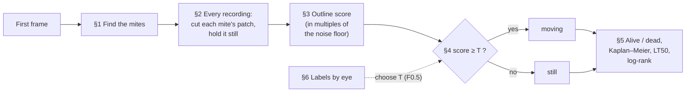
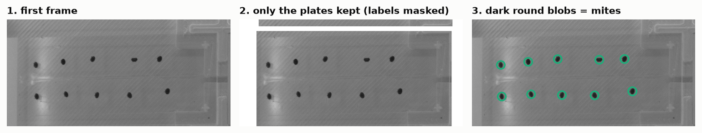
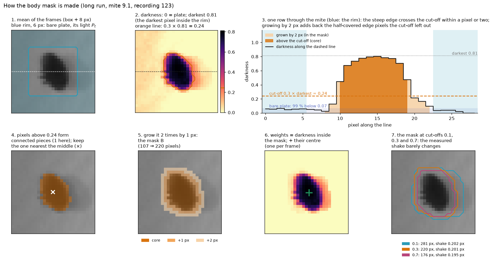
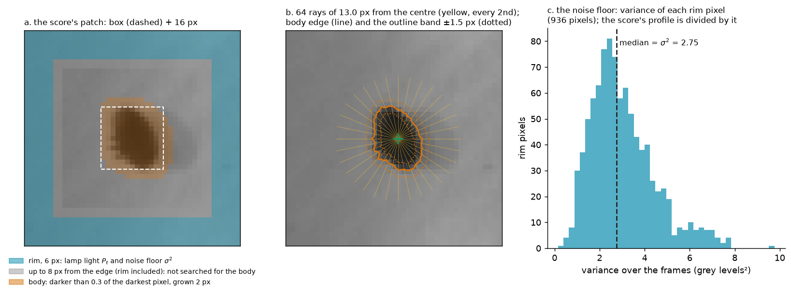
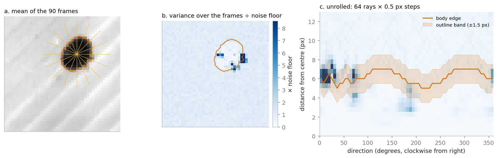
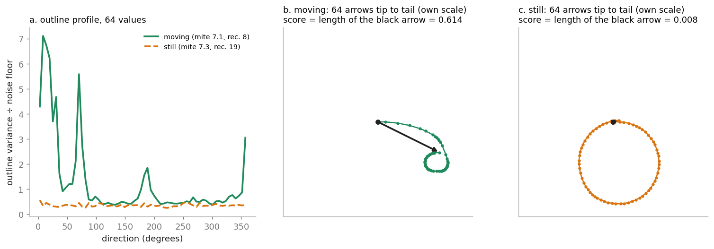
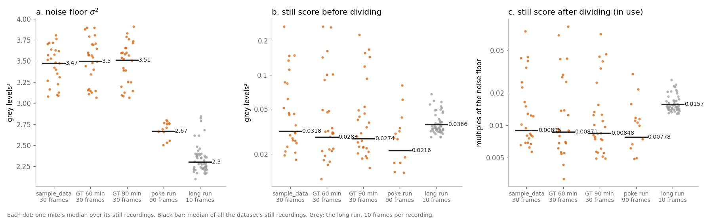

# Varroa detector for the Discobox: how it works

*Agroscope · status of 26 October 2026 · part 2 of 3*

*Part 1 (`1_user_manual.md`) explains how to use the app. Part 3 (`3_performance.md`) compares the performance of the app against the current setup in terms of speed, storage and memory usage. This part is intended to guide the user through the algorithms steps so they are better able to interpret its results. Every step mentions where in the code its implemented so the user can have a look at the code if they so please.

**flowchart of the analysis pipline**

**Notation.** A *recording* is a short burst of $N$ grey frames $I_1,\dots,I_N$ ($N$ = `frame_count`, taken at `fps`; live runs
are fixed at 3 s × 30 fps, so 90 frames; (older recordings have a variable amout of frames per recording). Grey levels
run from 0 (black) to 255. $\operatorname{var}_t$ is the variance over the frames of a recording( variance of individual pixels divided by the numner of pixels), $\operatorname{med}$ a median. All pixel distances are in
pixels (px) of the 2064 × 1544 camera image.

**Parameters.** The text refers to each setting by its name in the results workbook's
`settings` sheet (and `run_settings.json`), such as `stabilizer_rim_px`, rather than by its
value: the sheet of a run gives the values that run used. The sheet's `section` column says
where each one is: `recording`, `detector` or `analysis`. For orientation, the values at the
time of writing (27 October 2026) are:

| Section | Parameter | Value |
|---|---|---|
| recording | `fps`, `frame_count` | 30, 90 (fixed for live runs) |
| recording | `follow_px` | 50 |
| detector | `min_threshold`, `threshold_step`, `max_threshold` | 30, 10, 200 |
| detector | `blob_color` | 0 (dark) |
| detector | `min_area`, `max_area` | 40, 1,200 px² |
| detector | `min_circularity`, `min_convexity`, `min_inertia_ratio` | 0.55, 0.80, 0.45 |
| analysis | `metric` | `outline_variability` |
| analysis | `metric_pad`, `metric_width` | 16 px, 1.04 px |
| analysis | `threshold` | 0.074 (new machine) |
| analysis | `outline_rim_px`, `body_share`, `edge_share` | 3 px, 0.355, 0.226 |
| analysis | `rays`, `ray_step_px`, `ray_reach_px` | 128, 0.5 px, 11.4 px |
| analysis | `stabilize_plate` | true |
| analysis | `stabilizer_pad_px`, `stabilizer_rim_px` | 4 px, 8 px |
| analysis | `stabilizer_darkest_n`, `stabilizer_body_share`, `stabilizer_body_grow_px` | 8, 0.241, 4 px |
| analysis | `stabilizer_margin_px`, `stabilizer_interpolation` | 16 px, bilinear |
| analysis | `death_minutes` | set per run |

**Positions are vectors.** Bold letters are positions or displacements in the image, with two
components: $\mathbf x = (x, y)$, where $x$ is the column and $y$ the row, in pixels. The
origin is the top-left pixel of whatever is being worked on (the crop in 2, the patch in
3), $x$ grows to the right and $y$ **downwards**, as in any image. A pixel's whole-number
coordinates are its centre, so the top-left pixel is $(0, 0)$ and its neighbour to the right
$(1, 0)$. A position worked out from pixels (a centre $\mathbf c_t$, a shift $\mathbf s_t$)
has real-valued components and can fall between pixel centres; the image's value there,
$I_t(\mathbf x)$, is interpolated.

---

## 1. Finding the mites

*Code: `classes/scoring/analyzer.py` (`detect`), `classes/plate/zones.py`.*

The mites are found once, on the first frame of the first recording.

1. **Mask.** `coords_pixel.txt` segments the image into mite zones and text zones. The detector will only run on the mite zones to avoid falsely detecting the text as a mite.
2. **Blob detection.** OpenCV's `SimpleBlobDetector` thresholds the masked image at every
   grey level from `min_threshold` to `max_threshold` in steps of `threshold_step`, finds the connected dark regions at each level,
   and keeps the regions whose centres agree across several levels. A region then has to
   pass every filter (from `config.yaml`, section `detector`; the settings sheet's section `detector`):

   | Filter | Definition | Kept when |
   |---|---|---|
   | colour | grey level at the blob's centre | = `blob_color` (0: dark) |
   | area | pixels in the region | `min_area` ≤ A ≤ `max_area` |
   | circularity | $4\pi A / P^2$ (P = perimeter) | ≥ `min_circularity` |
   | convexity | $A / A_\text{convex hull}$ | ≥ `min_convexity` |
   | inertia ratio | minor / major axis of the second moments | ≥ `min_inertia_ratio` |

3. **mite ROI.** the output of the blob detector is  a centre $(x, y)$ and a diameter    $s$  The mite's **ROI** is the
   square $[x - s/2,\, x + s/2] \times [y - s/2,\, y + s/2]$.
4. **Zone and id.** A mite belongs to the zone (plate, or half-plate with two zones per
   plate, `zones_per_plate`) that holds its whole box. Inside a zone the mites are sorted in reading order.For example Mite `13.4` is the fourth mite of zone 13.

Labels, ground truth and corrections are saved **by position** (matched to a mite within
10 px, `classes/plate/positions.py`), not by id, so they survive a change to the detector.

In a live run each mite is also *followed* (`classes/live/`, `motion_analysis.py`):
before each recording the detector runs on its first frame, and each mite moves to the
nearest blob of its own zone at most `follow_px` away. A mite
with no blob in reach, or one less than 2 px away, stays where it is.

---

## 2. Cutting each mite's patch, and holding it still

*Code: `classes/scoring/plate_stabilizer.py`.*

For each recording, each mite gets a **patch**: its ROI plus $p$ = `metric_pad` px on every side,
cut from every frame, giving a stack of $N$ small images. Everything after this point
looks only at the patch. Before the patch is cut, the **stabiliser** (`stabilize_plate` boolean) measures how far the
mite moved as a whole in each frame and cuts each patch shifted back by that amount.

### 2.1 why stabilization is crucial 

The scoring metric looks for changes on the mite's outline. A shaky plate will move the mite(often less than 1px). Although small, if this subpixel shifts are left unattended will significantly degrade the perfomance of the alorithm.

The long run's plates shake by up to 0.24 px within a recording. Without stabilisation,
the shaky recordings are where most still mites get called moving. If this happens late into the recording this will push death times back by hours rendering the alorithms calls effectively useless.

### 2.2 Overview and rationale behind stabilization algorithm design

Sice mites are fixed onto the glass plates, the plate shake is directly transfered to the mite itself. Thus the shake can be measured directly on the mites: find where the mite is in each frame, and move each frame back so that the mite sits
where it was in the first.

to determine the position of the mite we use it's "centre of darkness": the average position of its pixels weighted by their darkness, which is equivalent to calculating its center of mass if pixel darkness were treated as density. Determining the mite's centre this way yields sub-pixel accuracy for two key reasons: first, if the mite moves by less than a single pixel, that tiny shift is already baked into the changing intensities of the surrounding pixels (some will get fractionally ligher or darker), and second, taking the average over the whole body causes random pixel noise to naturally cancel itself out.

Moving legs could theoretically pull the centre off track relative to the plate's shake, but the effect is negligible: the body has vastly more pixels than the legs, so its sheer mass completely dominates the center of darkness.

The main rationale behind stabilizing on a per-mite basis instead of calculating a zone-wide average is lens distortion: because optical distortion warps magnification across the field of view, the exact same physical shake of the plate is perceived as moving more pixels near the edges than at the center. Averaging across a zone would therefore miss the mark, applying the wrong correction depending on where a mite sits. On top of that, if the plate rotates, mites further from the center of rotation will physically travel more than those near the middle, making per-mite stabilization more accurate.
### 2.3 Step by step

**Step 1: light of the plate.** Take a slightly larger crop, the box plus `stabilizer_pad_px` pixels. Its outer
ring of `stabilizer_rim_px` pixels (the *rim*) is bare plate. In each frame $t$ the plate's light is

$$P_t = \operatorname{med}_{\mathbf x \in \text{rim}} I_t(\mathbf x).$$

**Step 2: darkness.** Each pixel's darkness is the share of the plate's median light it takes
away:

$$D_t(\mathbf x) = \max\!\left(0,\; 1 - \frac{I_t(\mathbf x)}{P_t}\right).$$

**Step 3: the body.** On the mean darkness $\bar D = \frac{1}{N}\sum_t D_t$, let $\delta$
be the mean of its `stabilizer_darkest_n` largest values inside the rim (the mite's darkest part). The pixels
inside the rim with $\bar D(\mathbf x) >$ `stabilizer_body_share` $\cdot\,\delta$ form one piece. It is expanded by `stabilizer_body_grow_px` 3 × 3 dilations (one px each), to make the body mask $B$: $B(\mathbf x) = 1$ for a pixel
in the mask, 0 elsewhere.

**
--> adjust image !!!**

**Where the constants come from.** The crop (`stabilizer_pad_px`), the rim
(`stabilizer_rim_px`), the share (`stabilizer_body_share`), the number of darkest pixels
(`stabilizer_darkest_n`) and the growth (`stabilizer_body_grow_px`) were chosen by an Optuna optimization campain.

**Step 4: centre per frame.** The mite's centre in frame $t$ is the centre of its
darkness inside the body. Using the  weights $w_t(\mathbf x) = D_t(\mathbf x)\,B(\mathbf x)$ ensures that we only care about points inside the body mask.

$$\mathbf c_t = \frac{\sum_{\mathbf x} w_t(\mathbf x)\,\mathbf x}{\sum_{\mathbf x} w_t(\mathbf x)},
\qquad\text{that is}\qquad
c_{t,x} = \frac{\sum_{\mathbf x} w_t(\mathbf x)\,x}{\sum_{\mathbf x} w_t(\mathbf x)},\quad
c_{t,y} = \frac{\sum_{\mathbf x} w_t(\mathbf x)\,y}{\sum_{\mathbf x} w_t(\mathbf x)}.$$

If some frame's centre is a whole pixel or more from the mean centre, the mask $B$ is moved
by those whole pixels for that frame and the centre is computed again, so no part of the
mite falls outside its mask.

**Step 5: shift.** The mite's shift in frame $t$ is the vector

$$\mathbf s_t = \mathbf c_t - \mathbf c_1 $$

Each component is clipped to ±(`stabilizer_margin_px`) px (the margin a saved run keeps). Extremely large shifts often belong to a waling mite that became unglued, not a plate shaking. A mite whose centre can't be found in some frame takes the
plate's shift: the median of the other mites' shifts.

**Step 6: cut.** Each frame's patch is cut shifted back by $-\mathbf s_t$: the value the
stabilised frame has at position $\mathbf x$ is the one the original frame has where the mite
had moved to. Thus:

$$I^{\text{stab}}_t(\mathbf x) = I_t(\mathbf x + \mathbf s_t),$$

A shift of a fraction of a pixel
puts $\mathbf x + \mathbf s_t$ between pixel centres, so it needs interpolation: each new
pixel is computed from the pixels around the point it comes from. The stabiliser uses
the interpolation `stabilizer_interpolation`. Where the cut
reaches past the image's edge, the image is mirrored in.

### 2.4 What it records, and what it doesn't handle

The app records, per mite and recording, the largest shift (`shake`) and how far the
mite's shift strayed from the plate's median (`stray`). The results page plots the median
shake per recording, to spot a recording or a stretch of time in which the plate shook.

A mite that walks more than `stabilizer_margin_px` px within a recording, or a plate displaced by many pixels
*between* recordings, is beyond what the stabiliser follows. The second is handled in live
runs by moving each mite's box to the mite before every recordings.

---

## 3. The motion score: outline variability

*Code: `classes/scoring/analyzer.py`, `_outline_variability`, `outline_variability_profile`,
`plate_noise`, `_lit`, `_outline_rays`.*

 `metric` is the scoring algorithm used, by default it's  `outline_variability`, and it is recommened to keep as such.

The score measures how much the outline changes over the recording on one
side more than the others, in units of the camera's noise in that recording.

The score works on the stabilised patch: the ROI plus `metric_pad` px on every side.

The score uses three regions of the patch:

*The same mite as in §2, stabilised. a. Blue: the rim, the outermost 6 px, always bare plate.
It gives the lamp's light in each frame (§3.1) and the noise floor (§3.6). Grey and blue: the
outer 8 px, where the body isn't looked for, so a neighbour at the patch's edge isn't taken
for the mite. Orange: the body mask (§3.2). b. The 64 rays from the centre (§3.3), the body's
edge on each (solid, §3.4) and the outline band ±1.5 px round it (dotted, §3.5). c. The noise
floor: the variance over the frames of each of the rim's 936 pixels; their median is
$\sigma^2$ (§3.6). The median ignores the long right tail, where a neighbour or a speck
changes a few rim pixels.*

The example below is mite 7.1 in recording 8 of the poke run of 22 October 2026 (3 s,
30 fps, 90 frames), labelled moving by eye.

### 3.1 Even out the lamp

The patch's outermost `outline_rim_px` are bare plate (the rim, $R$). Per frame, the plate's light is
$P_t = \operatorname{med}_{\mathbf x\in R} I_t(\mathbf x)$, and its mean over the recording is
$L = \frac{1}{N}\sum_t P_t$. Every frame is scaled to the same plate light:

$$\tilde I_t(\mathbf x) = I_t(\mathbf x)\,\frac{L}{P_t}.$$

A flickering lamp then changes nothing. (If the plate is black, $P_t \le 0$, the patch
gets no score.)

### 3.2 Find the body once, its centre in every frame

Darkness $D_t$, the body mask $B$ and the centre $\mathbf c_t$ are found as in the
stabiliser, with these differences: the body is the piece darker than `body_share` $\cdot\,\delta$
($\delta$ the mean of the `stabilizer_darkest_n` darkest pixels of the whole patch), not grown; the outer 8 px of
the patch are left out of the mask; and the mask is not moved along for frames where
the centre strays a pixel or more. The mask is found once, on $\bar D$, and is the same in
every frame; the centre is found in every frame.

If the mite or the plate moved a little within the recording, $\mathbf c_t$ moves with
it, and the rays below start from where the mite is **in that frame**. Shake the stabiliser
left over then does not count as a change of outline.

Why not simply threshold the darkness in each frame and take the centre of what is left?

### 3.3 Cast $K$ rays

From $\mathbf c_t$, $K$ = `rays` rays go out at angles $\theta_k = 2\pi k/K$
($k = 0,\dots,K-1$, one every $360°/K$). Ray $k$ points along the unit vector $\mathbf e_k = (\cos\theta_k, \sin\theta_k)$:
$\theta = 0$ points right, $\theta = 90°$ down (since $y$ grows downwards), so the angles go
round clockwise in the image. Each ray is sampled every `ray_step_px` from $r = 0$ out to the reach
$\rho$, the smaller of `ray_reach_px` and the distance from the centre to the patch's edge, with
bilinear interpolation; the point at distance $r$ along ray $k$ is $\mathbf c_t + r\,\mathbf e_k$:

$$u_t(k, r) = \tilde I_t\big(\mathbf c_t + r\,\mathbf e_k\big).$$

`ray_reach_px` is chosen to reach past a mite's legs (the yellow lines in panel **a**, drawn
13 px long). Unrolled, the patch becomes a grid of $K$ directions × $\rho/$`ray_step_px` + 1
distances (panel **c**: 64 × 26). If $\rho < 2$ px, the patch
gets no score.

### 3.4 Find the body's edge on each ray

Let $\delta$ be the mean of the `stabilizer_darkest_n` largest values of $\bar d$ (the mite's darkest part). On
ray $k$, with $\bar u(k, r) = \frac{1}{N}\sum_t u_t(k, r)$ the mean frame along it, the edge
$b_k$ is the first distance at which its darkness drops below $\varepsilon\,\delta$, with
$\varepsilon$ = `edge_share`:

$$b_k = \min\big\{ r : d\big(\bar u(k, r)\big) < \varepsilon\,\delta \big\}$$

(the outermost point if it never does). This is the solid orange line in panels **a**–**c**.

### 3.5 Measure the change along the outline

The variance over the frames at every point of every ray is
$V(k, r) = \operatorname{var}_t\, u_t(k, r)$ (blue in panels **b** and **c**). The
**outline** is the band within $w$ = `metric_width` px of the edge (shaded in **c**). Each direction's
value is the mean variance in that band:

$$v_k = \operatorname{mean}\{\,V(k, r) : |r - b_k| \le w\,\}, \qquad k = 0,\dots,K-1.$$

These $K$ numbers, in grey levels², are the mite's **outline profile**. If they are all
below $10^{-6}$ (frames identical), the score is 0.

### 3.6 Divide by the recording's noise floor

The camera's noise in this recording, at this mite, is the median over the rim's pixels of
their variance over the frames (lamp-corrected as in 3.1):

$$\sigma^2 = \operatorname{med}_{\mathbf x\in R}\; \operatorname{var}_t\,\tilde I_t(\mathbf x).$$

The profile is then
expressed in multiples of this noise floor:

$$a_k = v_k / \sigma^2.$$

This has the added benefit of making the score robust to changes in plate color and lighting as camera noise is correlated to pixel brightness.

If $\sigma^2 = 0$ (frames with no noise at all, or a black plate), the profile is left
undivided and the app raises a `NoNoiseWarning`: that score isn't on the threshold's scale.

### 3.7 Add the $K$ values up as vectors

Each direction's value becomes an arrow pointing in that direction, as long as the value:
the vector $a_k\,\mathbf e_k$, with $\mathbf e_k$ the unit
vector of ray $k$ (§3.3). The score is the length $\lVert\cdot\rVert$ of their sum, divided
by $K$:

$$\boxed{\;\text{score} = \left\lVert\frac{1}{K}\sum_{k=0}^{K-1} a_k\,\mathbf e_k\right\rVert\;}$$

Reading each position $(x, y)$ of the image as the complex number $x + jy$, the unit vector
$\mathbf e_k$ becomes $e^{j\theta_k} = e^{j2\pi k/K}$, and the score can be written as

$$\boxed{\;\text{score} = \left|\frac{1}{K}\sum_{k=0}^{K-1} a_k\, e^{j2\pi k/K}\right|\;}$$

This is closely linked to the discrete Fourier transform (DFT) of the outline profile. The DFT of the $K$
values $a_0, \dots, a_{K-1}$ (here normalised by $1/K$) is

$$X[h] = \frac{1}{K}\sum_{k=0}^{K-1} a_k\, e^{-j2\pi hk/K}, \qquad h = 0, \dots, K-1.$$

The score is equal to the DFT coefficient $X[-1] = X[K-1]$. Since the $a_k$ are real, $X[-1]$ is the complex
conjugate of $X[1]$ and has the same magnitude, so the score is the magnitude of the first
Fourier coefficient:

$$\text{score} = \big|X[1]\big|.$$

**Do still mites land on the same level?** 

*a. The noise floor at each mite. b. The still scores, in grey
levels². c. The same score divided by the floor, as the app computes it now (log scales in
b and c). Each dot is one mite's median over its still recordings; the black bar is the
median of the dataset's still recordings. Data: `results/scripts/noise_floor.csv.gz`
(`scripts/noise_floor.py`).*

### 3.8 How the app displays the score

The mite page draws the profile over the mite's clip: a dot per direction, darker where the
outline varies more, and frames the clip green when the mite is called moving and orange
when still.

*The dots are shaded relative to the mite's own largest value, so a still mite's noise
looks dark all round: what tells it from a moving mite is that the dark dots are not on one side.*

---

## 4. One threshold: moving or still

*Code: `classes/plate/mite.py`, `classes/app_config.py`.*

$T$ (`threshold`) is `mite.metric_thresholds.outline_variability` in the machine's `config.yaml`
(a new machine starts with the one in `config.default.yaml`, the poke run's best F0.5
threshold with the constants of 27 October 2026; a threshold saved before that is on another
scale and has to be saved again). It is chosen on the Calibration
page. **A threshold fits only recordings as long as the ones it was calibrated on, which
is why live recordings are fixed at 3 s / 30 fps.**

**Close calls.** On the results page the app also draws a band $[T - \beta_-, T + \beta_+]$
around $T$ (`classes/results/review_band.py`). A score inside it is a close call. The user
says how many mites to check by eye ($n$, 20 by default). The app takes the narrowest band
of the configured shape (how far below $T$ against above, or symmetric) that contains close
calls of $n$ mites whose time of death depends on them. Neither edge goes further than $T$
from $T$ (so the band stays within $[0, 2T]$). Only close calls after the mite's last
*settled* movement count: a score at or above the band, or a call set by hand. They are
asked latest first. The band changes no call by itself.

**Set aside.** A recording in which another mite walked into this mite's patch
(`classes/scoring/unusual_activity.py`) is censored: it counts neither as moving nor as
still. A mite whose place stays empty for 3 recordings in a row (no blob within 6 px and its
contrast below half its first) is a *fly-off* and is left out of the analysis.

---

## 5. From moving and still to alive and dead

*Code: `classes/results/survival.py`.*

### 5.1 The death rule

For one mite, let its calls be $m_0, m_1, \dots$ (moving, still, or none where it wasn't
followed), with recording times $t_0, t_1, \dots$ in minutes, and let $D$ be the death time
(*dead when still for*, `death_minutes`).

- **In the study** only if it moved at least once. A mite never seen moving may have been
  dead from the start.
- $\ell$ = its last recording called moving; $E$ = its last recording with a call (the end
  of its follow-up); $s$ = the recording it was first followed in (0 unless added mid-run).
- If $E > \ell$ and $t_E - t_{\max(\ell, s)} < D$, it hasn't been still long enough: it is
  **alive and censored** at $t_E - t_s$ (all that is known is that it lived that long).
- Otherwise it **died** at recording $\ell + 1$, at time $t_{\ell+1} - t_s$.

Every mite runs on its own clock from $t_s$. A mite marked *gone* (e.g. fell off) has no
call from then on and is censored at its last recording.

### 5.2 Kaplan–Meier survival

With the deaths at distinct times $\tau_1 < \tau_2 < \dots$, $d_j$ deaths at $\tau_j$ and
$n_j$ mites at risk just before it (not yet dead or censored):

$$\hat S(t) = \prod_{\tau_j \le t}\left(1 - \frac{d_j}{n_j}\right).$$

The 95 % confidence interval uses Greenwood's variance on the log-log scale, which keeps it
inside 0–100 % (`scipy.stats.ecdf(...).sf.confidence_interval(method="log-log")`):

$$\hat V = \sum_{\tau_j\le t} \frac{d_j}{n_j(n_j - d_j)}, \qquad
\hat S(t)^{\exp\left(\pm 1.96\,\sqrt{\hat V}\,/\,\ln \hat S(t)\right)}.$$

Where it is undefined (everyone alive or everyone dead) the interval is the estimate itself.

### 5.3 LT50

LT50 is the first recording time at which $\hat S \le 50\,\%$. Its 95 % interval runs from
the first time the lower bound reaches 50 % to the first time the upper bound does. Each is
"not reached" if it doesn't happen by the end of the run.

### 5.4 Log-rank test against the negative control

Each group (all zones with the same label, pooled) is tested against the zones ticked as
negative control. At each death time $\tau_j$ (pooled over both), with $d_j$ deaths among
$n_j$ at risk, of which $n_{1j}$ in the tested group, the expected deaths in the tested
group are

$$E = \sum_j d_j\,\frac{n_{1j}}{n_j},$$

against the observed $O$. The statistic is scipy's log-rank $Z$, and
$\chi^2 = Z^2$ with one degree of freedom gives the p value. The table shows $O$, $E$,
$\chi^2$ and $p$.

### 5.5 A live run stops itself

After each recording, a mite that counts as dead by §5.1 (a never-moved one too, once
still for $D$ from its start) is no longer followed, scored or saved. A zone is done when
every mite in it that was seen moving is dead or gone. Zones with no mite seen moving
don't count. The run stops when every counting zone is done.

---

## 6. Calibration: choosing $T$

*Code: `classes/ground_truth/calibration.py`, `pipeline/calibration/calibration_report.py`.*

**Labels.** On the ground-truth page the user marks each mite in each recording as
*moving*, *still* or *not a mite*, watching the clip without seeing the detector's call.
Each labelled (mite, recording) is one observation; *moving* is the positive class.

**Counts at a threshold $T$.** TP = moving called moving, FN = moving called still,
FP = still called moving, TN = still called still.

$$\text{precision} = \frac{TP}{TP + FP},\qquad \text{recall} = \frac{TP}{TP + FN}.$$

**Suggested threshold: the best F0.5.**

$$F_\beta = \frac{(1+\beta^2)\,TP}{(1+\beta^2)\,TP + \beta^2\,FN + FP}, \qquad \beta = 0.5.$$

With $\beta = 0.5$ one still recording called moving (FP) costs as much as four moving
recordings called still (FN, weight $\beta^2 = 0.25$). The reason is asymmetric: in a long
run a dead mite is scored hundreds of times, and a single FP after its death brings it back
to life and moves its death by hours. A live mite called still once moves again in a later
recording and loses nothing. TN counts for nothing, so the number of still labels doesn't
dilute the result.

$F_{0.5}$ is evaluated at every distinct score, from the highest down. Of the thresholds
with the largest $F_{0.5}$, the highest is taken. 

**Precision-recall curve and average precision.** The report draws precision against
recall over all thresholds and gives the average precision

$$AP = \sum_n (R_n - R_{n-1})\,P_n,$$

the precision averaged over recall: 1 when every moving label scores above every still
label, and the share of moving labels when the score tells nothing.

**Death-time error** (reported, not chosen on). For each mite seen moving, its death by the
detector (the recording after its last call of moving) is compared with its death by the
labels. The report gives the mean absolute difference in recordings and how many mites are
exact.

**Poke test.** A poked mite that moves was alive; one that doesn't is dead from that poke.
The report draws the Kaplan–Meier curve of the poked mites by the pokes (dead at the first
poke not answered; censored at the last poke for one that answered every poke) with the
detector's curve over it.

**Saving.** Saving a threshold writes it to `config.yaml`, and scales the review band in
use by $T_\text{new}/T_\text{old}$, so the band keeps its shape.

---

## 7. What is saved

*Code: `classes/storage/roi_recordings.py`, `classes/storage/kept_scores.py`.*

A live run saves only each mite's surroundings: its box plus 32 px (room for the score's `metric_pad`
plus the stabiliser's `stabilizer_margin_px`), at least 40 px round its centre, as one lossless FFV1
video per mite (`rois/mite_NNN.mkv`). Lossless compression and the 32-px margin mean that
analysing the saved run reads exactly the pixels the live run read, so it gives the same
scores to the last digit. For `sample_data` this takes 17.5 MB instead of 574 MB of BMPs.

Scores are cached per dataset (`scores/`) and per result (`kept/`) under a hash of the
scoring source code: any change to the scoring code re-scores from the frames.
