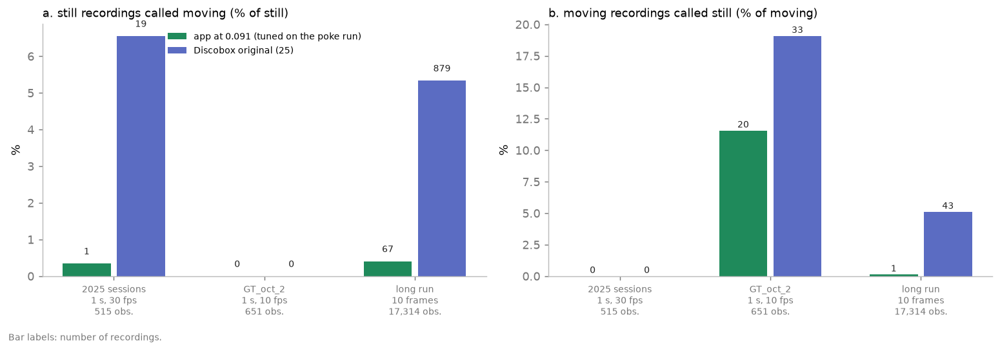
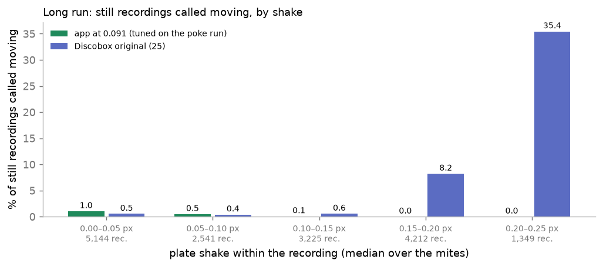
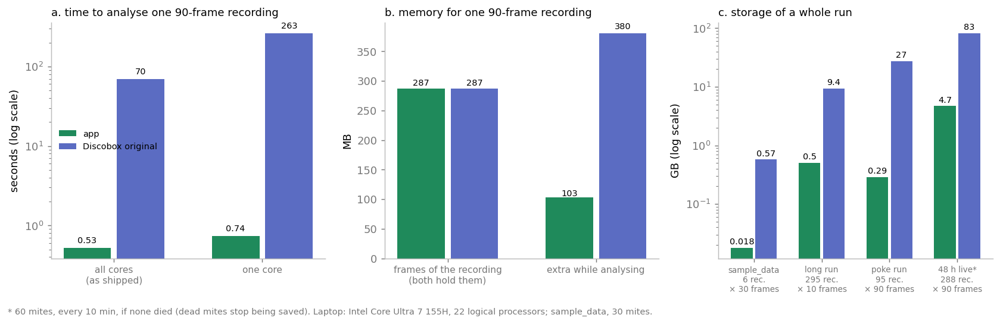

# Varroa detector for the Discobox: performance against the original software

*Agroscope · status of 30 October 2026 · part 3 of 3*

*Part 1 (`1_user_manual.md`) explains how to use the app, part 2 (`2_how_it_works.md`) what
it computes, with each step run on one real mite. This part compares the app with the Discobox's original analysis software: how well each calls
moving and still against labels made by eye, and how fast, how much memory and how much
disk each takes.*

Both were run on the same mite-recordings: the app with its code of 30 October 2026, the
original with its own code and constants (`classes/scoring/benchmark.py`). **The app uses
one threshold, 0.091**, its default, the best on the poke run by F0.25 (part 2, section 6).
The poke run was used only to set it, so it is not among the datasets the methods are
compared on. The original uses its fixed threshold of 25.

The calls are judged by **F0.25**, the score the app's calibration chooses its threshold on:
it weighs a still recording called moving sixteen times as much as a moving one called
still, because a single false *moving* brings a dead mite back to life (part 2, section 6).
The speed, memory and storage of section 6 were measured on 26 October 2026.

## 1. The data

| Dataset | Recorded | Recording | Mites | Labelled mite-recordings (moving / still) |
|---|---|---|---:|---:|
| **2025 sessions** (`sample_data`, `ground_truth_60min`, `ground_truth_90min`) | 4 Sep 2025, Discobox app | 1 s, 30 fps (30 frames), 6 recordings each | 86 | 515 (225 / 290) |
| **GT_oct_2** | 15–16 Oct 2026, live | 1 s, 10 fps (10 frames), 31 recordings | 21 | 651 (173 / 478) |
| **Long run** | 8–10 Sep 2026 | 10 frames, every 10 min, 295 recordings | 59 | 17,314 (843 / 16,471) |

*Moving* is the positive class throughout. The app's threshold was set on a fourth run, the
poke run (`poke_test_oct`, 22–23 Oct 2026, 3 s at 30 fps, 304 labelled mite-recordings of
14 mites), which is therefore left out of the comparison.

---

## 2. The two methods

The Discobox ships with Abilium's analysis
([varroa-discobox](https://github.com/Abilium-GmbH/varroa-discobox), `src/processing.py`).
It never finds the mites. On each recording it:

1. denoises every frame (`fastNlMeansDenoising`, template 7, search 21);
2. takes the absolute difference of every frame to the first and combines them (bitwise OR);
3. thresholds that at **25** grey levels, grows the spots (3 × 3 dilation, 5 times) and
   closes holes;
4. counts each spot as one mite alive.

To compare it on the same question, it calls a mite **moving** when one of its spots
touches the mite's box.

| | Discobox original | This app |
|---|---|---|
| Finds the mites | no, counts changed spots | yes, on the first frame |
| Measure | frame-to-first difference, OR, threshold 25 | variance on the outline, vector sum, ÷ noise floor |
| Shake and flicker | not handled | per-mite stabilisation, lamp correction, vector sum |
| Threshold | fixed at 25 | 0.091, calibrated on the poke run (best F0.25) |
| Output | spots per recording ("mites alive") | moving/still per mite, survival per group |

---

## 3. Moving or still

| Dataset | Method | Accuracy | Precision | Recall | Still called moving | Moving called still | F0.25 |
|---|---|---:|---:|---:|---:|---:|---:|
| 2025 sessions | **app, 0.091** | **0.998** | **0.996** | 1.000 | **1** | 0 | **0.996** |
| | original (25) | 0.963 | 0.922 | 1.000 | 19 | 0 | 0.926 |
| GT_oct_2 | **app, 0.091** | **0.969** | 1.000 | **0.884** | 0 | **20** | **0.992** |
| | original (25) | 0.949 | 1.000 | 0.809 | 0 | 33 | 0.986 |
| Long run | **app, 0.091** | **0.996** | **0.926** | **0.999** | **67** | **1** | **0.930** |
| | original (25) | 0.947 | 0.476 | 0.949 | 879 | 43 | 0.491 |
| **Sum of the three** | **app** | | | | **68** | **21** | |
| | original (25) | | | | 898 | 76 | |

*Precision: of the recordings called moving, the share labelled moving. Recall: of the
recordings labelled moving, the share called moving. F0.25 weighs a still recording called
moving sixteen times as much as a moving one called still, so it rewards precision far more
than recall: on `GT_oct_2`, where neither method calls a still recording moving, both score
close to 1 although the original misses 13 more movements.*

**Is the difference more than chance?** The observations aren't independent (a hard mite is
hard in every recording), so the mites were resampled with replacement 2,000 times, the
threshold staying at 0.091. The app's F0.25 minus the original's, median and 95 % interval:

| Dataset | Difference in F0.25 |
|---|---|
| 2025 sessions | +0.068 (+0.039 to +0.102) |
| GT_oct_2 | +0.006 (+0.002 to +0.011) |
| Long run | +0.440 (+0.346 to +0.532) |

Every interval excludes 0. The gain is largest where the original calls still recordings
moving (the long run), which F0.25 punishes most.

---

## 4. Time of death

Each mite's death by the calls (the recording after its last call of moving) against its
death by the labels: mean distance in recordings, and the mites exact.

| Dataset | App at 0.091 | Original (25) |
|---|---|---|
| 2025 sessions (86 mites) | **0.02** (85 / 86 exact, 1 late) | 0.09 (81 / 86, 5 late) |
| GT_oct_2 (21) | **0.24** (19 / 21, 2 early) | 0.71 (17 / 21, 4 early) |
| Long run (59) | **3.4** (50 / 59, 9 late) | 199.6 (3 / 59, 56 late) |

In the long run the original keeps nearly every mite alive about 200 recordings (33 h)
beyond its death; the app puts 9 deaths late.

---

## 5. Where the original fails

### 5.1 Shake

*The long run's still recordings, grouped by how much the plate shook within the recording
(the largest distance from the first frame of the plate's shift, the median of the mites'
centre shifts).*

| Shake within the recording | Still recordings | App at 0.091 called moving | Original called moving |
|---|---:|---:|---:|
| 0–0.05 px | 5,144 | 1.0 % | 0.5 % |
| 0.05–0.1 px | 2,541 | 0.5 % | 0.4 % |
| 0.1–0.15 px | 3,225 | 0.06 % | 0.6 % |
| 0.15–0.2 px | 4,212 | 0 % | 8.2 % |
| 0.2–0.25 px | 1,349 | 0 % | 35.4 % |

The original takes raw differences to the first frame. A shake of a fifth of a pixel slides
every dark mite edge across its pixels by enough to pass 25 grey levels, and the grown spot
touches the mite's box. The app follows each mite's centre and holds its patch still
(part 2, section 2), and calls no still recording moving once the plate shakes more than 0.15 px.
In the calmest recordings (below 0.05 px) the app calls slightly more still recordings
moving than the original (1.0 % against 0.5 %).

### 5.3 Short recordings

With 10 frames there are fewer chances for a leg to move by more than 25 grey levels from
the first frame: the original misses 33 of 173 moving recordings in `GT_oct_2`, the app 20.

### 5.4 No mites, only spots

The original reports spots per recording as mites alive, so it can't follow a mite, give a
time of death, or compute survival per group. The comparison above had to ask it about each
mite's box.

---

## 6. Speed, memory and storage

### 6.1 How it was measured

Both methods analysed the same recordings: `sample_data`'s whole frames (2064 × 1544 grey,
30 mites), read into memory first so that reading from disk doesn't count. Each method ran
in its own process:

- **The app:** for each recording, scoring every mite (`Analyzer.score_pool`: stabilise,
  cut, score) and finding the blobs on the first and last frame, as a live run does after
  every recording.
- **The original:** for each recording, its own steps (`Benchmark.circles`: denoise every
  frame, OR the differences to the first frame, threshold at 25, grow, close, find the
  contours). Drawing the circles and writing its picture are left out.

Each ran as shipped: the app on 8 worker threads with OpenCV single-threaded, the original
on OpenCV's default (all 22 logical processors). Each was also run limited to one core.
The 90-frame recordings were made by joining three 30-frame recordings. The machine is a
Windows laptop (Intel Core Ultra 7 155H, 22 logical processors). Memory is the process's
peak working set, minus what it held before the recording.

### 6.2 Speed

| Per recording | App | Original | Original ÷ app |
|---|---:|---:|---:|
| 30 frames, all cores (as shipped) | 0.31 s | 24.4 s | 79 × |
| **90 frames, all cores (as shipped)** | **0.53 s** | **69.8 s** | **133 ×** |
| 90 frames, one core | 0.74 s | 263 s | 355 × |
| 90 frames, processor time used (as shipped) | 1.2 s | 459 s | 392 × |

Nearly all of the original's time goes into denoising every whole frame (about 2.7 s of
processor time per frame on one core). The app only works on the mites' patches.

For a run of 48 h with a 3 s / 30 fps recording every 10 min (288 recordings), the app
spends about 2.5 min analysing in total, the original about 5.6 h on 22 processors, or 21 h
on one.

### 6.3 Memory

| One 90-frame recording | App | Original |
|---|---:|---:|
| The frames themselves (both hold the whole recording) | 287 MB | 287 MB |
| Extra while analysing it | 50–110 MB | 380 MB |
| **Total** | **≈ 340–400 MB** | **≈ 670 MB** |

The original keeps a denoised copy of every frame (another 287 MB) plus its difference
images; the app works on each mite's patch, a few kilobytes.

### 6.4 Storage

The Discobox app saves every frame whole, as an 8-bit BMP of 3.19 MB. This app saves only
each mite's surroundings (box + 32 px), as one lossless video per mite, plus the first frame
(1.6 MB), and stops saving mites once they are dead.

| Run | Recordings × frames | App | Whole-frame BMPs | BMPs ÷ app |
|---|---|---:|---:|---:|
| `sample_data` (30 mites) | 6 × 30 | 18 MB | 574 MB | 32 × |
| `GT_oct_2` (21 mites) | 31 × 10 | 21 MB | 988 MB | 48 × |
| Long run (60 mites) | 295 × 10 | 503 MB | 9.4 GB | 19 × |
| Poke run (14 mites) | 95 × 90 | 287 MB | 27.3 GB | 95 × |
| 48 h run, 60 mites, every 10 min, no deaths (estimate) | 288 × 90 | ≤ 4.7 GB | 82.6 GB | ≥ 17 × |

The estimate uses the poke run's 272 kB per mite and 90-frame recording; it is an upper
bound, as dead mites stop being saved.
