# How it works, step by step on one mite

*Agroscope · status of 30 October 2026 · part 3 of 4, a visual companion to part 2 (`2_how_it_works.md`)*

This walks through the whole analysis on real data: the poke run `poke_test_oct` (a live
run of 22–23 October 2026, 3 s at 30 fps = 90 frames per recording, 14 mites, 95 recordings
over 15.7 h). Every step shows the **command the app runs** and a figure of what it did to
the mite. The examples are the ones of part 2:

- **moving:** mite **7.1** in recording **8** (labelled moving by eye),
- **still:** mite **7.3** in recording **19** (labelled still).

All figures and numbers come from one script, which calls the app's own functions and
re-implements nothing but two pictures (marked *picture only*):

```bash
python scripts/visual_walkthrough.py --long-run %TEMP%/zzrc/perf/long_run   # reads the poke run in %TEMP%/zzrc/gt; writes report/images/walk_*.png
```

**Check that the steps are the app's.** The score this walk-through builds up step by step
is identical to the score the app's own analysis of the run gives
(`scoring.detect_and_score()`): 0.617032 for the moving example and 0.010960 for the still
one, difference 0.0 for both.

All of it uses the constants the app has run on since 29 October 2026: 64 rays of 13 px, the
body's edge at 0.5 of its darkest, a ±1.5 px outline band and a Lanczos stabilizer. They are
the constants from before an Optuna search of 27 October (`notebooks/pipeline_optuna.ipynb`),
whose own constants did not separate the held-back test mites better and were set back. The
score is the vector sum alone (step 7).

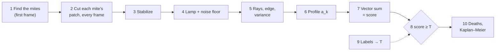

---

## 1. Find the mites on the first frame

```python
zones  = plate_zones.zones_of(data_dir)                 # the plates from coords_pixel.txt
masked = zones.mask_image_to_valid_rois(first_frame)    # keep the plates, blank the rest
mites  = Analyzer().detect(masked)                      # cv2.SimpleBlobDetector -> one Mite per blob
zones.assign_mites(mites)                               # each mite to its zone; ids "zone.n" in reading order
# all four: motion_analysis.detect_mites(zones, first_frame, Analyzer())
```

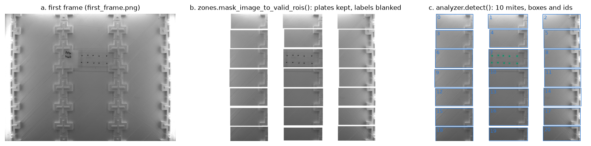

**a.** The first frame. **b.** Only the plates are kept; the rest (the box, the hand-written
labels) is painted white, so it can't be taken for a mite. **c.** The blob detector finds
10 mites, all on plate 7. (Plate 13's four mites were added during the run with the *Add
mites* button: they are followed from recording 1 on.)

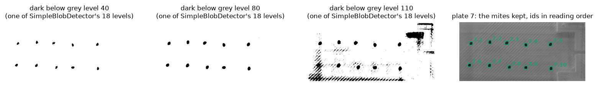

`SimpleBlobDetector` thresholds the image at 18 grey levels (30, 40, …, 200) and keeps
the dark regions whose centre stays put across several levels and that pass the area,
circularity, convexity and inertia filters of `config.yaml`. Three of the levels are shown:
at 40 only the mites' darkest cores; at 80 the whole mites; at 110 the plate's texture
starts to come through too, but those regions fail the filters. Right: the 10 mites kept,
numbered in reading order (two mite heights per line, then left to right).

---

## 2. Cut each mite's patch from every frame of a recording

```python
loader = score_cache.open_recordings(data_dir)            # a live run: one FFV1 video per mite (rois/)
box    = loader.placements(name)[number]                  # where the live run followed the mite to
frames = loader.load_recording_region(name, x0, y0, x1, y1)   # (90, H, W) grey frames round it
patch  = PlateStabilizer.cut(frames, box, pad=16, shifts=0)   # box + 16 px, every frame
```

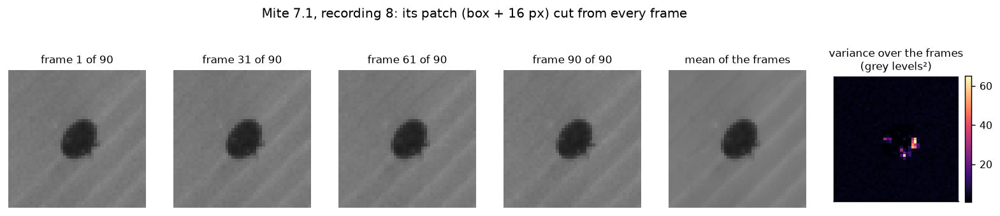

The patch is the mite's box plus 16 px on every side, in all 90 frames. By eye the frames
look the same; the **variance over the frames** (right) shows where pixels changed: a few
bright spots on the mite's edge, where its legs moved. Everything after this point is
computed from this stack of 90 small images.

---

## 3. Hold the patch still (the stabilizer)

```python
shifts = PlateStabilizer().shifts(frames, [box])[0]     # (90, 2): how far the mite moved since frame 1
roi    = PlateStabilizer.cut(frames, box, 16, shifts)   # every frame moved back by -s_t (Lanczos)
```

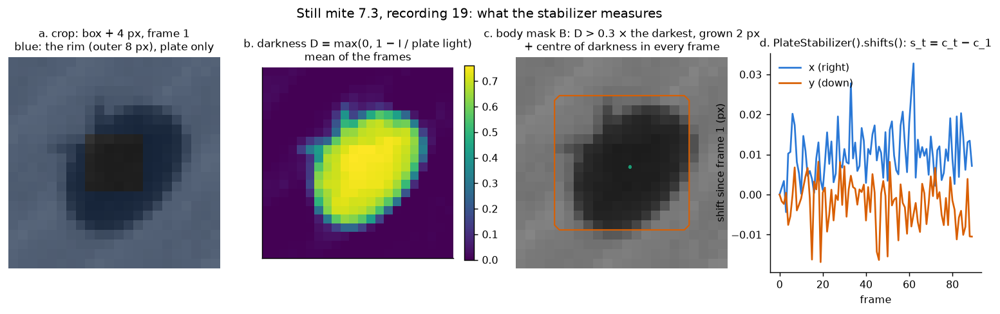

**a.** A crop of the box + 8 px; its outer 6 px (blue) are bare plate and give the
plate's light in each frame. **b.** Each pixel's *darkness*, the share of the plate's
light it takes away. **c.** The body mask: at least 0.3 as dark as the darkest pixel,
grown by 2 px (orange); the green dots are the centre of darkness in each of the 90 frames, all on top of
each other. **d.** The shift $s_t = c_t - c_1$ per frame: for this still mite at most
0.03 px, only noise.

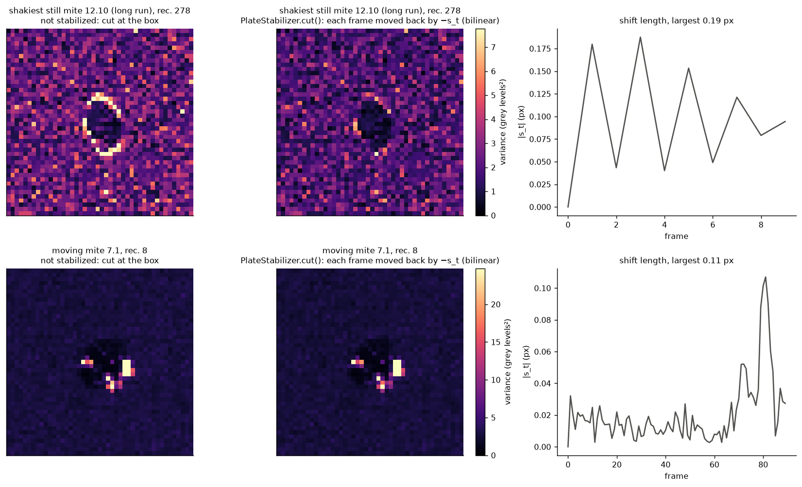

**Top:** the poke run hardly shakes, so this row uses the **long run's** shakiest
still-labelled recording (mite 12.10, recording 278, 10 frames), whose plate moved by up to
**0.29 px** (as the stabilizer measures it). Cut at the box (left), the whole outline lights
up: a shift far too small to see moves the dark edge across its pixels. Moved back by its
shift (middle), most of the ring is gone (the 99th percentile of the variance drops from 7.6
to 5.6 grey levels²), and **the score drops sevenfold: 0.0144 → 0.0020**, far below the
threshold.
**Bottom:** the moving mite. Its centre moves by up to 0.14 px (its legs pull it), and the
legs' changes stay: stabilizing removes a shift of the whole mite, not a leg moving.

---

## 4. Even out the lamp, and measure the noise floor

```python
lit, L, rim = Analyzer._lit(roi)        # every frame scaled so the plate has the same light L
sigma2      = Analyzer.plate_noise(roi) # median over the rim of each pixel's variance over the frames
```

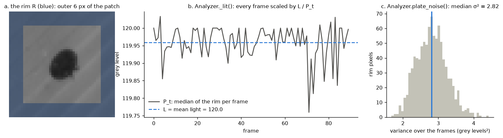

**a.** The rim $R$: the outer 6 px of the patch (936 pixels), bare plate. **b.** The plate's
light per frame $P_t$ (the median of the rim). Here the lamp is steady to a quarter of a
grey level; each frame is scaled by $L/P_t$ anyway, so a flickering lamp would change
nothing. **c.** The variance over the frames of each rim pixel; their median is the
**noise floor** $\sigma^2 = 2.82$ grey levels²: how much a pixel changes from noise alone in
this recording, at this mite.

---

## 5. Cast 64 rays and find the change on the outline

```python
variance, edge, step, centre = Analyzer._outline_rays(roi)
# variance: (64, 26) = V(k, r), the variance over the frames at each point of each ray
# edge:     (64,)    = e_k, where each ray leaves the body (darkness < 0.5 × the darkest, the mean of the 30 darkest)
```

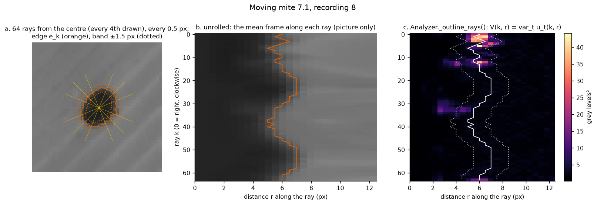

**a.** From the mite's centre in each frame, 64 rays (every fourth drawn), sampled every
0.5 px out to 13 px with bilinear interpolation. Orange: the body's edge $e_k$ on each
ray; dotted: the outline band ±1.5 px round it. **b.** *(picture only)* The mean frame
unrolled: ray $k$ is a row, distance along it a column; the body is the dark part on the
left, the edge the orange line. **c.** What the score uses: $V(k,r)$, the variance over the
90 frames at every point. The bright patches sit on the edge band between 0° and 70° (right of
the mite, a little below) and around 180° (left): the legs.

---

## 6. One number per direction: the outline profile

```python
v = Analyzer.outline_variability_profile(roi)   # (64,): mean of V(k, r) within 1.5 px of e_k
a = v / Analyzer.plate_noise(roi)               # in multiples of the noise floor
```

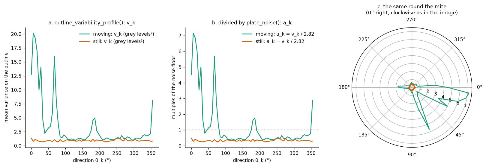

**a.** $v_k$, the mean variance in each ray's outline band, in grey levels². **b.** Divided
by the noise floor (2.82 for both): $a_k$. The still mite is flat at about 0.33 (a dark body
is less noisy than the bright plate, so it sits below 1). The moving mite has peaks at about
5°, 30°, 65° and 355°, up to 7 times the noise, and a small one at 185°. **c.** The same values drawn round the mite: the
moving mite's change is all on one side, to the right and below.

---

## 7. Add the 64 values up as arrows: the score

```python
score = Analyzer._motion_score(roi, "outline_variability")
# inside: direction = exp(2j·π·k/64);  score = |mean(a · direction)|
```

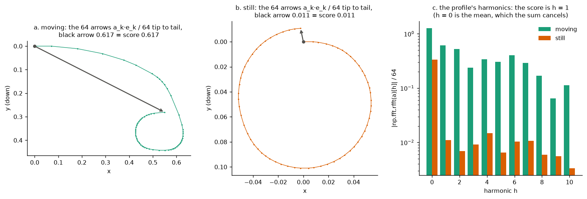

Each $a_k$ becomes an arrow of that length pointing in direction $k$; laid tip to tail they
make a walk. **a.** The moving mite's arrows walk away from the start: the black arrow is
0.617 long, and that is the score, **0.617**. **b.** The still mite's arrows are all about equally long and go round a
circle back to almost where they started: the black arrow is 0.011, although the mean value
(0.33) is far from 0: score **0.011**.
**c.** The same thing as a Fourier transform: the black arrow is exactly harmonic 1 of the
profile (`np.fft.rfft(a)[1] / 64` gives 0.617 and 0.011). Harmonic 0 (the mean, change the
same all round) is the largest bar for both, and the vector sum cancels it.

---

## 8. One threshold: moving or still

```python
run    = scoring.detect_and_score(data_dir, None)   # steps 1–7 for every mite in every recording
moving = score >= T                                  # Mite.moving: one call per recording
```

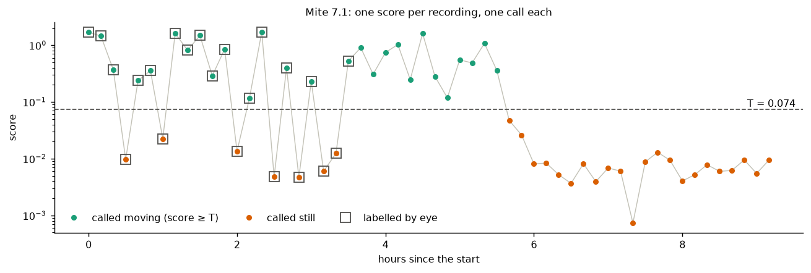

Mite 7.1's score in each recording it was followed in, on a log scale. Green: at or above
the threshold $T = 0.087$ (step 9), called moving; orange: below, called still. Squares: recordings
labelled by eye. It moves on and off for 5.5 h, then its scores drop more than tenfold, to
0.01 and below, and stay there: still for good. The live run stopped saving it once it counted as dead (step 10),
which is why its line ends at 9.2 h.

---

## 9. Where $T$ comes from: calibration on labels

```python
T  = calibration.best_f05_threshold(scores, labels)      # the threshold with the best F0.25
AP = calibration.average_precision(scores, labels)
```

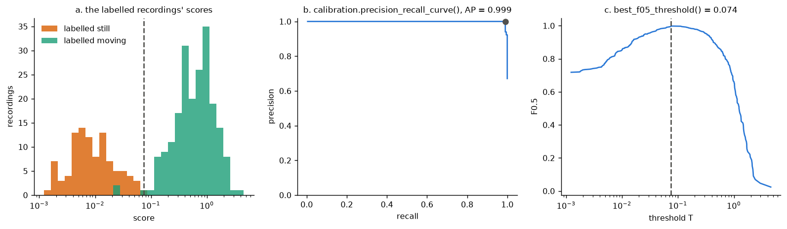

**a.** The scores of the 304 labelled (mite, recording)s of this run: 204 moving (green),
100 still (orange). They barely overlap. **b.** Precision against recall over every
threshold: average precision 0.9995. **c.** F0.25 at every threshold (a still recording
called moving costs sixteen times a moving one called still); its maximum is at **0.087**,
which calls 0 still recordings moving and 4 moving ones still. Any threshold between the
highest still score below it (0.082) and the lowest moving score above it (0.092) makes the
same calls; the app's default threshold, 0.091, lies in that gap too.

---

## 10. From calls to deaths and survival

```python
analysis = SurvivalAnalysis(times, death_minutes=200)
time, dead = analysis.survival(Calls(calls, start=mite.start))   # dead after 200 min still
alive = analysis.alive_percent(movings)                           # Kaplan–Meier, in %
```

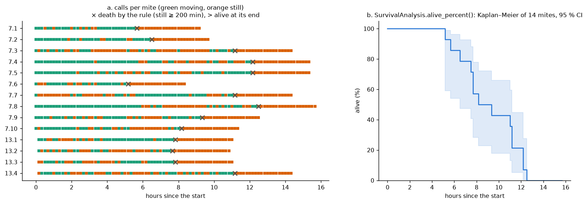

**a.** Every mite's call in every recording it was followed in (green moving, orange
still). A mite **dies** at the recording after its last movement, once it has been still
for 200 min (this run's *dead when still for*); × marks that. All 14 moved at least once,
so all are in the study, and all 14 died. After death the live run stopped following them.
**b.** The Kaplan–Meier curve of the 14 with its 95 % interval: the first mite died after
5.2 h, half were dead by about 8 h, the last at 12.5 h.

---

### Where to read more

| Step | Part 2 section | Code |
|---|---|---|
| 1 Detection | 1 | `classes/scoring/analyzer.py` `detect`, `classes/plate/zones.py` |
| 2–3 Patch, stabilizer | 2 | `classes/scoring/plate_stabilizer.py` |
| 4–7 Score | 3 | `classes/scoring/analyzer.py` `_lit`, `plate_noise`, `_outline_rays`, `outline_variability_profile`, `_outline_variability` |
| 8 Threshold | 4 | `classes/plate/mite.py` |
| 9 Calibration | 6 | `classes/ground_truth/calibration.py` |
| 10 Survival | 5 | `classes/results/survival.py` |

